<!--知识点1-->
## 一、LTI 系统的特征函数

### 图 3-1　复指数是 LTI 系统的特征函数

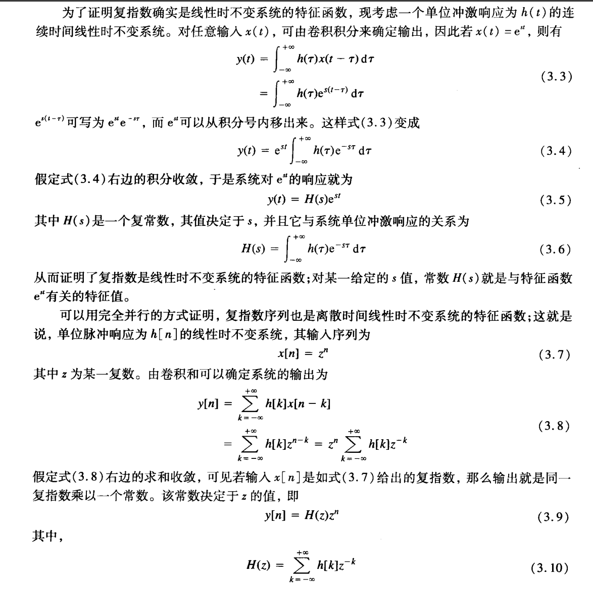

- 把 $x(t)=e^{st}$ 输入冲激响应为 $h(t)$ 的 LTI 系统，由卷积积分：
$$

y(t)=\int_{-\infty}^{+\infty}h(\tau)e^{s(t-\tau)}d\tau
=e^{st}\int_{-\infty}^{+\infty}h(\tau)e^{-s\tau}d\tau
$$

- 记
$$

H(s)=\int_{-\infty}^{+\infty}h(\tau)e^{-s\tau}d\tau
$$

则
$$

\boxed{y(t)=H(s)e^{st}}
$$

- 也就是说：**输入是复指数，输出仍是同一个复指数，只乘了一个复常数**。所以 $e^{st}$ 是 LTI 系统的**特征函数**，$H(s)$ 是对应的**特征值**，称为**系统函数**。
- 离散情形完全平行：输入 $x[n]=z^{n}$，则 $y[n]=H(z)z^{n}$，其中
$$

H(z)=\sum_{k=-\infty}^{+\infty}h[k]z^{-k}
$$

1. [返回](#li-ti)例题1（用特征值求输出）

设 LTI 系统为 $y(t)=x(t-3)$（延迟 $3$ 个单位）。  
**(1)** 求冲激响应 $h(t)$ 与系统函数 $H(s)$；  
**(2)** 若输入 $x(t)=e^{j2t}$，求输出 $y(t)$，并用 $H(j2)$ 验证；  
**(3)** 若输入改为 $x(t)=\cos(2t)$，求输出。

  
点击查看解析与答案

  

**(1)** 由 $y(t)=x(t-3)$ 直接读出冲激响应：
$$

h(t)=\delta(t-3)
$$

代入系统函数定义：
$$

H(s)=\int_{-\infty}^{+\infty}\delta(t-3)e^{-st}dt=e^{-3s}
$$

**(2)** 直接代入 $y(t)=x(t-3)$：
$$

y(t)=e^{j2(t-3)}=e^{-j6}e^{j2t}
$$

用特征值验证：$H(j2)=e^{-j3\cdot2}=e^{-j6}$，故 $y(t)=H(j2)e^{j2t}=e^{-j6}e^{j2t}$，与直接计算一致 ✔

**(3)** 把 $\cos(2t)$ 拆成复指数：$\cos(2t)=\dfrac{1}{2}\left(e^{j2t}+e^{-j2t}\right)$，分别用 $H(j2)$、$H(-j2)$ 处理：
$$

H(-j2)=e^{j6}
$$

$$

y(t)=\dfrac{1}{2}\left[e^{-j6}e^{j2t}+e^{j6}e^{-j2t}\right]
=\cos(2t-6)
$$

可见**纯延迟系统只平移相位、不改变幅度**——这也说明若 $h(t)$ 为实函数，则 $H(-j\omega)=H^{*}(j\omega)$。

  

<!--知识点2-->
## 二、连续时间周期信号的傅里叶级数

### 图 3-3 + 图 3-4　系数的确定与综合公式

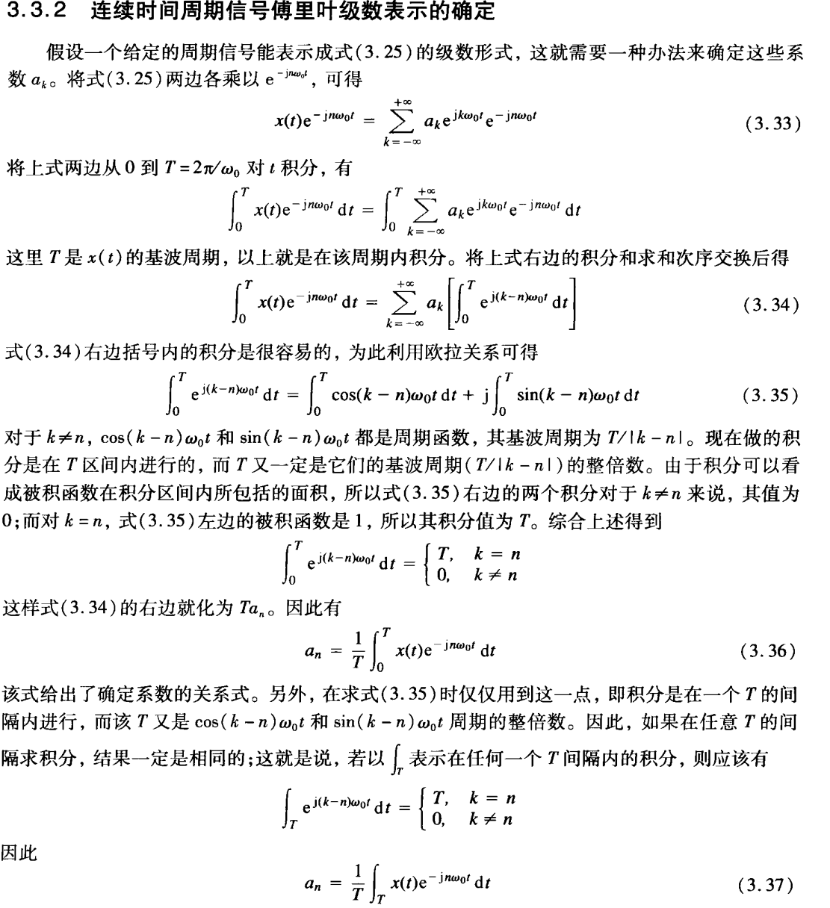

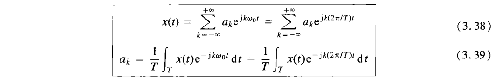

- 关键一步是**正交性**：在一个周期 $T$ 上
$$

\int_{T}e^{j(k-n)\omega_0 t}dt=
\begin{cases}
T, & k=n\\[6pt]
0, & k\ne n
\end{cases}
$$

- 两边同乘 $e^{-jn\omega_0t}$ 再积分，利用正交性把级数中只有 $k=n$ 那一项留下，得到**分析公式**（求系数）：
$$

\boxed{a_k=\dfrac{1}{T}\int_{T}x(t)e^{-jk\omega_0 t}dt}
$$

- 反过来，用系数合成信号就是**综合公式**：
$$

\boxed{x(t)=\sum_{k=-\infty}^{+\infty}a_k e^{jk\omega_0 t}}
$$

- 其中 $\omega_0=\dfrac{2\pi}{T}$；$a_0$ 是信号的**平均值（直流分量）**；$a_k$ 与 $a_{-k}$ 合起来描述第 $k$ 次谐波。

2. [返回](#li-ti)例题2（周期方波的傅里叶级数）

周期性方波在一个周期内定义为
$$

x(t)=
\begin{cases}
1, & \left|t\right|<T_1\\[6pt]
0, & T_1<\left|t\right|<\dfrac{T}{2}
\end{cases}
$$

**(1)** 求 $a_0$；**(2)** 求 $k\ne0$ 时的 $a_k$；**(3)** 若 $T=2T_1$，讨论谐波特点。

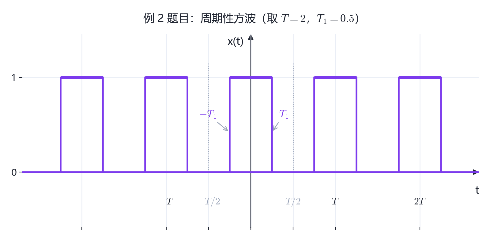

  
点击查看解析与答案

  

由于 $x(t)$ 关于 $t=0$ 对称，取一个完整周期 $[-T/2,\,T/2]$ 作积分：在这个周期内只有 $[-T_1,T_1]$ 上 $x(t)\ne0$，所以积分直接落在 $[-T_1,T_1]$ 上即可。

**(1)** 
$$

a_0=\dfrac{1}{T}\int_{-T_1}^{T_1}1\,dt=\dfrac{2T_1}{T}
$$

正是"在一个周期内 $x(t)=1$ 所占的比例"（占空比）。

**(2)** 对 $k\ne0$：
$$

a_k=\dfrac{1}{T}\int_{-T_1}^{T_1}e^{-jk\omega_0 t}dt
=\dfrac{1}{T}\left[\dfrac{e^{-jk\omega_0 t}}{-jk\omega_0}\right]_{-T_1}^{T_1}
$$

$$

=\dfrac{1}{-jk\omega_0T}\left(e^{-jk\omega_0T_1}-e^{jk\omega_0T_1}\right)
=\dfrac{2\sin\left(k\omega_0T_1\right)}{k\omega_0T}
$$

改写一下更便于看出包络：
$$

\boxed{a_k=\dfrac{2T_1}{T}\cdot\dfrac{\sin\left(k\omega_0T_1\right)}{k\omega_0T_1}}
$$

**(3)** 当 $T=2T_1$ 时 $k\omega_0T_1=k\cdot\dfrac{2\pi}{T}\cdot\dfrac{T}{2}=k\pi$，于是 $a_k=\dfrac{\sin k\pi}{k\pi}$：
$$

a_k=
\begin{cases}
\dfrac{1}{\pi k}\sin\dfrac{\pi k}{2}=\dfrac{(-1)^{(k-1)/2}}{\pi k}, & k\ \text{为奇数}\\[8pt]
0, & k\ \text{为偶数}\ (k\ne0)
\end{cases}
$$

也就是说**只含奇次谐波**，且幅度按 $\dfrac{1}{k}$ 衰减——这正是用奇次谐波叠加逼近方波的依据。

把上面三问的结果画成**线状谱**（取 $T=2,\ T_1=0.5$，即 $T=2T_1$）：奇数 $k$ 处有谱线、偶数 $k$ 处恰好为零，各谱线顶点落在包络 $\dfrac{2T_1}{T}Sa(\omega T_1)$ 上：

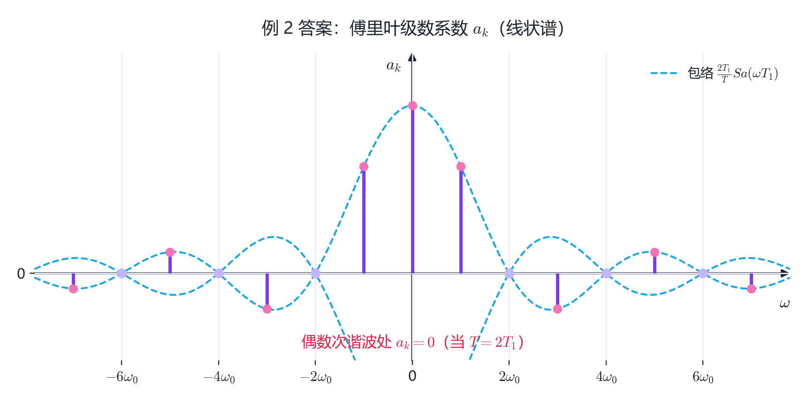

  

<!--知识点3-->
## 三、连续时间傅里叶级数性质表

### 图 3-6　表 3.1

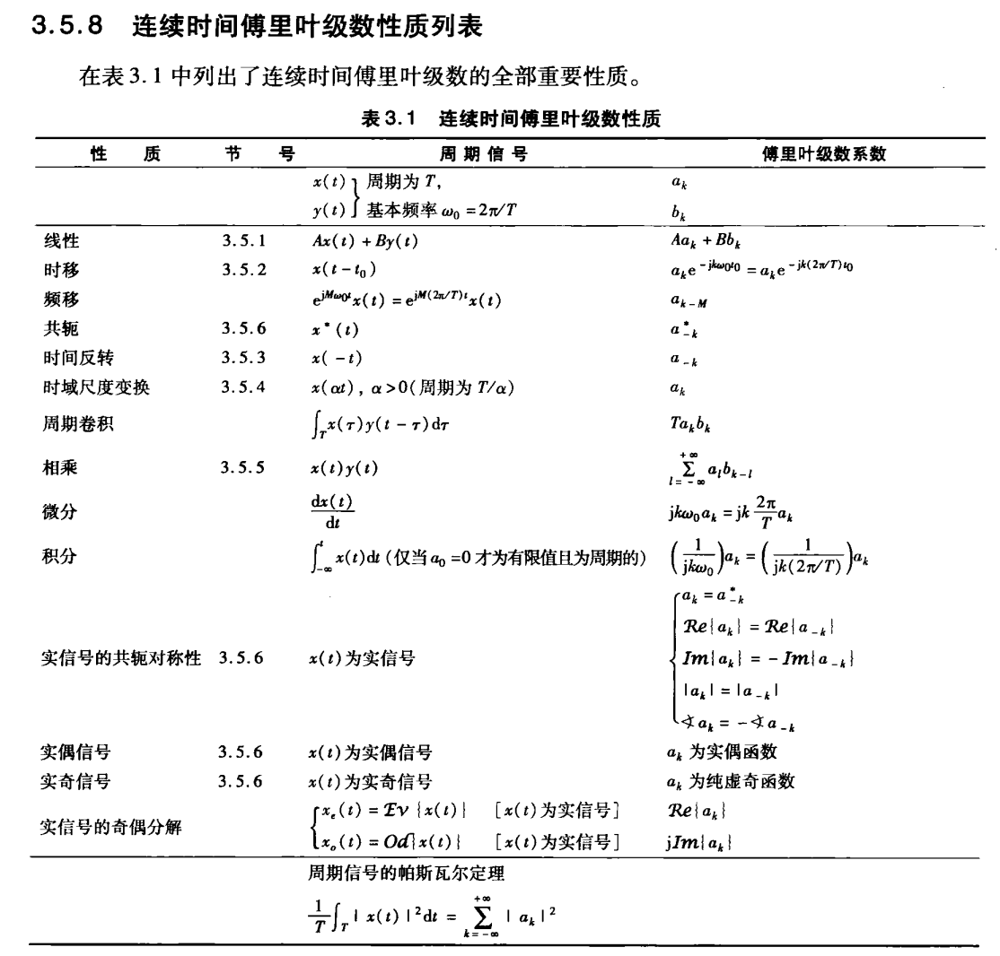

<!--知识点4-->
## 四、离散时间傅里叶级数

### 图 3-8 + 图 3-9　变换对与性质表

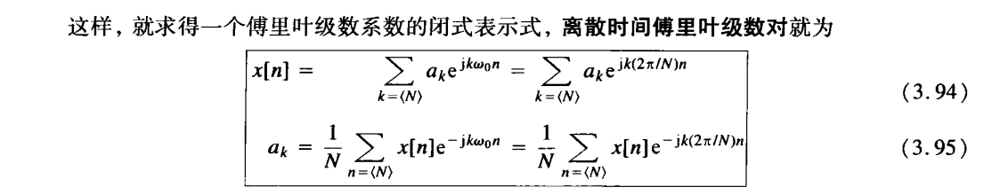

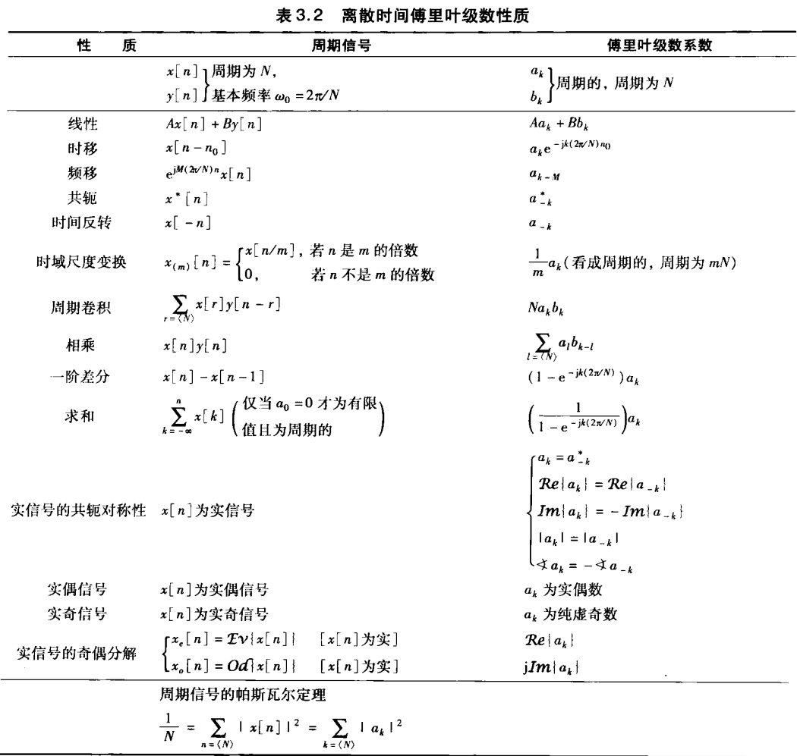

<!--知识点5-->
## 五、频率响应

### 图 3-10 + 图 3-11　系统函数在虚轴 / 单位圆上的取值

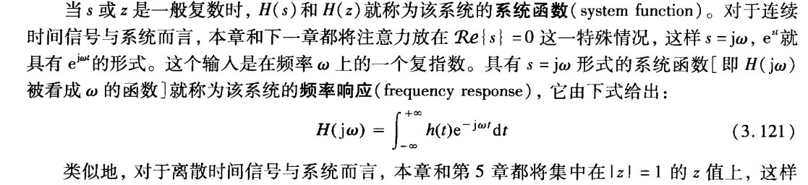

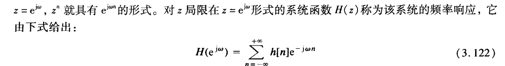

- 系统函数 $H(s)$ 是 $s$ 的一般复函数；当 $s$ 限制在**虚轴** $s=j\omega$ 上（即 $e^{st}$ 退化为 $e^{j\omega t}$）时
$$

H(j\omega)=\int_{-\infty}^{+\infty}h(t)e^{-j\omega t}dt
$$

称为系统的**频率响应**。离散情形把 $z$ 限制在**单位圆** $z=e^{j\omega}$ 上：
$$

H(e^{j\omega})=\sum_{n=-\infty}^{+\infty}h[n]e^{-j\omega n}
$$

- 频率响应的意义：设 $x(t)=A\cos(\omega_0 t+\varphi)$，则稳态输出仍为同频余弦，只是
$$

y(t)=A\left|H(j\omega_0)\right|\cos\left(\omega_0 t+\varphi+\angle H(j\omega_0)\right)
$$

即**幅度乘 $\left|H\right|$、相位加 $\angle H$**。

3. [返回](#li-ti)例题3（一阶系统对余弦的响应）

设 LTI 系统的冲激响应为 $h(t)=e^{-2t}u(t)$。  
**(1)** 求频率响应 $H(j\omega)$；  
**(2)** 若输入 $x(t)=\cos(3t)$，求稳态输出 $y(t)$。

  
点击查看解析与答案

  

**(1)** 直接按定义积分：
$$

H(j\omega)=\int_{0}^{\infty}e^{-2t}e^{-j\omega t}dt
=\int_{0}^{\infty}e^{-(2+j\omega)t}dt
=\dfrac{1}{2+j\omega}
$$

**(2)** 取 $\omega_0=3$：
$$

H(j3)=\dfrac{1}{2+j3}=\dfrac{2-j3}{2^{2}+3^{2}}=\dfrac{2}{13}-j\dfrac{3}{13}
$$

于是
$$

\left|H(j3)\right|=\dfrac{1}{\sqrt{2^{2}+3^{2}}}=\dfrac{1}{\sqrt{13}}\approx0.277
\qquad
\angle H(j3)=-\arctan\dfrac{3}{2}\approx-56.3^{\circ}
$$

由频率响应公式：
$$

\boxed{y(t)=\dfrac{1}{\sqrt{13}}\cos\left(3t-\arctan\dfrac{3}{2}\right)}
$$

即输出被**衰减**到原来的 $0.277$ 倍并被**滞后**约 $56.3^{\circ}$；频率不变。低频($\omega\to0$)时 $\left|H\right|\to\dfrac12$，高频时 $\left|H\right|\to0$，所以这是一个**低通**系统。

  

<!--知识点6-->
## 六、连续时间傅里叶变换

### 图 4-1 + 图 4-2　变换对与存在条件

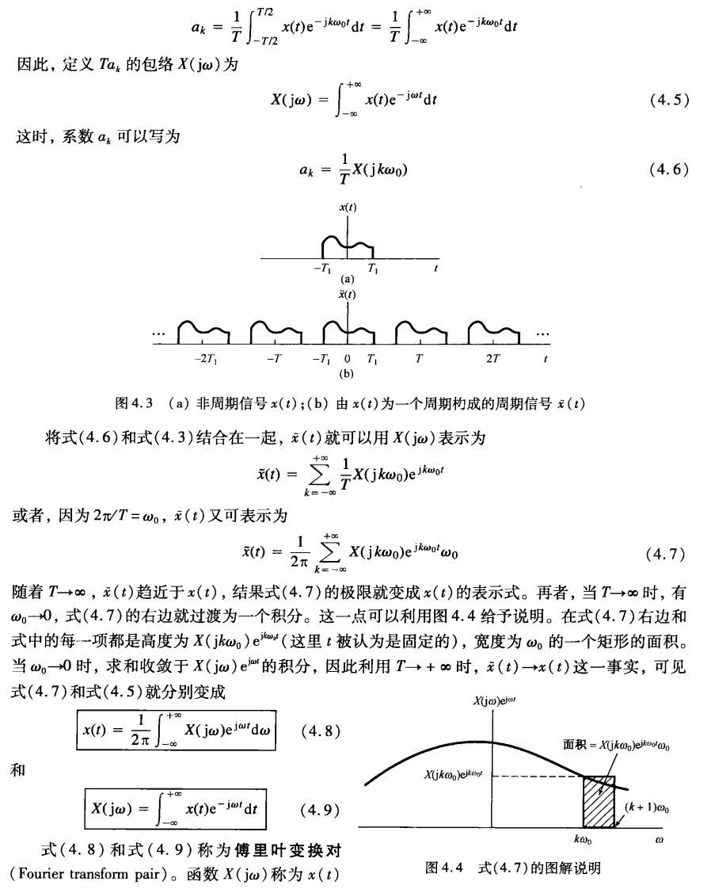

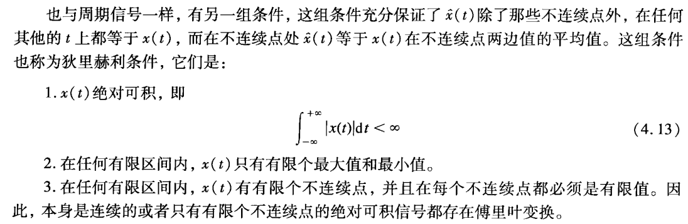

- 把周期信号的傅里叶级数取 $T\to\infty$ 的极限，谐波间隔 $\omega_0\to0$，求和变成积分，就得到**傅里叶变换对**：

分析公式（正变换）：
$$

\boxed{X(j\omega)=\int_{-\infty}^{+\infty}x(t)e^{-j\omega t}dt}
$$

综合公式（反变换）：
$$

\boxed{x(t)=\dfrac{1}{2\pi}\int_{-\infty}^{+\infty}X(j\omega)e^{j\omega t}d\omega}
$$

- 直观理解：$X(j\omega)$ 描述信号在频率 $\omega$ 上的"含量"，反变换则是把所有频率成分按权重 $X(j\omega)$ 叠加回去。
- **存在的充分条件（狄里赫利条件）**：① $x(t)$ 绝对可积 $\int\left|x(t)\right|dt<\infty$；② 任何有限区间内只有有限个极大值、极小值；③ 任何有限区间内只有有限个不连续点，且每个不连续点的值有限。满足这三条的信号一定存在傅里叶变换（不连续点处反变换收敛到左右极限的平均值）。

4. [返回](#li-ti)例题4（矩形脉冲的傅里叶变换）

求矩形脉冲（门函数）
$$

x(t)=
\begin{cases}
1, & \left|t\right|<T_1\\[6pt]
0, & \left|t\right|>T_1
\end{cases}
$$

的傅里叶变换 $X(j\omega)$，并指出其零点位置。

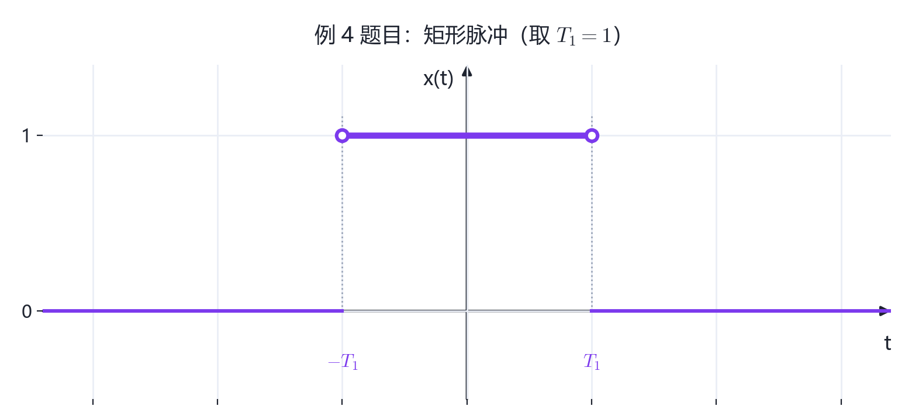

  
点击查看解析与答案

  

按正变换公式，只需在 $x(t)\ne0$ 的区间上积分：
$$

X(j\omega)=\int_{-T_1}^{T_1}1\cdot e^{-j\omega t}dt
=\left[\dfrac{e^{-j\omega t}}{-j\omega}\right]_{-T_1}^{T_1}
=\dfrac{e^{-j\omega T_1}-e^{j\omega T_1}}{-j\omega}
$$

分子用欧拉公式：
$$

e^{-j\omega T_1}-e^{j\omega T_1}=-2j\sin\left(\omega T_1\right)
$$

于是
$$

\boxed{X(j\omega)=\dfrac{2\sin\left(\omega T_1\right)}{\omega}=2T_1\,Sa\left(\omega T_1\right)}
$$

**零点**：$\sin(\omega T_1)=0$ 且 $\omega\ne0$，即
$$

\omega=\dfrac{n\pi}{T_1},\qquad n=\pm1,\pm2,\cdots
$$

（$\omega=0$ 处是极限值 $X(j0)=2T_1$，即脉冲的"面积"，也是 $X(j\omega)$ 的峰值。）

**记忆要点**：时域越窄（$T_1$ 越小），频域主瓣越宽——**时宽与带宽成反比**。

画出频谱（取 $T_1=1$）：中心主瓣最高，两侧旁瓣正负交替、幅度递减，零点正好落在 $\omega=\pm\pi,\ \pm2\pi,\ \pm3\pi\cdots$ 处：

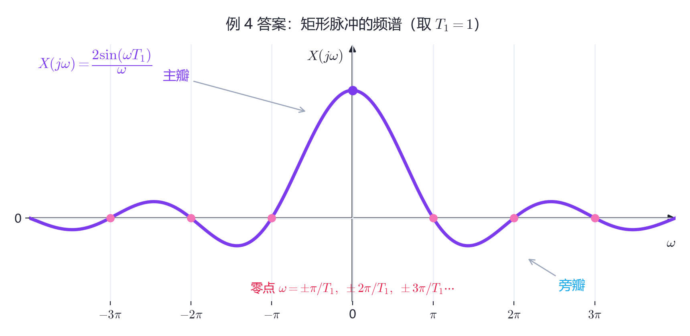

  

5. [返回](#li-ti)例题5（由门形频谱反求时域信号）

已知信号的频谱为门函数
$$

X(j\omega)=
\begin{cases}
1, & \left|\omega\right|<W\\[6pt]
0, & \left|\omega\right|>W
\end{cases}
$$

求 $x(t)$。

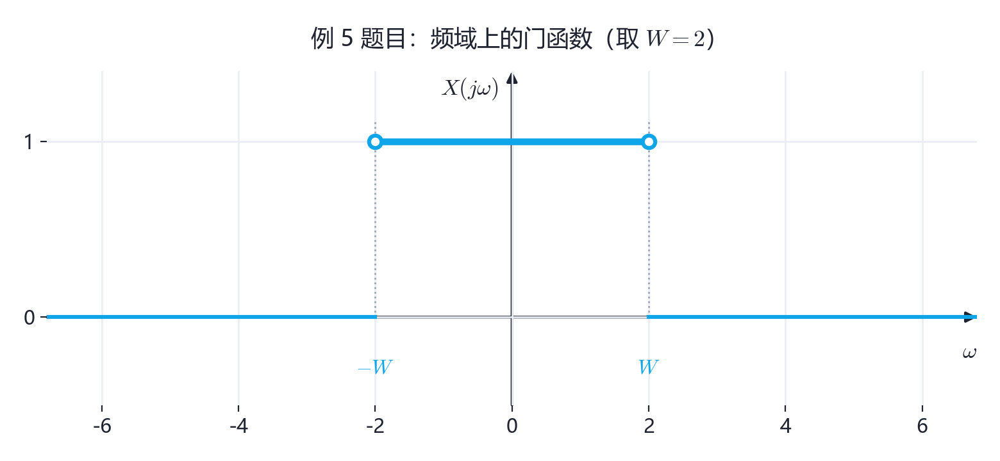

  
点击查看解析与答案

  

这次用**反变换**，并且只需在 $X(j\omega)\ne0$ 的区间积分：
$$

x(t)=\dfrac{1}{2\pi}\int_{-W}^{W}1\cdot e^{j\omega t}d\omega
=\dfrac{1}{2\pi}\left[\dfrac{e^{j\omega t}}{jt}\right]_{-W}^{W}
=\dfrac{1}{2\pi}\cdot\dfrac{e^{jWt}-e^{-jWt}}{jt}
$$

再用欧拉公式 $e^{jWt}-e^{-jWt}=2j\sin(Wt)$：
$$

\boxed{x(t)=\dfrac{\sin(Wt)}{\pi t}=\dfrac{W}{\pi}\,Sa(Wt)}
$$

画出时域波形（取 $W=2$）：中间是宽度约 $2\pi/W$ 的主瓣，两侧振荡衰减，零点落在 $t=\pm\dfrac{\pi}{W},\ \pm\dfrac{2\pi}{W},\cdots$ 处：

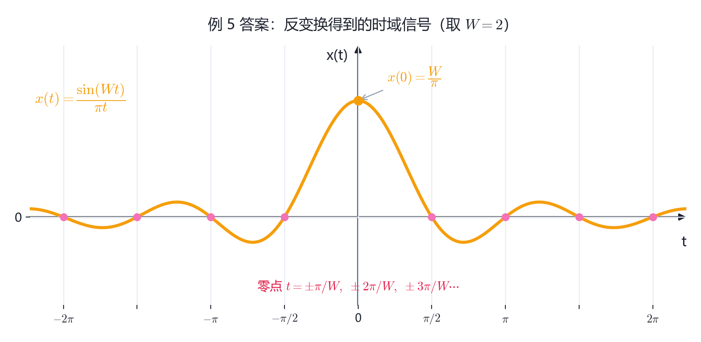

**与例题 4 构成一对对偶关系**：

| 时域 | 频域 |
| :--- | :--- |
| 矩形脉冲（宽 $2T_1$） | $\dfrac{2\sin(\omega T_1)}{\omega}$（$Sa$ 形） |
| $\dfrac{\sin(Wt)}{\pi t}$（$Sa$ 形） | 矩形脉冲（宽 $2W$） |

注意 $t=0$ 处要用极限：$x(0)=\dfrac{W}{\pi}$。

  

<!--知识点7-->
## 七、周期信号的傅里叶变换

### 图 4-5　周期信号 ↔ 冲激串

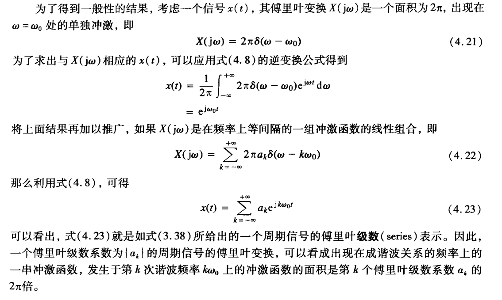

周期信号不满足绝对可积，本来不满足狄里赫利条件，不能直接求傅里叶变换。但把它**放进冲激函数**的语言里，就能给出一套完全统一的描述。

从最简单的 $X(j\omega)=2\pi\delta(\omega-\omega_0)$ 出发，用反变换：
$$

x(t)=\dfrac{1}{2\pi}\int_{-\infty}^{+\infty}2\pi\delta(\omega-\omega_0)e^{j\omega t}d\omega=e^{j\omega_0 t}
$$

也就是说：**频域上一根面积为 $2\pi$ 的冲激，对应时域上一个复指数 $e^{j\omega_0t}$**。冲激的位置决定频率，冲激的面积决定幅度。

把这个结论推广：若频谱是出现在各次谐波频率上的一组冲激
$$

X(j\omega)=\sum_{k=-\infty}^{+\infty}2\pi a_k\delta\left(\omega-k\omega_0\right)
$$

那么反变换给出
$$

x(t)=\sum_{k=-\infty}^{+\infty}a_k e^{jk\omega_0 t}
$$

这恰好就是傅里叶级数的综合公式！于是得到一条重要结论：

> **一个傅里叶级数系数为 $\{a_k\}$ 的周期信号，其傅里叶变换是出现在各次谐波频率 $k\omega_0$ 上的一串冲激，第 $k$ 根冲激的"面积"等于 $2\pi a_k$。**

这条结论把"级数"和"变换"两种工具统一起来了：周期信号既可以用级数（离散系数）描述，也可以用变换（冲激串）描述，两者相差一个 $2\pi$ 因子。同时它也是后面"抽样定理、频率搬移"等内容的基础。

6. [返回](#li-ti)例题6（周期信号的傅里叶变换）

**(1)** 求 $x_1(t)=1+2\cos(2t)+3\sin(4t)$ 的傅里叶变换；  
**(2)** 设 $x_2(t)$ 为例题 2 中的周期方波（周期 $T$、脉宽 $2T_1$），写出它的傅里叶变换。

  
点击查看解析与答案

  

**(1)** 用常用变换对逐项处理：
$$

1\ \longleftrightarrow\ 2\pi\delta(\omega)
$$

$$

\cos(2t)\ \longleftrightarrow\ \pi\left[\delta(\omega-2)+\delta(\omega+2)\right]
$$

$$

\sin(4t)\ \longleftrightarrow\ \dfrac{\pi}{j}\left[\delta(\omega-4)-\delta(\omega+4)\right]
$$

叠加得
$$

\boxed{X_1(j\omega)=2\pi\delta(\omega)+2\pi\left[\delta(\omega-2)+\delta(\omega+2)\right]+\dfrac{3\pi}{j}\left[\delta(\omega-4)-\delta(\omega+4)\right]}
$$

注意 $\dfrac{3\pi}{j}=-j3\pi$，所以 $4\ \text{rad/s}$ 处的冲激是纯虚的——这与"$\sin$ 是实奇函数，其频谱为纯虚奇函数"是一致的。

**(2)** 由例题 2 已求出 $a_0=\dfrac{2T_1}{T}$、$a_k=\dfrac{2\sin(k\omega_0T_1)}{k\omega_0T}$，代入"面积 $=2\pi a_k$"：
$$

\boxed{X_2(j\omega)=\sum_{k=-\infty}^{+\infty}\dfrac{4\pi\sin\left(k\omega_0T_1\right)}{k\omega_0T}\,\delta\left(\omega-k\omega_0\right)}
$$

其中 $\omega_0=\dfrac{2\pi}{T}$。可以验证 $k=0$ 项应取极限：
$$

\lim_{k\to0}\dfrac{4\pi\sin(k\omega_0T_1)}{k\omega_0T}
=\dfrac{4\pi T_1}{T}=2\pi a_0
$$

与 $k=0$ 的公式一致，所以上式对全部 $k$ 都成立。

  

<!--知识点8-->
## 八、傅里叶变换的性质与推导

### 图 4-6 + 图 4-7　性质表与共轭对称性

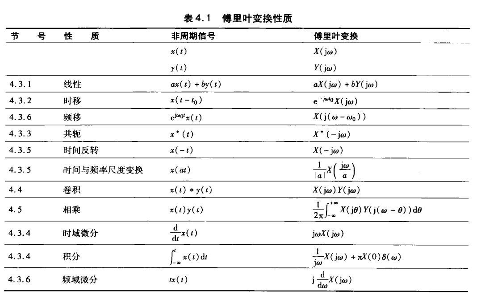

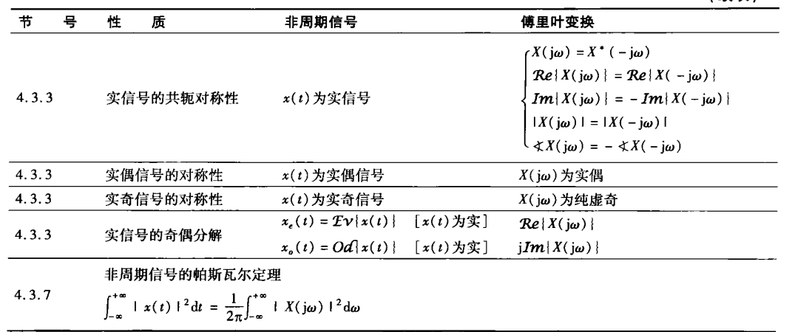

下面把最重要性质的推导写清楚（都能由定义 + 变量代换得到，值得自己推一遍）。

#### 1. 线性

$$

\mathscr{F}\{ax(t)+by(t)\}=aX(j\omega)+bY(j\omega)
$$

积分是线性运算，直接得到。

#### 2. 时移

$$

\mathscr{F}\{x(t-t_0)\}=\int x(t-t_0)e^{-j\omega t}dt
$$

令 $\tau=t-t_0$，则 $t=\tau+t_0$、$dt=d\tau$：
$$

=\int x(\tau)e^{-j\omega(\tau+t_0)}d\tau
=e^{-j\omega t_0}\int x(\tau)e^{-j\omega\tau}d\tau
=\boxed{e^{-j\omega t_0}X(j\omega)}
$$

结论：时域平移 $t_0$ ⟹ 频域只乘一个**纯相位因子**，幅度谱不变。

#### 3. 频移

$$

\mathscr{F}\left\{e^{j\omega_0t}x(t)\right\}
=\int x(t)e^{-j(\omega-\omega_0)t}dt=\boxed{X\left(j(\omega-\omega_0)\right)}
$$

结论：时域乘 $e^{j\omega_0t}$ ⟹ 频域整体右移 $\omega_0$。这是**调制/搬移**的数学基础。

#### 4. 时间反转

$$

\mathscr{F}\{x(-t)\}=\int x(-t)e^{-j\omega t}dt
\overset{\tau=-t}{=}\int x(\tau)e^{j\omega\tau}d\tau
=\boxed{X(-j\omega)}
$$

#### 5. 时间与频率尺度变换

$$

\mathscr{F}\{x(at)\}=\int x(at)e^{-j\omega t}dt
\overset{\tau=at}{=}\dfrac{1}{a}\int x(\tau)e^{-j\frac{\omega}{a}\tau}d\tau
=\boxed{\dfrac{1}{\left|a\right|}X\left(\dfrac{j\omega}{a}\right)}
$$

（$a<0$ 时上下限互换会多一个负号，与 $1/a$ 合并后写成 $\left|a\right|$。）这正解释了例题 4 结尾那句"时宽与带宽成反比"。

#### 6. 卷积性质

$$

\mathscr{F}\{x(t)*y(t)\}
=\int\left[\int x(\tau)y(t-\tau)d\tau\right]e^{-j\omega t}dt
$$

交换积分次序，并令 $u=t-\tau$：
$$

=\int x(\tau)\left[\int y(u)e^{-j\omega(u+\tau)}du\right]d\tau
=\int x(\tau)e^{-j\omega\tau}d\tau\cdot\int y(u)e^{-j\omega u}du
=\boxed{X(j\omega)Y(j\omega)}
$$

**时域卷积 ⟹ 频域相乘**。对应地，**时域相乘 ⟹ 频域卷积**：
$$

\mathscr{F}\{x(t)y(t)\}=\dfrac{1}{2\pi}\int_{-\infty}^{+\infty}X(j\theta)Y\left(j(\omega-\theta)\right)d\theta
$$

#### 7. 时域微分与积分

由 $x(t)=\dfrac{1}{2\pi}\int X(j\omega)e^{j\omega t}d\omega$ 两边对 $t$ 求导：
$$

\dfrac{dx(t)}{dt}=\dfrac{1}{2\pi}\int j\omega X(j\omega)e^{j\omega t}d\omega
\quad\Longrightarrow\quad
\boxed{\mathscr{F}\left\{\dfrac{dx}{dt}\right\}=j\omega X(j\omega)}
$$

积分性质为
$$

\mathscr{F}\left\{\int_{-\infty}^{t}x(\tau)d\tau\right\}
=\dfrac{1}{j\omega}X(j\omega)+\pi X(j0)\delta(\omega)
$$

多出来的 $\pi X(j0)\delta(\omega)$ 是"积分后可能出现直流分量"造成的，$X(j0)=\int x(t)dt$ 就是信号的总面积。

#### 8. 频域微分

对 $X(j\omega)=\int x(t)e^{-j\omega t}dt$ 两边对 $\omega$ 求导：
$$

\dfrac{dX(j\omega)}{d\omega}=\int x(t)(-jt)e^{-j\omega t}dt=-j\int tx(t)e^{-j\omega t}dt
$$

整理得
$$

\boxed{\mathscr{F}\{tx(t)\}=j\dfrac{dX(j\omega)}{d\omega}}
$$

#### 9. 共轭相关性质（重点）

**先记住一个基本事实**：对复信号取共轭，等价于把频谱取共轭并把 $\omega$ 换成 $-\omega$。

**推导 1：共轭性质**
$$

\mathscr{F}\left\{x^{*}(t)\right\}=\int x^{*}(t)e^{-j\omega t}dt
=\left[\int x(t)e^{j\omega t}dt\right]^{*}
$$

而括号里的积分正是 $X(-j\omega)$（把定义式中的 $\omega$ 换成 $-\omega$），所以
$$

\boxed{\mathscr{F}\left\{x^{*}(t)\right\}=X^{*}(-j\omega)}
$$

**推导 2：实信号的共轭对称性**

如果 $x(t)$ 是**实信号**，那么 $x^{*}(t)=x(t)$，代入推导 1 的结论立即得到
$$

\boxed{X(j\omega)=X^{*}(-j\omega)}
$$

或等价地写成
$$

X(-j\omega)=X^{*}(j\omega)
$$

这句话是后面所有推论的"总开关"。把它拆成实部、虚部、模、辐角：

| 量 | 由 $X(-j\omega)=X^{*}(j\omega)$ 得到 | 对称性 |
| :--- | :--- | :--- |
| 实部 | $Re\{X(-j\omega)\}=Re\{X(j\omega)\}$ | **偶**函数 |
| 虚部 | $Im\{X(-j\omega)\}=-Im\{X(j\omega)\}$ | **奇**函数 |
| 模 | $\left\vert X(-j\omega)\right\vert =\left\vert X(j\omega)\right\vert $ | **偶**函数 |
| 辐角 | $\angle X(-j\omega)=-\angle X(j\omega)$ | **奇**函数 |

直观解释：实信号的频谱"正频率部分"和"负频率部分"互为共轭镜像，所以**幅度谱一定关于 $\omega=0$ 对称**（这一点很重要，画频谱图时可以直接用）。

**推导 3：实偶信号 ⟹ 频谱为实偶函数**

设 $x(t)$ 实且偶，即 $x(-t)=x(t)$。由时间反转性质：
$$

X(-j\omega)=\mathscr{F}\{x(-t)\}=\mathscr{F}\{x(t)\}=X(j\omega)
$$

频谱是偶函数；再结合实信号的 $X(-j\omega)=X^{*}(j\omega)$，得
$$

X(j\omega)=X^{*}(j\omega)\quad\Longrightarrow\quad X(j\omega)\ \text{为实数}
$$

故 $X(j\omega)$ 是**实偶函数**（如例题 4 的矩形脉冲，频谱就是实的 $Sa$ 函数）。

**推导 4：实奇信号 ⟹ 频谱为纯虚奇函数**

设 $x(t)$ 实且奇，$x(-t)=-x(t)$，则
$$

X(-j\omega)=\mathscr{F}\{x(-t)\}=-\mathscr{F}\{x(t)\}=-X(j\omega)
$$

频谱是奇函数；又由 $X(-j\omega)=X^{*}(j\omega)$ 得
$$

X(j\omega)=X^{*}(-j\omega)=-X^{*}(j\omega)
$$

移项得 $X(j\omega)+X^{*}(j\omega)=0$，即 $X(j\omega)$ **实部为零、是纯虚数**。故 $X(j\omega)$ 为**纯虚奇函数**（如例题 6 中 $\sin(4t)$ 对应的冲激系数是纯虚的）。

**推导 5：实信号的奇偶分解**

任何实信号都能拆成偶部与奇部：
$$

x_e(t)=\dfrac{1}{2}\left[x(t)+x(-t)\right]
\qquad
x_o(t)=\dfrac{1}{2}\left[x(t)-x(-t)\right]
$$

对两边做变换（用时间反转性质）：
$$

X_e(j\omega)=\dfrac{1}{2}\left[X(j\omega)+X(-j\omega)\right]
$$

代入实信号条件 $X(-j\omega)=X^{*}(j\omega)$：
$$

X_e(j\omega)=\dfrac{1}{2}\left[X(j\omega)+X^{*}(j\omega)\right]=\boxed{Re\left\{X(j\omega)\right\}}
$$

同理
$$

X_o(j\omega)=\dfrac{1}{2}\left[X(j\omega)-X(-j\omega)\right]
=\dfrac{1}{2}\left[X(j\omega)-X^{*}(j\omega)\right]=\boxed{j\,Im\left\{X(j\omega)\right\}}
$$

（因为 $X-X^{*}=2j\,Im\{X\}$。）

**结论汇总**：实信号的偶部对应频谱的实部，奇部对应频谱的虚部（再乘 $j$）。这也是"实偶 ⟹ 实频谱、实奇 ⟹ 纯虚频谱"的另一种说法。

#### 10. 帕斯瓦尔定理

$$

\int_{-\infty}^{+\infty}\left|x(t)\right|^{2}dt=\dfrac{1}{2\pi}\int_{-\infty}^{+\infty}\left|X(j\omega)\right|^{2}d\omega
$$

物理意义：**时域总能量等于频域总能量**，两种算法给出同一个值。

7. [返回](#li-ti)例题7（用卷积性质求系统输出）

已知 LTI 系统的频率响应
$$

H(j\omega)=\dfrac{j\omega+2}{\left(j\omega+1\right)\left(j\omega+3\right)}
$$

输入为 $x(t)=e^{-t}u(t)$。  
**(1)** 求 $X(j\omega)$；**(2)** 用卷积性质求 $Y(j\omega)$ 并作部分分式展开；**(3)** 求 $y(t)$。

  
点击查看解析与答案

  

**(1)** 由常用变换对表：
$$

X(j\omega)=\dfrac{1}{1+j\omega}
$$

**(2)** 时域卷积对应频域相乘：
$$

Y(j\omega)=H(j\omega)X(j\omega)
=\dfrac{j\omega+2}{\left(j\omega+1\right)\left(j\omega+3\right)}\cdot\dfrac{1}{j\omega+1}
=\dfrac{j\omega+2}{\left(j\omega+1\right)^{2}\left(j\omega+3\right)}
$$

令 $s=j\omega$，对 $\dfrac{s+2}{(s+1)^{2}(s+3)}$ 作部分分式：
$$

\dfrac{s+2}{(s+1)^{2}(s+3)}=\dfrac{A}{s+1}+\dfrac{B}{(s+1)^{2}}+\dfrac{C}{s+3}
$$

- 求 $C$：两边乘 $(s+3)$ 后令 $s=-3$，得 $C=\dfrac{-3+2}{(-3+1)^{2}}=-\dfrac{1}{4}$；
- 求 $B$：两边乘 $(s+1)^{2}$ 后令 $s=-1$，得 $B=\dfrac{-1+2}{-1+3}=\dfrac{1}{2}$；
- 求 $A$：比较 $s^{2}$ 的系数，左边为 $0$，右边为 $A+C$，故 $A=-C=\dfrac{1}{4}$。

所以
$$

Y(j\omega)=\dfrac{1/4}{j\omega+1}+\dfrac{1/2}{\left(j\omega+1\right)^{2}}-\dfrac{1/4}{j\omega+3}
$$

**(3)** 用常用变换对逐项反变换：
$$

\dfrac{1}{j\omega+1}\ \longleftrightarrow\ e^{-t}u(t)
\qquad
\dfrac{1}{\left(j\omega+1\right)^{2}}\ \longleftrightarrow\ te^{-t}u(t)
\qquad
\dfrac{1}{j\omega+3}\ \longleftrightarrow\ e^{-3t}u(t)
$$

于是
$$

\boxed{y(t)=\left[\dfrac{1}{4}e^{-t}+\dfrac{1}{2}te^{-t}-\dfrac{1}{4}e^{-3t}\right]u(t)}
$$

校验：$y(0)=\dfrac14+0-\dfrac14=0$，与 $x(t)$ 从零开始、系统严格真分式相符。

  

<!--知识点9-->
## 九、离散时间傅里叶变换

### 图 5-1 + 图 5-2　DTFT 变换对

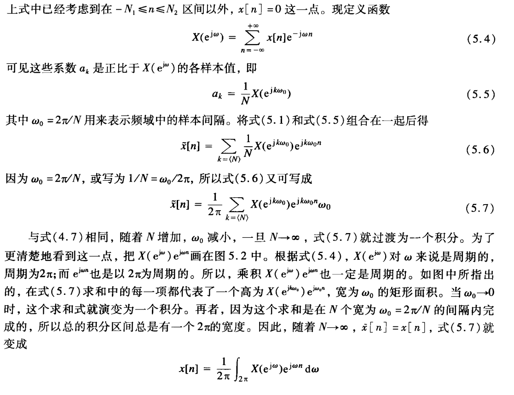

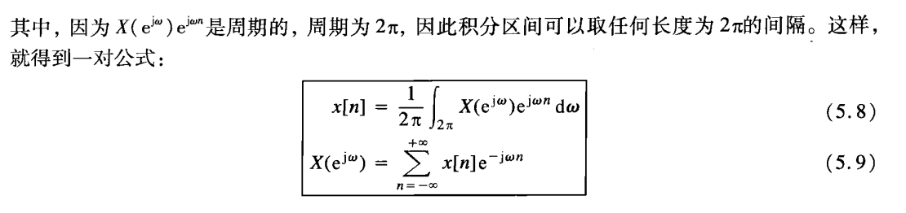

- 与连续情形完全平行：把周期 $N\to\infty$、$\omega_0=\dfrac{2\pi}{N}\to0$，求和过渡为积分：

分析公式：
$$

\boxed{X(e^{j\omega})=\sum_{n=-\infty}^{+\infty}x[n]e^{-j\omega n}}
$$

综合公式：
$$

\boxed{x[n]=\dfrac{1}{2\pi}\int_{2\pi}X(e^{j\omega})e^{j\omega n}d\omega}
$$

- 与连续情形最大的区别：$X(e^{j\omega})$ 是 $\omega$ 的**周期函数，周期为 $2\pi$**，所以积分区间只要取任意长度为 $2\pi$ 的区间即可（记为 $\int_{2\pi}$）。

<!--知识点10-->
## 十、周期序列的离散时间傅里叶变换

### 图 5-3　周期序列 ↔ 冲激串

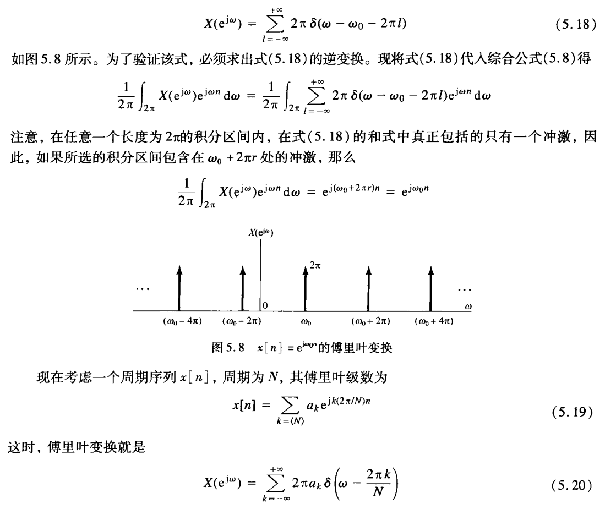

和连续情形一样，周期序列也不满足绝对可和，但借助冲激函数仍可写出它的 DTFT。

先看最基本的复指数序列 $x[n]=e^{j\omega_0 n}$：
$$

X(e^{j\omega})=\sum_{l=-\infty}^{+\infty}2\pi\delta\left(\omega-\omega_0-2\pi l\right)
$$

**注意这里的 $l$ 求和**：因为 $X(e^{j\omega})$ 本身以 $2\pi$ 为周期，所以 $\omega_0$ 处的冲激必须在 $\omega_0\pm2\pi$、$\omega_0\pm4\pi$、$\cdots$ 处**重复出现**，形成周期为 $2\pi$ 的冲激串（图 5.8 正是这个意思）。这是离散情形与连续情形的一个明显差别——连续时 $e^{j\omega_0t}$ 只对应**一根**冲激 $2\pi\delta(\omega-\omega_0)$。

一般地，周期为 $N$、傅里叶级数系数为 $a_k$ 的周期序列
$$

x[n]=\sum_{k=\langle N\rangle}a_k e^{jk(2\pi/N)n}
$$

其 DTFT 为
$$

\boxed{X(e^{j\omega})=\sum_{k=-\infty}^{+\infty}2\pi a_k\,\delta\left(\omega-\dfrac{2\pi k}{N}\right)}
$$

同样地，冲激出现在 $N$ 个等间隔频率 $\dfrac{2\pi k}{N}$ 上（再按 $2\pi$ 周期重复），第 $k$ 根冲激的面积为 $2\pi a_k$。由于 $\{a_k\}$ 本身是周期为 $N$ 的序列，所以一个 $2\pi$ 区间内恰好有 $N$ 根冲激。

8. [返回](#li-ti)例题8（周期序列的 DTFT）

设 $x[n]=1+\cos\left(\dfrac{\pi n}{4}\right)+2\sin\left(\dfrac{\pi n}{2}\right)$。  
**(1)** 求基波周期 $N$ 与傅里叶级数系数 $a_k$；  
**(2)** 写出 $X(e^{j\omega})$。

  
点击查看解析与答案

  

**(1)** 各项周期：$\cos\left(\dfrac{\pi n}{4}\right)$ 的 $\dfrac{\omega_0}{2\pi}=\dfrac{1}{8}$，周期 $8$；$2\sin\left(\dfrac{\pi n}{2}\right)$ 的周期为 $4$；常数任意。取最小公倍数：
$$

N=8,\qquad \omega_0=\dfrac{2\pi}{8}=\dfrac{\pi}{4}
$$

把 $x[n]$ 展开成复指数：
$$

x[n]=1+\dfrac{1}{2}\left(e^{j\frac{\pi n}{4}}+e^{-j\frac{\pi n}{4}}\right)+\dfrac{2}{2j}\left(e^{j\frac{\pi n}{2}}-e^{-j\frac{\pi n}{2}}\right)
$$

$$

=1+\dfrac{1}{2}e^{j\frac{\pi n}{4}}+\dfrac{1}{2}e^{-j\frac{\pi n}{4}}-j\,e^{j\frac{\pi n}{2}}+j\,e^{-j\frac{\pi n}{2}}
$$

与 $x[n]=\sum a_k e^{jk(\pi/4)n}$ 逐项对照：

| $k$ | $0$ | $1$ | $-1$ | $2$ | $-2$ | 其他 |
| :---: | :---: | :---: | :---: | :---: | :---: | :---: |
| $a_k$ | $1$ | $\dfrac{1}{2}$ | $\dfrac{1}{2}$ | $-j$ | $j$ | $0$ |

（可验证共轭对称：$a_{-1}=a_{1}^{*}$、$a_{-2}=a_{2}^{*}$，符合实序列的要求。）

**(2)** 由 $X(e^{j\omega})=\sum 2\pi a_k\delta\left(\omega-\dfrac{2\pi k}{8}\right)$：
$$

\boxed{X(e^{j\omega})=2\pi\delta(\omega)+\pi\delta\left(\omega-\dfrac{\pi}{4}\right)+\pi\delta\left(\omega+\dfrac{\pi}{4}\right)-2\pi j\,\delta\left(\omega-\dfrac{\pi}{2}\right)+2\pi j\,\delta\left(\omega+\dfrac{\pi}{2}\right)}
$$

并且整个冲激串还要按 $\omega$ 以 $2\pi$ 为周期无限重复。

  

<!--知识点11-->
## 十一、离散时间傅里叶变换的性质

### 图 5-4 + 图 5-5　性质表与推导

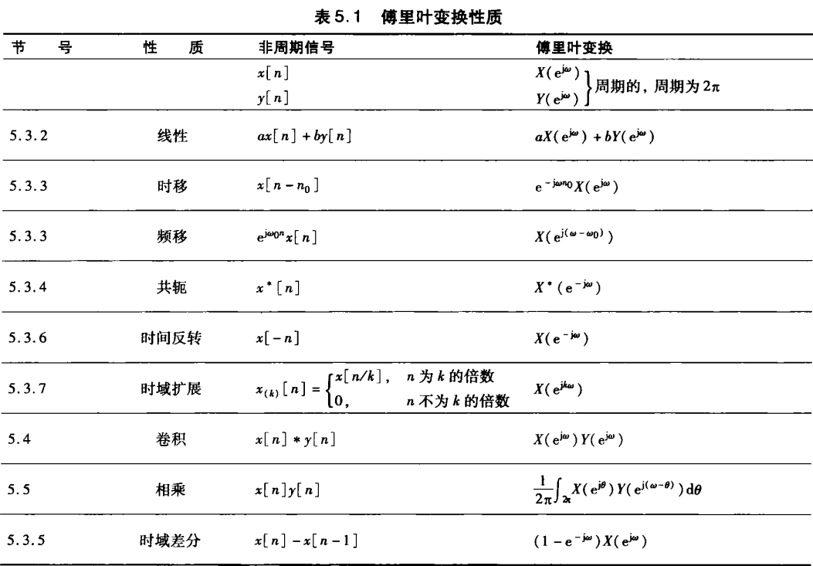

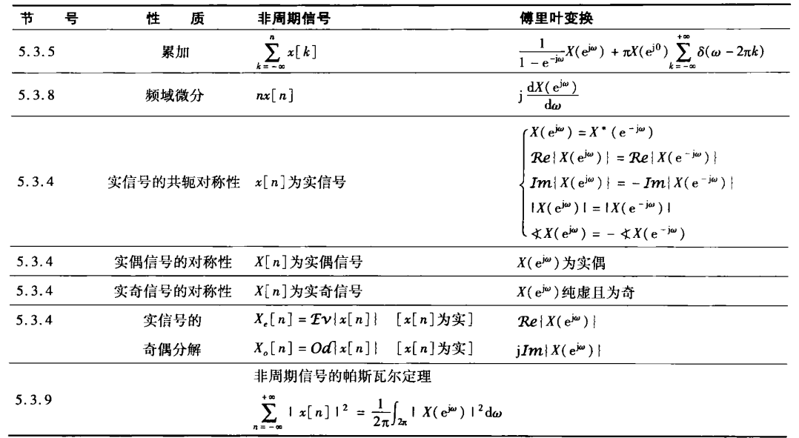

与连续情形一一对应，下面给出主要性质的推导。

#### 1. 线性

$$

\mathscr{F}\{ax[n]+by[n]\}=aX(e^{j\omega})+bY(e^{j\omega})
$$

#### 2. 时移

$$

\mathscr{F}\{x[n-n_0]\}=\sum_{n}x[n-n_0]e^{-j\omega n}
\overset{m=n-n_0}{=}\sum_{m}x[m]e^{-j\omega(m+n_0)}
=\boxed{e^{-j\omega n_0}X(e^{j\omega})}
$$

#### 3. 频移

$$

\mathscr{F}\left\{e^{j\omega_0 n}x[n]\right\}
=\sum_{n}x[n]e^{-j(\omega-\omega_0)n}
=\boxed{X\left(e^{j(\omega-\omega_0)}\right)}
$$

#### 4. 共轭

$$

\mathscr{F}\left\{x^{*}[n]\right\}=\sum_{n}x^{*}[n]e^{-j\omega n}
=\left[\sum_{n}x[n]e^{j\omega n}\right]^{*}
=\boxed{X^{*}\left(e^{-j\omega}\right)}
$$

若 $x[n]$ 为**实序列**，则 $x^{*}[n]=x[n]$，于是
$$

X(e^{j\omega})=X^{*}\left(e^{-j\omega}\right)
$$

由此同样得到：实部偶、虚部奇、模偶、辐角奇，即
$$

Re\left\{X(e^{j\omega})\right\}=Re\left\{X(e^{-j\omega})\right\}
\qquad
Im\left\{X(e^{j\omega})\right\}=-Im\left\{X(e^{-j\omega})\right\}
$$

与连续情形完全一致（只是把 $\omega$ 换成 $-\omega$）。本例例题 8 中的 $a_{-k}=a_k^{*}$ 就是它的离散傅里叶级数版本。

#### 5. 时间反转

$$

\mathscr{F}\{x[-n]\}=\sum_{n}x[-n]e^{-j\omega n}
\overset{m=-n}{=}\sum_{m}x[m]e^{-j(-\omega)m}
=\boxed{X\left(e^{-j\omega}\right)}
$$

对比"实信号共轭对称"可以看出：**实信号的时间反转 ↔ 频谱取共轭**。

#### 6. 卷积

$$

\mathscr{F}\{x[n]*y[n]\}
=\sum_{n}\left[\sum_{k}x[k]y[n-k]\right]e^{-j\omega n}
\overset{m=n-k}{=}\sum_{k}x[k]e^{-j\omega k}\cdot\sum_{m}y[m]e^{-j\omega m}
=\boxed{X(e^{j\omega})Y(e^{j\omega})}
$$

同样地，时域相乘 ⟹ 频域周期卷积：
$$

\mathscr{F}\{x[n]y[n]\}=\dfrac{1}{2\pi}\int_{2\pi}X(e^{j\theta})Y\left(e^{j(\omega-\theta)}\right)d\theta
$$

#### 7. 一阶差分

$$

\mathscr{F}\{x[n]-x[n-1]\}=X(e^{j\omega})-e^{-j\omega}X(e^{j\omega})
=\boxed{\left(1-e^{-j\omega}\right)X(e^{j\omega})}
$$

与连续情形"微分 ⟺ 乘 $j\omega$"对应，离散情形是"差分 ⟺ 乘 $1-e^{-j\omega}$"。

#### 8. 累加

$$

\mathscr{F}\left\{\sum_{k=-\infty}^{n}x[k]\right\}
=\dfrac{1}{1-e^{-j\omega}}X(e^{j\omega})+\pi X(e^{j0})\sum_{k=-\infty}^{+\infty}\delta(\omega-2\pi k)
$$

对应连续情形的积分性质，多出来的冲激串表示"累加可能引入直流分量"。

#### 9. 频域微分

$$

\mathscr{F}\{nx[n]\}=\sum_{n}nx[n]e^{-j\omega n}
=j\sum_{n}x[n]\dfrac{d}{d\omega}\left(e^{-j\omega n}\right)
=\boxed{j\dfrac{dX(e^{j\omega})}{d\omega}}
$$

#### 10. 帕斯瓦尔定理

$$

\sum_{n=-\infty}^{+\infty}\left|x[n]\right|^{2}
=\dfrac{1}{2\pi}\int_{2\pi}\left|X(e^{j\omega})\right|^{2}d\omega
$$

时域总能量等于频域总能量（注意离散情形是**求和**，而频域仍是积分）。

## 附:常用傅里叶变换对速查

### 连续时间傅里叶变换

| 时域 $x(t)$ | 频域 $X(j\omega)$ |
| :--- | :--- |
| $\delta(t)$ | $1$ |
| $\delta(t-t_0)$ | $e^{-j\omega t_0}$ |
| $1$ | $2\pi\delta(\omega)$ |
| $e^{j\omega_0 t}$ | $2\pi\delta(\omega-\omega_0)$ |
| $\cos\omega_0 t$ | $\pi\left[\delta(\omega-\omega_0)+\delta(\omega+\omega_0)\right]$ |
| $\sin\omega_0 t$ | $\dfrac{\pi}{j}\left[\delta(\omega-\omega_0)-\delta(\omega+\omega_0)\right]$ |
| $u(t)$ | $\dfrac{1}{j\omega}+\pi\delta(\omega)$ |
| $e^{-at}u(t),\ Re\{a\}>0$ | $\dfrac{1}{a+j\omega}$ |
| $te^{-at}u(t),\ Re\{a\}>0$ | $\dfrac{1}{(a+j\omega)^{2}}$ |
| $\dfrac{t^{n-1}}{(n-1)!}e^{-at}u(t)$ | $\dfrac{1}{(a+j\omega)^{n}}$ |
| 门函数 $g_\tau(t)$（宽 $\tau$） | $\tau\,Sa\left(\dfrac{\tau\omega}{2}\right)$ |
| $\dfrac{\Omega}{2\pi}Sa\left(\dfrac{\Omega t}{2}\right)$ | 门函数 $g_\Omega(\omega)$（宽 $\Omega$） |
| 周期信号 $\sum a_k e^{jk\omega_0 t}$ | $2\pi\sum a_k\delta(\omega-k\omega_0)$ |

### 门函数与 $Sa$ 函数的对偶（重点）

**① 时域门函数 → 频域 $Sa$**

$$

g_\tau(t)=
\begin{cases}
1, & \left|t\right|<\dfrac{\tau}{2}\\[8pt]
0, & \left|t\right|>\dfrac{\tau}{2}
\end{cases}
$$

$$

G_\tau(j\omega)=\int_{-\tau/2}^{\tau/2}e^{-j\omega t}dt
=\dfrac{e^{-j\omega\tau/2}-e^{j\omega\tau/2}}{-j\omega}
=\dfrac{2\sin\left(\omega\tau/2\right)}{\omega}
$$

$$

\boxed{g_\tau(t)\ \longleftrightarrow\ \tau\,Sa\left(\dfrac{\tau\omega}{2}\right)}
$$

- $G_\tau(j0)=\tau$，就是门函数的**面积**；
- 零点在 $\dfrac{\tau\omega}{2}=n\pi$，即 $\omega=\dfrac{2n\pi}{\tau}$；
- $\tau$ 越小 ⟹ 时域越窄、频域主瓣越宽。

**② 频域门函数 → 时域 $Sa$**

与 $g_\tau(t)$ 采用**同一记法**（参量就是门的**宽度**），宽为 $\Omega$ 的频域门函数：

$$

g_\Omega(\omega)=
\begin{cases}
1, & \left|\omega\right|<\dfrac{\Omega}{2}\\[8pt]
0, & \left|\omega\right|>\dfrac{\Omega}{2}
\end{cases}
$$

$$

x(t)=\dfrac{1}{2\pi}\int_{-\Omega/2}^{\Omega/2}e^{j\omega t}d\omega
=\dfrac{1}{2\pi}\cdot\dfrac{e^{j\Omega t/2}-e^{-j\Omega t/2}}{jt}
=\dfrac{1}{2\pi}\cdot\dfrac{2j\sin\left(\Omega t/2\right)}{jt}
=\dfrac{\sin\left(\Omega t/2\right)}{\pi t}
$$

再由 $\sin\left(\dfrac{\Omega t}{2}\right)=\dfrac{\Omega t}{2}\,Sa\left(\dfrac{\Omega t}{2}\right)$ 整理：

$$

\boxed{g_\Omega(\omega)\ \longleftrightarrow\ \dfrac{\Omega}{2\pi}\,Sa\left(\dfrac{\Omega t}{2}\right)}
$$

- $x(0)=\dfrac{\Omega}{2\pi}$；
- 零点在 $\dfrac{\Omega t}{2}=n\pi$，即 $t=\dfrac{2n\pi}{\Omega}$；
- $\Omega$ 越大 ⟹ 频域越宽、时域主瓣越窄。

**③ 用对偶性互相推出**

若 $x(t)\longleftrightarrow X(j\omega)$，把变量互换并取反转可得**对偶性**

$$

X(jt)\ \longleftrightarrow\ 2\pi\,x(-\omega)
$$

把 ① 的 $G_\tau(j\omega)=\tau Sa\left(\dfrac{\tau\omega}{2}\right)$ 代入左边：

$$

\tau\,Sa\left(\dfrac{\tau t}{2}\right)\ \longleftrightarrow\ 2\pi\,g_\tau(\omega)
$$

两边同除 $2\pi$，再把 $\tau$ 换成 $\Omega$：

$$

\dfrac{\Omega}{2\pi}\,Sa\left(\dfrac{\Omega t}{2}\right)\ \longleftrightarrow\ g_\Omega(\omega)
$$

与 ② 完全一致——**这个 $2\pi$ 就是从这里来的**。所以 ①、② 是同一条对偶关系的两个方向，记住一条即可推出另一条。

**④ 对照与用法**

| | 时域 | 频域 |
| :--- | :--- | :--- |
| ① 时域门 | $g_\tau(t)$，宽 $\tau$ | $\tau Sa\left(\dfrac{\tau\omega}{2}\right)$ |
| ② 频域门 | $\dfrac{\Omega}{2\pi}Sa\left(\dfrac{\Omega t}{2}\right)$ | $g_\Omega(\omega)$，宽 $\Omega$ |

- 两式**形式对称**：都是"门（宽 $W$）↔ $W\,Sa(W\cdot\text{另一变量}/2)$"，只是门在频域时要多带一个 $\dfrac{1}{2\pi}$。
- 记忆口诀："**门 ↔ $Sa$**"，且**宽度参数原样带走**：宽 $\tau$ 的时域门，对应的 $Sa$ 自变量是 $\dfrac{\tau\omega}{2}$；宽 $\Omega$ 的频域门，对应的 $Sa$ 自变量是 $\dfrac{\Omega t}{2}$。
- 与前文例题对应：例题 4 的矩形脉冲宽 $2T_1$，即 $g_{2T_1}(t)$，故 $X(j\omega)=2T_1Sa\left(\omega T_1\right)$；例题 5 的频域门为 $\left|\omega\right|<W$，宽 $2W$，即 $g_{2W}(\omega)$，代入 ② 得 $\dfrac{2W}{2\pi}Sa\left(Wt\right)=\dfrac{W}{\pi}Sa\left(Wt\right)$——与该例答案一致。

例题(点击下面跳转)  

[例1](#li-1)　[例2](#li-2)　[例3](#li-3)　[例4](#li-4)  
[例5](#li-5)　[例6](#li-6)　[例7](#li-7)　[例8](#li-8)
