<!--知识点1-->
## 一、群时延

### 图 6-1　相位特性的斜率与群时延

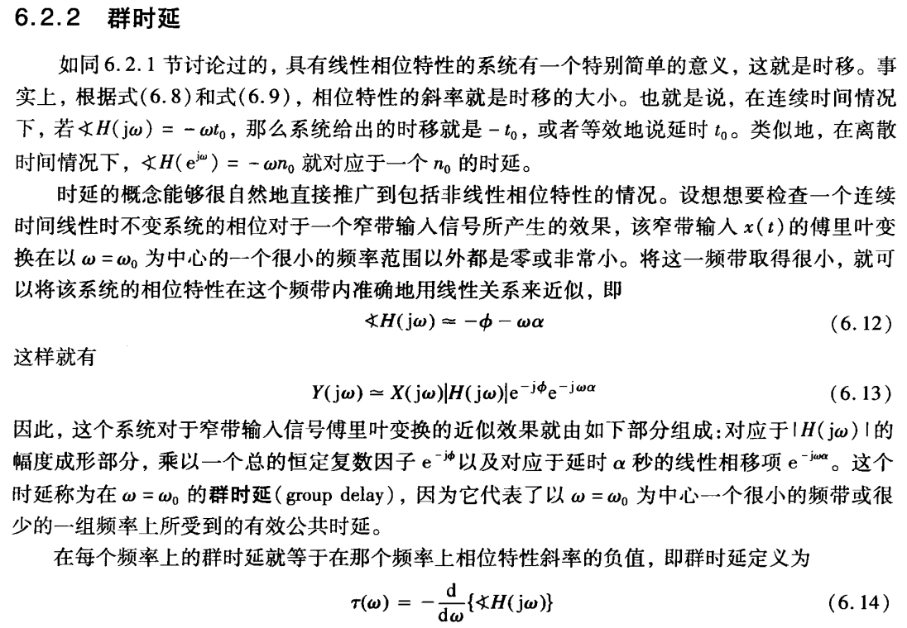

**1. 线性相位意味着"纯时移"**

如果系统的相位是 $\omega$ 的线性函数
$$

\angle H(j\omega)=-\omega t_0
$$

那么由频移/时移性质可知，系统对输入的作用就是**把整个波形延迟 $t_0$**，波形形状完全不变（无失真）。此时定义**相位时延**

$$

\tau_p(\omega)=-\dfrac{\angle H(j\omega)}{\omega}=t_0
$$

**2. 相位非线性时：只对"窄带"定义时延**

实际的系统相位一般是非线性的。此时若输入是**窄带信号**（频谱只在以 $\omega_0$ 为中心的一个很小的频率范围内非零），就可以在这段窄频带内把相位曲线用一条直线来近似：

$$

\angle H(j\omega)\approx-\phi-\omega\alpha \tag{6.12}
$$

代入 $Y(j\omega)=X(j\omega)H(j\omega)$：

$$

Y(j\omega)\approx X(j\omega)\left|H(j\omega)\right|e^{-j\phi}e^{-j\omega\alpha} \tag{6.13}
$$

对照可见，输出由三部分构成：

- $\left|H(j\omega)\right|$：**幅度成形**（在窄带内近似为常数）；
- $e^{-j\phi}$：一个**固定的复数因子**（只改变相位，不改变形状）；
- $e^{-j\omega\alpha}$：**线性相位项，等价于延迟 $\alpha$ 秒**。

这个 $\alpha$ 就是**群时延**——它代表"以 $\omega_0$ 为中心的一小段频率所受到的共同（有效）时延"。

**3. 群时延的定义式**

把"相位曲线的斜率"写成一般形式，就得到群时延的定义：

$$

\boxed{\tau(\omega)=-\dfrac{d}{d\omega}\left\{\angle H(j\omega)\right\}} \tag{6.14}
$$

**4. 几点需要注意**

- 群时延是"相频特性曲线的**负斜率**"，单位是秒。
- 线性相位时，$\tau(\omega)=\tau_p(\omega)=t_0$，处处相同，信号各频率成分**同时到达**，故无相位失真。
- 非线性相位时，不同频率成分的时延不同，波形会"散开"（相位失真 / 色散）。所以**群时延是否平坦**是衡量相位失真的常用指标。
- 一个常用例子：一阶低通 $H(j\omega)=\dfrac{1}{1+j\omega/\omega_0}$，则 $\angle H=-\arctan\dfrac{\omega}{\omega_0}$，
$$

\tau(\omega)=\dfrac{\omega_0}{\omega_0^{2}+\omega^{2}}
$$

在 $\omega=0$ 处 $\tau=\dfrac{1}{\omega_0}$，随 $\omega$ 增大而减小——说明它并**不平坦**，方波通过后会失真。

<!--知识点2-->
## 二、伯德图

### 图 6-2　用对数坐标画频率响应

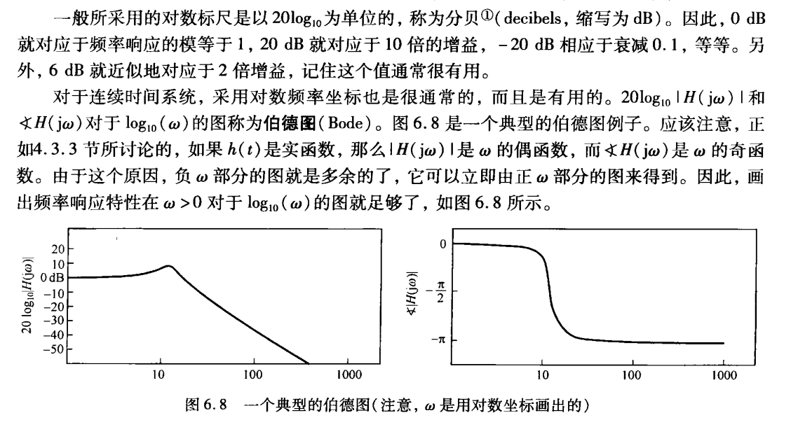

**1. 分贝**

$$

\text{dB}\ =\ 20\log_{10}\left|H(j\omega)\right|
$$

记住几个常用换算：$0\ \text{dB}=1$；$20\ \text{dB}=10$ 倍；$-20\ \text{dB}=0.1$；$6\ \text{dB}\approx2$ 倍；$3\ \text{dB}\approx\sqrt{2}$ 倍（即 $-3$ dB 是半功率点）。

> 注意：这里算的是**幅度比**，用 $20\log$；如果算功率比，用 $10\log$。

**2. 伯德图 = 两张半对数图**

- 横轴都取 $\log_{10}\omega$（对数刻度）；
- 上图纵轴是 $20\log_{10}\left|H(j\omega)\right|$（单位 dB），下图纵轴是 $\angle H(j\omega)$（单位度或弧度）。

由于实冲激响应系统满足 $\left|H\right|$ 偶、$\angle H$ 奇，**只需画 $\omega>0$ 的一半**，负频率部分可由对称性得到。

**3. 画法：把 $H(j\omega)$ 拆成若干基本因子的乘积**

每个基本因子贡献一条**渐近线**，叠加即可：

| 因子 | 幅频渐近线 | 相频特性 |
| :--- | :--- | :--- |
| 常数乘子 $K>0$ | 高度为 $20\log_{10}K$ 的水平线 | 恒为 $0^\circ$ |
| 一阶零点 $\left(1+j\dfrac{\omega}{\omega_1}\right)$ | $\omega\ll\omega_1$：$0$ dB；$\omega\gg\omega_1$：$+20$ dB/dec | $0^\circ\to+90^\circ$，在 $\omega_1$ 处 $+45^\circ$ |
| 一阶极点 $\dfrac{1}{1+j\omega/\omega_2}$ | $\omega\ll\omega_2$：$0$ dB；$\omega\gg\omega_2$：$-20$ dB/dec | $0^\circ\to-90^\circ$，在 $\omega_2$ 处 $-45^\circ$ |
| 原点零点 $j\omega$ | 过 $\omega=1$ 的 $+20$ dB/dec 直线 | 恒为 $+90^\circ$ |
| 原点极点 $\dfrac{1}{j\omega}$ | 过 $\omega=1$ 的 $-20$ dB/dec 直线 | 恒为 $-90^\circ$ |

要点：

- **转折（拐点）频率**就是各基本因子里的 $\omega_1,\omega_2$；
- 每经过一个一阶零点，斜率 $+20$ dB/dec；每经过一个一阶极点，斜率 $-20$ dB/dec；
- 实际的曲线在转折点附近会比折线"圆滑"一些（零点处略高、极点处略低），但用折线足够定性分析。

1. [返回](#li-ti)例题1（画一个二阶系统的伯德图）

已知系统频率响应
$$

H(j\omega)=\dfrac{10\left(1+j\dfrac{\omega}{2}\right)}{1+j\dfrac{\omega}{10}}
$$

**(1)** 写出 $20\log_{10}\left|H(j\omega)\right|$ 的分段渐近线，指出转折频率与各段斜率；  
**(2)** 求 $\omega=5$ 时的精确幅度（dB）与相位；  
**(3)** 概略画出伯德图。

  
点击查看解析与答案

  

**(1)** 拆成三个因子：常数 $10$、一阶零点 $\omega_1=2$、一阶极点 $\omega_2=10$。

- 常数项：$20\log_{10}10=20$ dB；
- $\omega<2$：只有常数项起作用，渐近线为 **$20$ dB 水平线**；
- $2<\omega<10$：零点开始贡献 $+20$ dB/dec，
$$

20\log_{10}\left|H\right|\approx20+20\log_{10}\dfrac{\omega}{2}
$$
- $\omega>10$：极点贡献 $-20$ dB/dec，与零点的 $+20$ dB/dec 抵消，斜率回到 $0$，
$$

20\log_{10}\left|H\right|\approx20+20\log_{10}\dfrac{10}{2}=34\ \text{dB}
$$

**转折频率**：$\omega=2$（零点）、$\omega=10$（极点）。

**(2)** 取 $\omega=5$：
$$

\left|H(j5)\right|=10\cdot\dfrac{\sqrt{1^{2}+2.5^{2}}}{\sqrt{1^{2}+0.5^{2}}}
=10\cdot\dfrac{2.6926}{1.1180}\approx24.08
$$

$$

20\log_{10}24.08\approx27.6\ \text{dB}
$$

相位：
$$

\angle H(j5)=\arctan\dfrac{5}{2}-\arctan\dfrac{5}{10}=68.2^{\circ}-26.6^{\circ}=41.6^{\circ}
$$

（此时渐近线给出 $20+20\log_{10}2.5\approx27.96$ dB，与精确值只差约 $0.3$ dB，说明折线法足够好用。）

**(3)** 画出伯德图如下。注意相位曲线有一个**正的峰**：

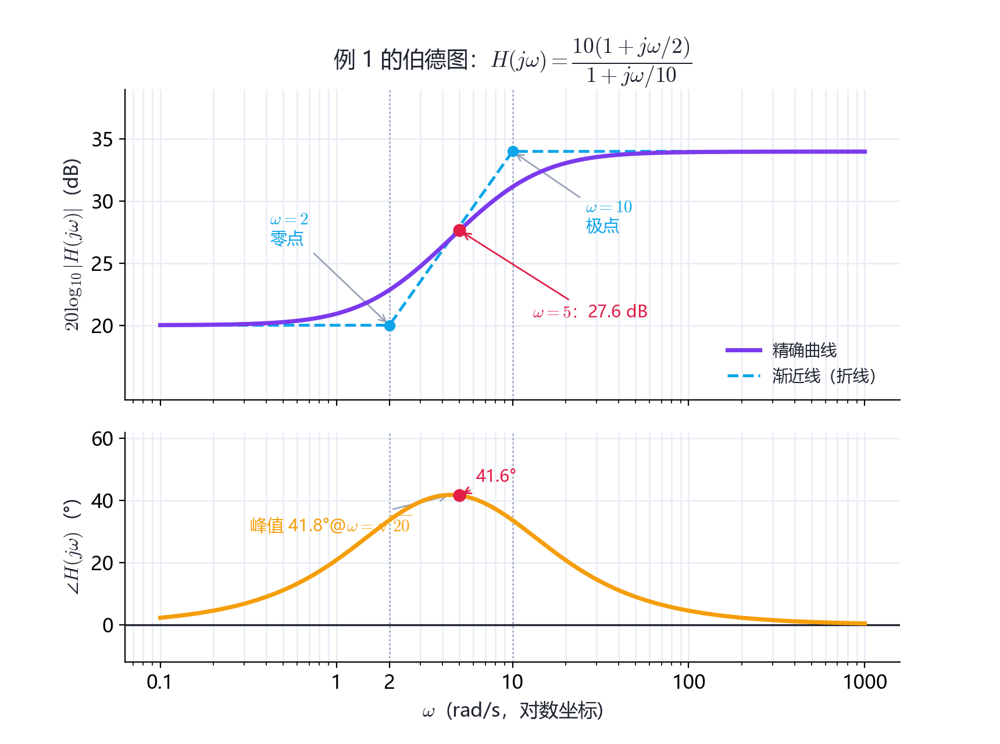

相位的峰值出现在 $\omega=\sqrt{\omega_1\omega_2}=\sqrt{20}\approx4.47$ 处，峰值约 $41.8^\circ$；$\omega\to0$ 与 $\omega\to\infty$ 时相位都回到 $0^\circ$（零点贡献 $+90^\circ$、极点贡献 $-90^\circ$，两端抵消）。这类"先升后降"的相位曲线也说明该系统**不满足线性相位**，存在相位失真。

  

<!--知识点3-->
## 三、冲激串采样与采样定理

### 图 7-3 + 图 7-4　冲激串采样与采样定理

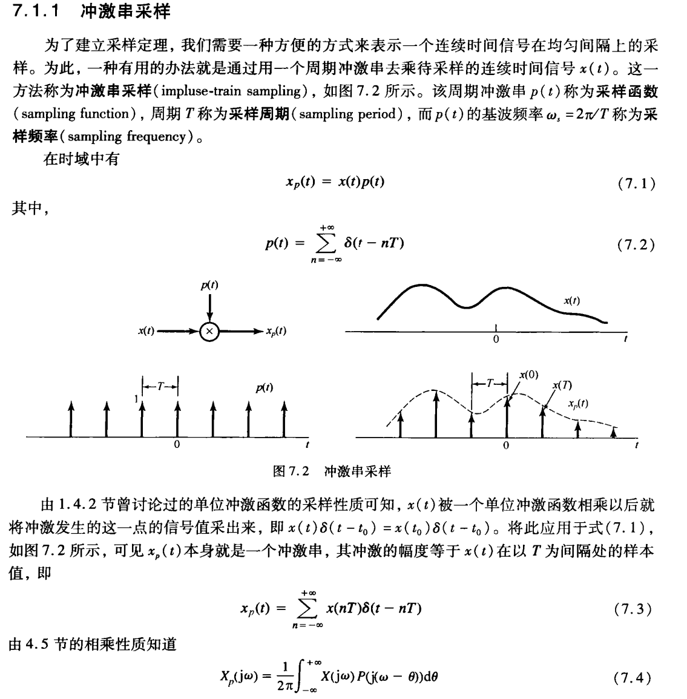

**采样模型**

用周期冲激串 $p(t)$ 去乘待采样信号 $x(t)$：

$$

x_p(t)=x(t)p(t) \tag{7.1}
$$

$$

p(t)=\sum_{n=-\infty}^{+\infty}\delta(t-nT) \tag{7.2}
$$

由冲激的**取样性质** $x(t)\delta(t-t_0)=x(t_0)\delta(t-t_0)$，乘积 $x_p(t)$ 是一个冲激串，"面积"等于各采样值：

$$

x_p(t)=\sum_{n=-\infty}^{+\infty}x(nT)\,\delta(t-nT) \tag{7.3}
$$

由**相乘性质**（时域相乘 $\longleftrightarrow$ 频域卷积）：

$$

X_p(j\omega)=\dfrac{1}{2\pi}\int_{-\infty}^{+\infty}X(j\theta)P\left(j(\omega-\theta)\right)d\theta \tag{7.4}
$$

下面只差 $P(j\omega)$，推导如下。

**式 (7.5) 的推导**

① $p(t)$ 以 $T$ 为周期，周期为 $T$ 的信号可展成傅里叶级数：

$$

p(t)=\sum_{k=-\infty}^{+\infty}a_k e^{jk\omega_s t},
\qquad
\omega_s=\dfrac{2\pi}{T}
$$

② 求系数 $a_k$：取一个周期 $\left[-\dfrac{T}{2},\dfrac{T}{2}\right]$，该区间内只有 $t=0$ 处的 $\delta(t)$（其余冲激落在区间外），且 $t=0$ 时 $e^{-jk\omega_s t}=1$：

$$

a_k=\dfrac{1}{T}\int_{-T/2}^{T/2}p(t)\,e^{-jk\omega_s t}dt
=\dfrac{1}{T}\int_{-T/2}^{T/2}\delta(t)\,e^{-jk\omega_s t}dt
=\dfrac{1}{T}\cdot 1
=\dfrac{1}{T}
$$

（$a_k$ 与 $k$ 无关：每根冲激面积都是 $1$，取样都在 $t=0$。）

③ 逐项作傅里叶变换，用 $e^{j\omega_0 t}\longleftrightarrow2\pi\delta(\omega-\omega_0)$：

$$

p(t)=\sum_{k=-\infty}^{+\infty}a_k e^{jk\omega_s t}
\quad\Longrightarrow\quad
P(j\omega)=\sum_{k=-\infty}^{+\infty}2\pi a_k\,\delta(\omega-k\omega_s)
$$

④ 代入 $a_k=\dfrac{1}{T}$：

$$

\boxed{P(j\omega)=\dfrac{2\pi}{T}\sum_{k=-\infty}^{+\infty}\delta\left(\omega-k\omega_s\right)} \tag{7.5}
$$

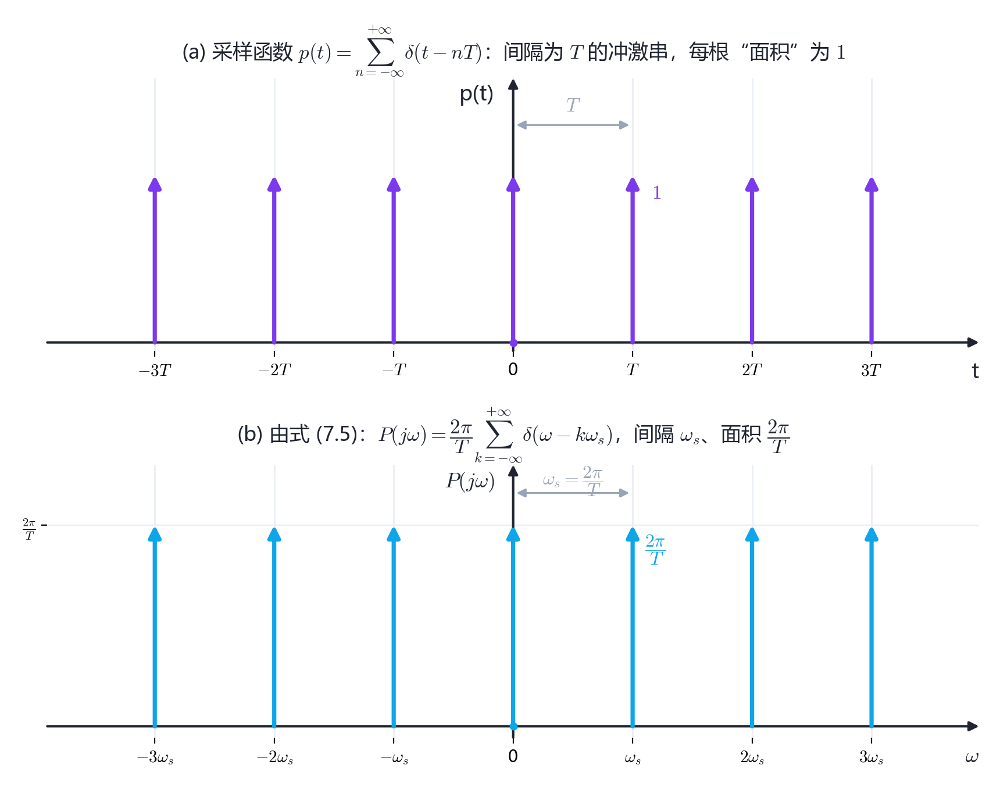

**式 (7.6) 的推导**

把 (7.5) 代入 (7.4)：

$$

X_p(j\omega)=\dfrac{1}{2\pi}\int_{-\infty}^{+\infty}X(j\theta)\cdot\dfrac{2\pi}{T}\sum_{k=-\infty}^{+\infty}\delta\left(\omega-\theta-k\omega_s\right)d\theta
$$

$$

=\dfrac{1}{T}\sum_{k=-\infty}^{+\infty}\int_{-\infty}^{+\infty}X(j\theta)\,\delta\Big(\left(\omega-k\omega_s\right)-\theta\Big)d\theta
$$

用取样性质（对 $\theta$ 取样，取 $\theta=\omega-k\omega_s$）：

$$

\boxed{X_p(j\omega)=\dfrac{1}{T}\sum_{k=-\infty}^{+\infty}X\left(j\left(\omega-k\omega_s\right)\right)} \tag{7.6}
$$

**采样定理**

- $\omega_s>2\omega_M$：各搬移副本互不重叠，用增益 $T$、截止频率介于 $\omega_M$ 与 $\omega_s-\omega_M$ 之间的理想低通即可取出 $X(j\omega)$；
- $\omega_s<2\omega_M$：副本重叠（混叠），无法恢复。

$$

\boxed{\omega_s>2\omega_M\qquad\left(\text{即}\ T<\dfrac{\pi}{\omega_M}\right)}
$$

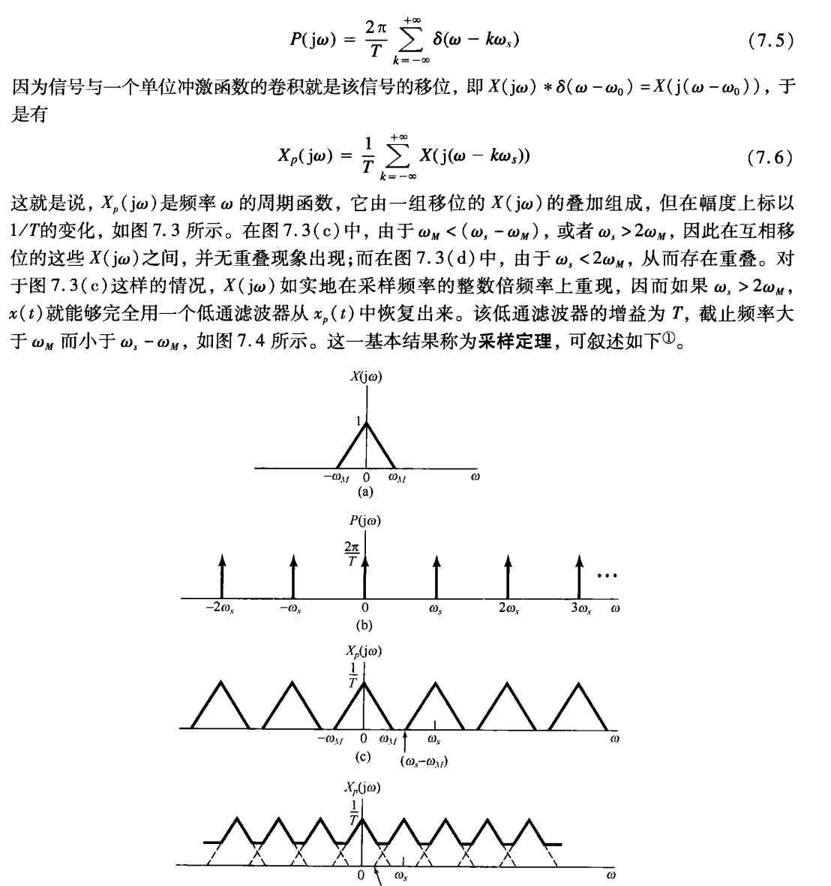

<!--知识点4-->
## 四、正弦载波的调制与解调

### 图 8-1 + 图 8-2 + 图 8-3　幅度调制与同步解调

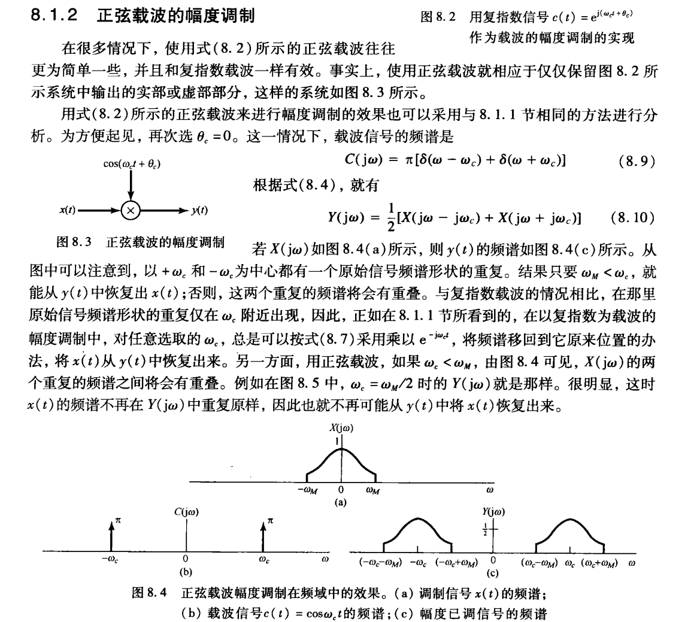

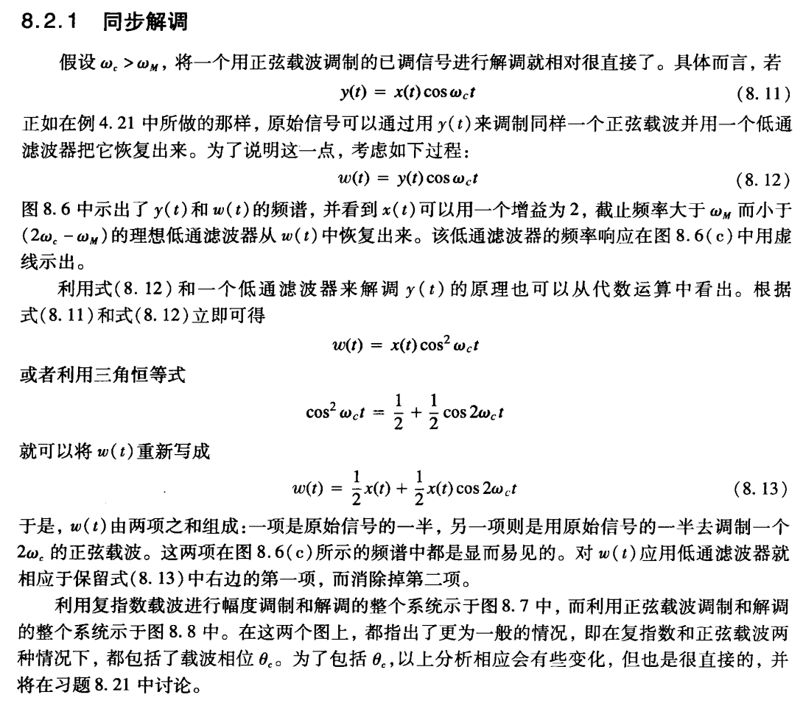

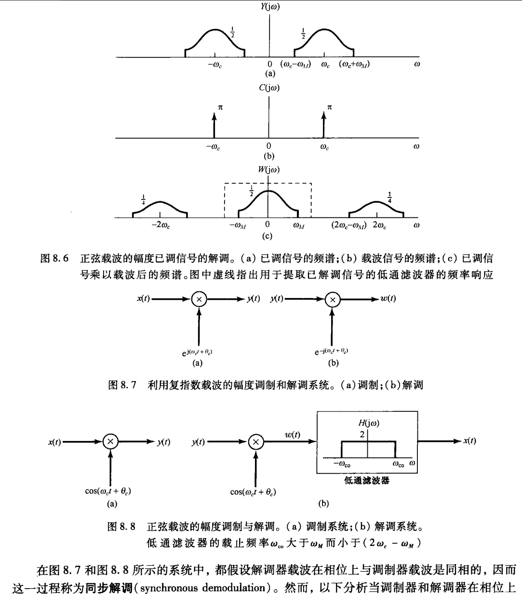

**1. 载波的频谱**

以 $\cos\omega_c t$ 为载波（本课程先取载波相位 $\theta_c=0$），由常用变换对：

$$

C(j\omega)=\pi\left[\delta(\omega-\omega_c)+\delta(\omega+\omega_c)\right] \tag{8.9}
$$

**2. 调制：把基带频谱搬到 $\pm\omega_c$**

$$

y(t)=x(t)\cos\omega_c t
$$

把余弦写成复指数：$\cos\omega_c t=\dfrac{1}{2}e^{j\omega_c t}+\dfrac{1}{2}e^{-j\omega_c t}$，再用**频移性质** $\mathscr{F}\{x(t)e^{j\omega_0t}\}=X(j(\omega-\omega_0))$：

$$

\boxed{Y(j\omega)=\dfrac{1}{2}\left[X\left(j(\omega-\omega_c)\right)+X\left(j(\omega+\omega_c)\right)\right]} \tag{8.10}
$$

即：原频谱被**复制成两份**，分别搬到 $+\omega_c$ 与 $-\omega_c$ 处，幅度各减半。

- 只要 $X(j\omega)$ 的最高频率满足 $\omega_M<\omega_c$，两份副本之间**不重叠**，信息完好；
- 若 $\omega_c<\omega_M$ 就会重叠，$x(t)$ 无法再恢复。

**3. 解调：再乘一次载波 + 低通**

接收端把收到的 $y(t)$ 再乘同一个载波：

$$

w(t)=y(t)\cos\omega_c t \tag{8.12}
$$

代入 $y(t)=x(t)\cos\omega_c t$：

$$

w(t)=x(t)\cos^{2}\omega_c t
$$

用三角恒等式 $\cos^{2}\omega_c t=\dfrac{1}{2}+\dfrac{1}{2}\cos2\omega_c t$：

$$

\boxed{w(t)=\dfrac{1}{2}x(t)+\dfrac{1}{2}x(t)\cos2\omega_c t} \tag{8.13}
$$

对应频谱（再搬移一次）：

$$

W(j\omega)=\dfrac{1}{2}X(j\omega)+\dfrac{1}{4}\left[X\left(j(\omega-2\omega_c)\right)+X\left(j(\omega+2\omega_c)\right)\right]
$$

- 第一项 $\dfrac{1}{2}X(j\omega)$ 是**位于原处（基带）**的副本；
- 第二、三项是**搬到 $\pm2\omega_c$ 附近**的高频副本。

于是用一个**增益为 $2$、截止频率 $\omega_{co}$ 满足**

$$

\omega_M<\omega_{co}<2\omega_c-\omega_M
$$

的理想低通滤波器，就能只保留第一项，得到

$$

2\cdot\dfrac{1}{2}X(j\omega)=X(j\omega)\quad\Longrightarrow\quad z(t)=x(t)
$$

**4. 两点补充**

- 低通滤波器的带宽下限必须大于 $\omega_M$（否则会切掉有用边带），上限必须小于 $2\omega_c-\omega_M$（否则高频副本会漏进来）——这个区间存在的前提正是 $\omega_c>\omega_M$。
- 收发两端载波必须**同频同相**，所以叫**同步解调**。若存在相位差，恢复出的幅度会乘上 $\cos(\Delta\theta)$，即出现衰减甚至为零。

<!--习题课-->
## 五、习题课：综合例题

下面 5 道题把前面的傅里叶级数、傅里叶变换、DTFT、频率响应与本章的调制内容串起来，全部是"给结论 + 要推导"的考研风格，且**只用傅里叶类工具，不用 s 域 / z 域**。

2. [返回](#li-ti)例题2（周期信号的傅里叶级数与帕斯瓦尔）

设周期信号 $x(t)$ 的周期 $T=2$，在一个周期内 $x(t)=t\ (-1<t<1)$（锯齿波）。  
**(1)** 求傅里叶级数系数 $a_k$；  
**(2)** 求 $x(t)$ 的平均功率，并用帕斯瓦尔定理验证。

  
点击查看解析与答案

  

**(1)** 基波频率 $\omega_0=\dfrac{2\pi}{T}=\pi$。

- $k=0$：$x(t)$ 是奇函数，直接得
$$

a_0=\dfrac{1}{T}\int_T x(t)dt=\dfrac{1}{2}\int_{-1}^{1}t\,dt=0
$$

- $k\ne0$：
$$

a_k=\dfrac{1}{2}\int_{-1}^{1}t\,e^{-jk\pi t}dt
$$

分部积分：令 $u=t$、$dv=e^{-jk\pi t}dt$，则 $du=dt$、$v=\dfrac{e^{-jk\pi t}}{-jk\pi}$：

$$

\int_{-1}^{1}t e^{-jk\pi t}dt
=\left[\dfrac{t\,e^{-jk\pi t}}{-jk\pi}\right]_{-1}^{1}
-\int_{-1}^{1}\dfrac{e^{-jk\pi t}}{-jk\pi}dt
$$

第一项：

$$

\left[\dfrac{t\,e^{-jk\pi t}}{-jk\pi}\right]_{-1}^{1}
=\dfrac{e^{-jk\pi}+e^{jk\pi}}{-jk\pi}
=\dfrac{2\cos k\pi}{-jk\pi}
=\dfrac{2(-1)^{k}}{-jk\pi}
=\dfrac{2j(-1)^{k}}{k\pi}
$$

第二项（$\sin k\pi=0$ 使其为零）：

$$

-\int_{-1}^{1}\dfrac{e^{-jk\pi t}}{-jk\pi}dt
=\dfrac{1}{jk\pi}\cdot\dfrac{e^{-jk\pi}-e^{jk\pi}}{-jk\pi}
=\dfrac{-2j\sin k\pi}{k^{2}\pi^{2}}=0
$$

所以

$$

a_k=\dfrac{1}{2}\cdot\dfrac{2j(-1)^{k}}{k\pi}=\dfrac{j(-1)^{k}}{k\pi},\qquad k\ne0
$$

**校验**：$x(t)=t$ 是实奇函数，其傅里叶系数应为**纯虚数且关于 $k$ 奇对称**。上面 $a_k$ 确实是纯虚数，且 $a_{-k}=\dfrac{j(-1)^{-k}}{-k\pi}=-\dfrac{j(-1)^k}{k\pi}=-a_k$ ✔

**(2)** 平均功率：

$$

P=\dfrac{1}{T}\int_{T}\left|x(t)\right|^{2}dt=\dfrac{1}{2}\int_{-1}^{1}t^{2}dt=\dfrac{1}{2}\cdot\dfrac{2}{3}=\dfrac{1}{3}
$$

用**帕斯瓦尔定理** $\displaystyle P=\sum_{k=-\infty}^{+\infty}\left|a_k\right|^{2}$ 验证：

$$

\sum_{k=-\infty}^{+\infty}\left|a_k\right|^{2}
=2\sum_{k=1}^{\infty}\dfrac{1}{k^{2}\pi^{2}}
=\dfrac{2}{\pi^{2}}\cdot\dfrac{\pi^{2}}{6}
=\dfrac{1}{3}
$$

（这里用到 $\displaystyle\sum_{k=1}^{\infty}\dfrac{1}{k^{2}}=\dfrac{\pi^{2}}{6}$。）

  

3. [返回](#li-ti)例题3（傅里叶变换性质的综合运用）

已知 $x(t)=te^{-t}u(t)$，其傅里叶变换为 $X(j\omega)=\dfrac{1}{(1+j\omega)^{2}}$。**只用性质**求：  
**(1)** $\mathscr{F}\{tx(t)\}$；  
**(2)** $\mathscr{F}\{x(2t-1)\}$；  
**(3)** $\mathscr{F}\{x(t)*x(t)\}$；  
**(4)** $\displaystyle\int_{-\infty}^{+\infty}x^{2}(t)dt$。

  
点击查看解析与答案

  

**(1)** 用**频域微分性质** $\mathscr{F}\{tx(t)\}=j\dfrac{dX(j\omega)}{d\omega}$：

$$

\dfrac{d}{d\omega}\left(1+j\omega\right)^{-2}=-2\left(1+j\omega\right)^{-3}\cdot j
$$

所以

$$

\mathscr{F}\{tx(t)\}=j\cdot\left[-2j\left(1+j\omega\right)^{-3}\right]=\dfrac{2}{(1+j\omega)^{3}}
$$

**(2)** 先尺度、后时移。

尺度：$\mathscr{F}\{x(2t)\}=\dfrac{1}{2}X\left(\dfrac{j\omega}{2}\right)=\dfrac{1}{2}\cdot\dfrac{1}{(1+j\omega/2)^{2}}$。

再注意 $x(2t-1)=x\left(2\left(t-\dfrac{1}{2}\right)\right)$，即"先把 $x(2t)$ 右移 $1/2$"，由时移性质乘 $e^{-j\omega/2}$：

$$

\mathscr{F}\{x(2t-1)\}=\dfrac{1}{2}\,e^{-j\omega/2}\cdot\dfrac{1}{\left(1+j\dfrac{\omega}{2}\right)^{2}}
$$

（注意尺度性质里是 $\dfrac{1}{\left|a\right|}$，$a=2$ 时系数 $\dfrac{1}{2}$；时移量是 $t_0=\dfrac{1}{2}$，不是 $1$，这是本题最容易错的地方。）

**(3)** 用**卷积性质** $\mathscr{F}\{x*x\}=X(j\omega)Y(j\omega)$：

$$

\mathscr{F}\{x(t)*x(t)\}=\left[\dfrac{1}{(1+j\omega)^{2}}\right]^{2}=\dfrac{1}{(1+j\omega)^{4}}
$$

**(4)** 用**帕斯瓦尔定理**：

$$

\int_{-\infty}^{+\infty}\left|x(t)\right|^{2}dt
=\dfrac{1}{2\pi}\int_{-\infty}^{+\infty}\left|X(j\omega)\right|^{2}d\omega
=\dfrac{1}{2\pi}\int_{-\infty}^{+\infty}\dfrac{d\omega}{\left(1+\omega^{2}\right)^{2}}
$$

计算积分 $\displaystyle\int_{-\infty}^{+\infty}\dfrac{d\omega}{(1+\omega^{2})^{2}}$：令 $\omega=\tan\theta$，则 $d\omega=\sec^{2}\theta\,d\theta$、$1+\omega^{2}=\sec^{2}\theta$，

$$

\int_{-\infty}^{+\infty}\dfrac{d\omega}{(1+\omega^{2})^{2}}
=\int_{-\pi/2}^{\pi/2}\dfrac{\sec^{2}\theta}{\sec^{4}\theta}d\theta
=\int_{-\pi/2}^{\pi/2}\cos^{2}\theta\,d\theta
=\dfrac{\pi}{2}
$$

所以

$$

\int_{-\infty}^{+\infty}x^{2}(t)dt=\dfrac{1}{2\pi}\cdot\dfrac{\pi}{2}=\dfrac{1}{4}
$$

**校验**：直接积分也对——

$$

\int_{0}^{\infty}\left(te^{-t}\right)^{2}dt=\int_{0}^{\infty}t^{2}e^{-2t}dt=\dfrac{2!}{2^{3}}=\dfrac{1}{4}
$$

  

4. [返回](#li-ti)例题4（频率响应：求多频输入的稳态输出）

已知 LTI 系统的频率响应 $H(j\omega)=\dfrac{1}{1+j\dfrac{\omega}{2}}$，输入
$$

x(t)=2+3\cos\left(2t+30^{\circ}\right)+4\cos\left(6t\right)
$$

求系统的稳态输出 $y(t)$。

  
点击查看解析与答案

  

对每个频率分量分别用"幅度乘 $\left|H\right|$、相位加 $\angle H$"：

- **直流分量**（$\omega=0$）：$H(j0)=1$，所以直流部分不变，仍为 $2$。

- **$\omega=2$**：$\dfrac{\omega}{2}=1$，
$$

H(j2)=\dfrac{1}{1+j}=\dfrac{1}{\sqrt{2}}\,e^{-j45^{\circ}}
\quad\Longrightarrow\quad
\left|H(j2)\right|=\dfrac{1}{\sqrt{2}},\quad \angle H(j2)=-45^{\circ}
$$

- **$\omega=6$**：$\dfrac{\omega}{2}=3$，
$$

H(j6)=\dfrac{1}{1+j3}
\quad\Longrightarrow\quad
\left|H(j6)\right|=\dfrac{1}{\sqrt{1+9}}=\dfrac{1}{\sqrt{10}},\quad \angle H(j6)=-\arctan3\approx-71.57^{\circ}
$$

于是

$$

y(t)=2\cdot1+\dfrac{3}{\sqrt{2}}\cos\left(2t+30^{\circ}-45^{\circ}\right)+\dfrac{4}{\sqrt{10}}\cos\left(6t-71.57^{\circ}\right)
$$

整理得

$$

\boxed{y(t)=2+\dfrac{3}{\sqrt{2}}\cos\left(2t-15^{\circ}\right)+\dfrac{4}{\sqrt{10}}\cos\left(6t-71.57^{\circ}\right)}
$$

**说明**：$\left|H(j6)\right|\approx0.316$ 远小于 $\left|H(j2)\right|\approx0.707$，说明该系统对高频的抑制更强，是一个**低通**系统；输出中高频分量的幅度被压得更多，这正是"滤波"的直观体现。

  

5. [返回](#li-ti)例题5（离散时间周期序列：DFS、DTFT 与功率）

周期序列 $x[n]$ 的周期 $N=4$，一个周期内 $x[n]=\left\{1,\,1,\,0,\,0\right\}$（$n=0,1,2,3$）。  
**(1)** 求离散时间傅里叶级数系数 $a_k$；  
**(2)** 写出它的 DTFT $X(e^{j\omega})$；  
**(3)** 用帕斯瓦尔定理验证平均功率。

  
点击查看解析与答案

  

**(1)** 由分析公式 $a_k=\dfrac{1}{N}\displaystyle\sum_{n=\langle N\rangle}x[n]e^{-jk(2\pi/N)n}$，取 $N=4$、$\dfrac{2\pi}{N}=\dfrac{\pi}{2}$：

$$

a_k=\dfrac{1}{4}\sum_{n=0}^{3}x[n]e^{-jk\frac{\pi}{2}n}
=\dfrac{1}{4}\left(1+e^{-jk\frac{\pi}{2}}\right)
$$

逐项算出：

| $k$ | $0$ | $1$ | $2$ | $3$ |
| :---: | :---: | :---: | :---: | :---: |
| $e^{-jk\pi/2}$ | $1$ | $-j$ | $-1$ | $j$ |
| $a_k$ | $\dfrac{1}{2}$ | $\dfrac{1-j}{4}$ | $0$ | $\dfrac{1+j}{4}$ |

**校验**：实序列应有 $a_{-k}=a_k^{*}$，即 $a_3=a_{-1}=a_1^{*}$：

$$

a_1^{*}=\left(\dfrac{1-j}{4}\right)^{*}=\dfrac{1+j}{4}=a_3
$$

**(2)** 周期序列的 DTFT 是一串冲激（第 5 章知识点）：

$$

X(e^{j\omega})=\sum_{k=-\infty}^{+\infty}2\pi a_k\,\delta\left(\omega-\dfrac{2\pi k}{4}\right)
=\sum_{k=-\infty}^{+\infty}2\pi a_k\,\delta\left(\omega-\dfrac{\pi k}{2}\right)
$$

代入系数：

$$

\boxed{X(e^{j\omega})=\pi\delta(\omega)+\dfrac{\pi}{2}(1-j)\delta\left(\omega-\dfrac{\pi}{2}\right)+\dfrac{\pi}{2}(1+j)\delta\left(\omega+\dfrac{\pi}{2}\right)}
$$

（这个冲激串还要以 $2\pi$ 为周期无限重复；$k=2$ 处 $a_2=0$，对应 $\omega=\pi$ 处**没有**冲激。）

**(3)** 平均功率（时域）：

$$

P=\dfrac{1}{N}\sum_{n=0}^{3}\left|x[n]\right|^{2}=\dfrac{1}{4}\left(1+1+0+0\right)=\dfrac{1}{2}
$$

帕斯瓦尔定理（离散傅里叶级数版）$P=\displaystyle\sum_{k}\left|a_k\right|^{2}$：

$$

\left|a_0\right|^{2}+\left|a_1\right|^{2}+\left|a_2\right|^{2}+\left|a_3\right|^{2}
=\dfrac{1}{4}+\dfrac{2}{16}+0+\dfrac{2}{16}
=\dfrac{1}{4}+\dfrac{1}{8}+\dfrac{1}{8}=\dfrac{1}{2}
$$

  

6. [返回](#li-ti)例题6（调制与解调：频谱搬移的完整分析）

设基带信号 $x(t)$ 的频谱 $X(j\omega)$ 是三角形：以 $\omega=0$ 为中心、支撑宽度 $\left|\omega\right|<\omega_M$，最高处为 $1$，且 $\omega_M=2\ \text{rad/s}$。载波频率取 $\omega_c=10$。

**(1)** 求 $y(t)=x(t)\cos10t$ 的频谱 $Y(j\omega)$，画出草图；  
**(2)** 若把 $y(t)$ 直接通过一个通带为 $\left|\omega\right|<2$、增益为 $1$ 的理想低通滤波器，输出是什么？说明原因；  
**(3)** 若先把 $y(t)$ 再乘 $\cos10t$ 得到 $w(t)$，再通过增益为 $2$、通带为 $\left|\omega\right|<5$ 的理想低通滤波器，求输出 $z(t)$。

  
点击查看解析与答案

  

**(1)** 由调制性质

$$

Y(j\omega)=\dfrac{1}{2}\left[X\left(j(\omega-10)\right)+X\left(j(\omega+10)\right)\right]
$$

即把三角形**复制成两份**，分别平移到 $\omega=10$ 与 $\omega=-10$，高度都从 $1$ 降为 $\dfrac{1}{2}$。每份的支撑区间是 $(8,12)$ 与 $(-12,-8)$。

**(2)** 低通通带 $\left|\omega\right|<2$ 内，$Y(j\omega)$ **恒为零**（所有分量都集中在 $\left|\omega\right|\in(8,12)$）。所以输出为

$$

z(t)=0
$$

**原因**：调制只是把频谱搬走，并没有带回基带；不先"再乘一次载波"把频谱搬回来，低通滤波器里什么也拿不到。这正是"调制后必须解调"的直观解释。

**(3)** 再乘一次载波：

$$

w(t)=y(t)\cos10t=x(t)\cos^{2}10t
=\dfrac{1}{2}x(t)+\dfrac{1}{2}x(t)\cos20t
$$

频谱：

$$

W(j\omega)=\dfrac{1}{2}X(j\omega)
+\dfrac{1}{4}\left[X\left(j(\omega-20)\right)+X\left(j(\omega+20)\right)\right]
$$

三部分的位置：$\dfrac{1}{2}X(j\omega)$ 在基带 $\left|\omega\right|<2$；另两份在 $\left|\omega\right|\in(18,22)$。

低通滤波器通带 $\left|\omega\right|<5$ 恰好**只保留基带项**（$2<5<18$，满足 $\omega_M<\omega_{co}<2\omega_c-\omega_M$），并乘上增益 $2$：

$$

Z(j\omega)=2\cdot\dfrac{1}{2}X(j\omega)=X(j\omega)
\quad\Longrightarrow\quad
\boxed{z(t)=x(t)}
$$

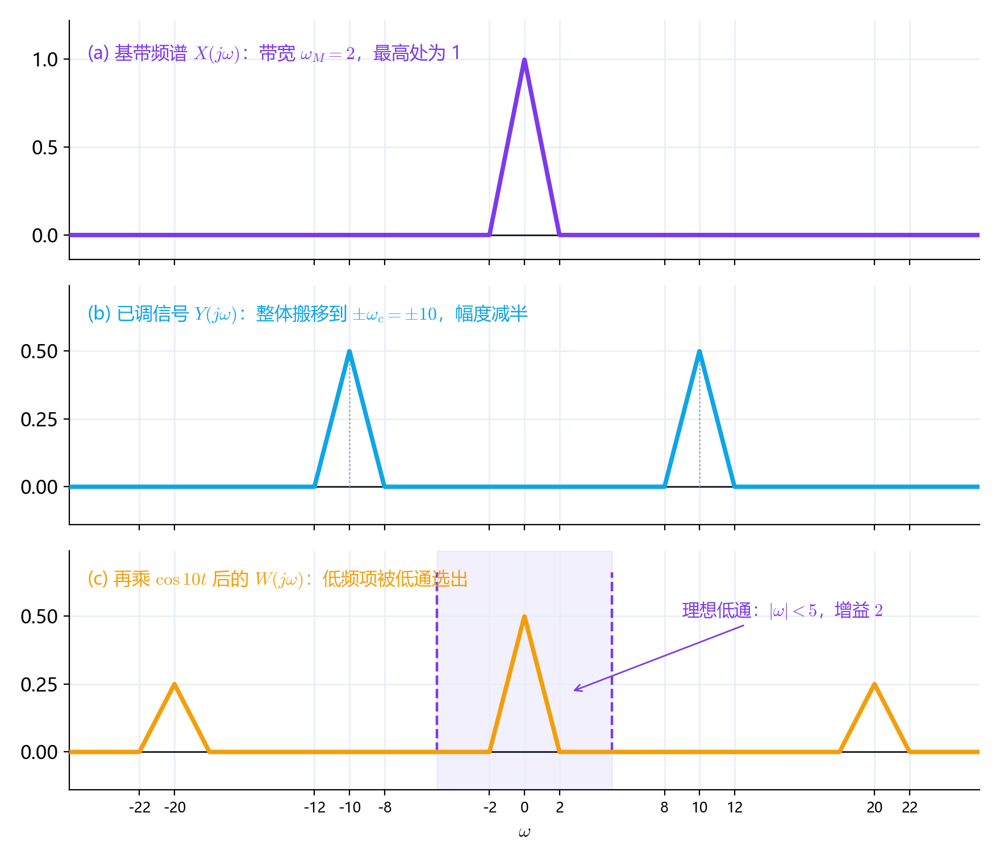

**小结**：整个过程做了两次搬移——调制把频谱搬到 $\pm\omega_c$（发射），解调再搬一次，让其中一份回到基带并产生一份搬到 $\pm2\omega_c$ 的"副产品"，最后用低通滤掉副产品。恢复的前提是 $2\omega_c-\omega_M>\omega_M$，即 $\omega_c>\omega_M$。

  

7. [返回](#li-ti)例题7（周期方波采样已调信号：经典大题）

已知信号及其频谱
$$

x(t)=\dfrac{\sin 2t}{\pi t},
\qquad
X(j\omega)=
\begin{cases}
1, & \left|\omega\right|<2\\[6pt]
0, & \left|\omega\right|>2
\end{cases}
$$

先用载波 $\cos 12t$ 调幅，得 $y(t)=x(t)\cos12t$；再用**周期矩形脉冲** $p(t)$ 对它采样。$p(t)$ 周期 $T=\dfrac{\pi}{6}$、脉宽 $\tau=\dfrac{T}{2}$、幅度为 $1$：

$$

p(t)=
\begin{cases}
1, & \left|t\right|<\dfrac{\tau}{2}\\[8pt]
0, & \dfrac{\tau}{2}<\left|t\right|<\dfrac{T}{2}
\end{cases},
\qquad p(t+T)=p(t)
$$

采样信号 $x_p(t)=y(t)p(t)$。

**(1)** 求 $Y(j\omega)$；  
**(2)** 求 $p(t)$ 的傅里叶级数系数 $a_k$，并写出 $X_p(j\omega)$ 各频带的合成值；  
**(3)** 把 $x_p(t)$ 通过理想低通
$$

H(j\omega)=
\begin{cases}
\pi, & \left|\omega\right|<\omega_{co}\\[6pt]
0, & \left|\omega\right|>\omega_{co}
\end{cases}
$$

求 $\omega_{co}$ 的取值范围，并写出输出 $z(t)$。

  
点击查看解析与答案

  

**第 (1) 问：调制**

$x(t)$ 的频谱是宽 $4$（$\left|\omega\right|<2$）的矩形。由调制性质

$$

Y(j\omega)=\dfrac{1}{2}\left[X\left(j(\omega-12)\right)+X\left(j(\omega+12)\right)\right]
$$

即把矩形**复制两份**、分别平移到 $\omega=\pm12$，高度由 $1$ 降为 $\dfrac{1}{2}$：在 $10<\left|\omega\right|<14$ 内 $Y(j\omega)=\dfrac{1}{2}$。

**第 (2) 问：方波采样的系数与采样频谱**

周期 $T=\dfrac{\pi}{6}$，故采样角频率

$$

\omega_s=\dfrac{2\pi}{T}=12
$$

占空比 $\dfrac{\tau}{T}=\dfrac{1}{2}$，傅里叶系数

$$

a_k=\dfrac{1}{T}\int_{-\tau/2}^{\tau/2}e^{-jk\omega_s t}dt
=\dfrac{2\sin\left(k\omega_s\tau/2\right)}{k\omega_s T}
=\dfrac{\tau}{T}\,Sa\left(\dfrac{k\omega_s\tau}{2}\right)
$$

代入 $\dfrac{\tau}{T}=\dfrac{1}{2}$、$\dfrac{k\omega_s\tau}{2}=\dfrac{k\pi}{2}$：

$$

\boxed{a_k=\dfrac{1}{2}Sa\left(\dfrac{k\pi}{2}\right)}
$$

逐项算出：

$$

a_0=\dfrac{1}{2},\qquad
a_{\pm1}=\dfrac{1}{\pi},\qquad
a_{\pm2}=0,\qquad
a_{\pm3}=\mp\dfrac{1}{3\pi}
$$

（偶数次谐波全为零，这是占空比 $1/2$ 的方波的特点。）

采样后频谱是各副本的叠加：

$$

X_p(j\omega)=\sum_{k=-\infty}^{+\infty}a_k\,Y\left(j(\omega-k\omega_s)\right)
=\dfrac{1}{2}\sum_{k}a_k\left[X\left(j(\omega-12k-12)\right)+X\left(j(\omega-12k+12)\right)\right]
$$

$X$ 的每个副本落在 $\omega=12k+12$ 或 $\omega=12k-12$ 处。逐 $k$ 列表：

| $k$ | $a_k$ | 副本中心 $\omega$ | 该处系数 |
| :---: | :---: | :--- | :--- |
| $0$ | $\dfrac{1}{2}$ | $\pm12$ | $\dfrac{1}{4}$ |
| $\pm1$ | $\dfrac{1}{\pi}$ | $\pm24$ 与 $0$ | $\dfrac{1}{2\pi}$ |
| $\pm2$ | $0$ | 无 | $0$ |
| $\pm3$ | $\mp\dfrac{1}{3\pi}$ | $\pm24$、$\pm48$ | $\mp\dfrac{1}{6\pi}$ |

于是各频带的合成值为：

- $\left|\omega\right|<2$：只由 $k=\pm1$ 落在 $\omega=0$ 处的副本贡献，且两者相同，
$$

X_p(j\omega)=\dfrac{1}{2\pi}+\dfrac{1}{2\pi}=\dfrac{1}{\pi}
$$
- $10<\left|\omega\right|<14$：只由 $k=0$ 贡献，
$$

X_p(j\omega)=\dfrac{1}{2}\cdot\dfrac{1}{2}=\dfrac{1}{4}
$$
- $22<\left|\omega\right|<26$：由 $k=\pm1$ 与 $k=\pm3$ **叠加**，
$$

X_p(j\omega)=\dfrac{1}{2\pi}-\dfrac{1}{6\pi}=\dfrac{1}{3\pi}
$$
- 其余频带同理。

**第 (3) 问：低通滤波与输出**

要取出 $\left|\omega\right|<2$ 的基带项，同时又不能碰到 $10<\left|\omega\right|<14$ 处的较大分量，故

$$

\boxed{2<\omega_{co}<10}
$$

此时

$$

Z(j\omega)=H(j\omega)X_p(j\omega)=\pi\cdot\dfrac{1}{\pi}X(j\omega)=X(j\omega)
$$

反变换得

$$

\boxed{z(t)=x(t)=\dfrac{\sin 2t}{\pi t}}
$$

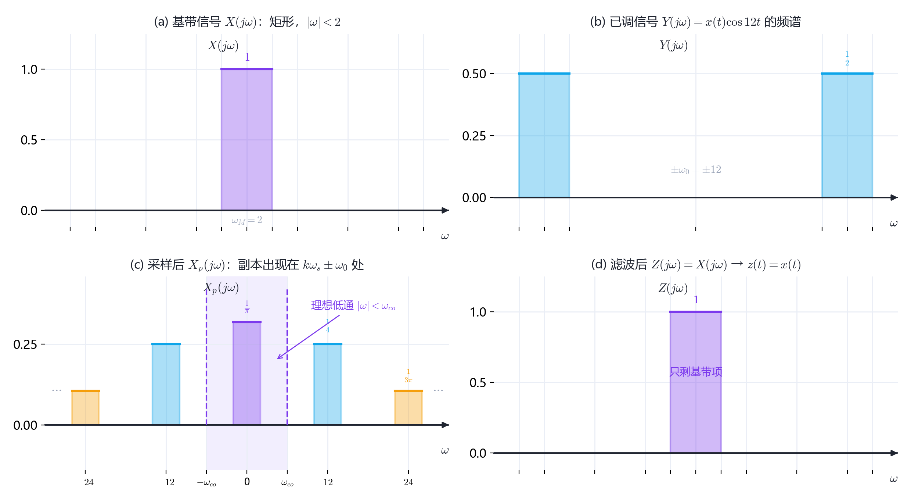

**要点**

1. $T=\dfrac{\pi}{6}$ 决定 $\omega_s=12$，而载波频率也是 $12$——两者相等，于是 $k=\pm1$ 的副本恰好把已调频谱搬回基带，这就是"**用采样实现解调**"。
2. **基带处是两个副本叠加**：$k=+1$ 与 $k=-1$ 都给出 $X(j\omega)$，系数各 $\dfrac{1}{2\pi}$，合成 $\dfrac{1}{\pi}$。
3. 低通增益取 $\pi$ 正是为了抵消这个 $\dfrac{1}{\pi}$ 的衰减，从而精确还原 $x(t)$。
4. 严格说，已调信号的最高频率为 $14$，而 $\omega_s=12<2\times14=28$，**并不满足采样定理**，其余频带（如 $22\sim26$）确实出现了副本叠加（混叠）。但 $\left|\omega\right|<2$ 这一段恰好没有别的副本侵入，所以低通仍能无误地取出 $X(j\omega)$——这类"利用混叠做频谱搬移"正是本题的精髓。

  

例题(点击下面跳转)  

[例1](#li-1)　[例2](#li-2)　[例3](#li-3)  
[例4](#li-4)　[例5](#li-5)　[例6](#li-6)  
[例7](#li-7)
