<!--知识点1-->
## 一、拉普拉斯变换的定义

### 图 9-1　双边拉普拉斯变换

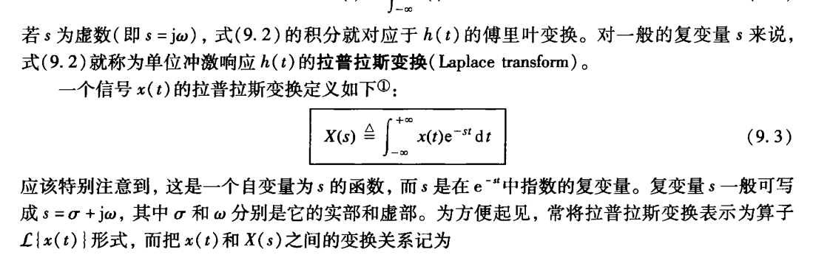

复变量 $s=\sigma+j\omega$，其中 $\sigma$、$\omega$ 分别是实部与虚部。一个信号 $x(t)$ 的**双边拉普拉斯变换**定义为

$$

\boxed{X(s)=\int_{-\infty}^{+\infty}x(t)e^{-st}dt} \tag{9.3}
$$

记作 $X(s)=\mathscr{L}\{x(t)\}$。

- 当 $s$ 取纯虚数 $s=j\omega$ 时，$X(j\omega)$ 就是 $x(t)$ 的**傅里叶变换**——所以拉普拉斯变换是傅里叶变换的推广（$\sigma$ 相当于给信号额外乘一个衰减因子 $e^{-\sigma t}$，用来"救回"不满足绝对可积的信号）。
- 注意 $X(s)$ 的自变量是复变量 $s$，它是 $s$ 的函数，定义在一个**复数平面**（$s$ 平面）上。

1. [返回](#li-ti)例题1（实指数与余弦之和的拉普拉斯变换）

求

$$

x(t)=e^{-2t}u(t)+e^{-t}\left(\cos 3t\right)u(t)
$$

的拉普拉斯变换。

  
点击查看解析与答案

  

由欧拉关系 $\cos 3t=\dfrac{1}{2}\left(e^{j3t}+e^{-j3t}\right)$，把 $x(t)$ 拆成三项实指数：

$$

x(t)=\left[e^{-2t}+\dfrac{1}{2}e^{-(1-3j)t}+\dfrac{1}{2}e^{-(1+3j)t}\right]u(t)
$$

逐项用 $e^{-at}u(t)\leftrightarrow\dfrac{1}{s+a}$：

$$

e^{-2t}u(t)\ \longleftrightarrow\ \dfrac{1}{s+2},\qquad Re\{s\}>-2
$$

$$

e^{-(1-3j)t}u(t)\ \longleftrightarrow\ \dfrac{1}{s+(1-3j)},\qquad Re\{s\}>-1
$$

$$

e^{-(1+3j)t}u(t)\ \longleftrightarrow\ \dfrac{1}{s+(1+3j)},\qquad Re\{s\}>-1
$$

三者要**同时**收敛，取收敛域的公共部分：$Re\{s\}>-1$。于是

$$

X(s)=\dfrac{1}{s+2}+\dfrac{1}{2}\cdot\dfrac{1}{s+(1-3j)}+\dfrac{1}{2}\cdot\dfrac{1}{s+(1+3j)},\qquad Re\{s\}>-1
$$

后两项合并（这正是"实信号的频谱共轭对称"在 $s$ 域的体现）：

$$

\dfrac{1}{2}\left[\dfrac{1}{s+1-3j}+\dfrac{1}{s+1+3j}\right]
=\dfrac{s+1}{(s+1)^{2}+9}
=\dfrac{s+1}{s^{2}+2s+10}
$$

所以

$$

\boxed{X(s)=\dfrac{1}{s+2}+\dfrac{s+1}{s^{2}+2s+10}
=\dfrac{2s^{2}+5s+12}{\left(s^{2}+2s+10\right)(s+2)},\qquad Re\{s\}>-1}
$$

  

2. [返回](#li-ti)例题2（双侧指数信号与收敛域）

设 $x(t)=e^{-b|t|}$，求它的拉普拉斯变换及收敛域。

  
点击查看解析与答案

  

这是**双边**信号，按 $t>0$、$t<0$ 拆成右边信号与左边信号之和：

$$

x(t)=e^{-bt}u(t)+e^{bt}u(-t)
$$

两项分别求：

$$

e^{-bt}u(t)\ \longleftrightarrow\ \dfrac{1}{s+b},\qquad Re\{s\}>-b
$$

$$

e^{bt}u(-t)\ \longleftrightarrow\ -\dfrac{1}{s-b},\qquad Re\{s\}<b
$$

**只有当 $b>0$ 时**，两个收敛域 $Re\{s\}>-b$ 与 $Re\{s\}<b$ 才有公共部分 $-b<Re\{s\}<b$。此时

$$

\boxed{e^{-b|t|}\ \longleftrightarrow\ \dfrac{1}{s+b}-\dfrac{1}{s-b}=\dfrac{-2b}{s^{2}-b^{2}},\qquad -b<Re\{s\}<b}
$$

若 $b\le 0$，两个收敛域没有交集，$x(t)$ 的拉普拉斯变换**不存在**（注意此时 $x(t)$ 不再衰减，双边积分发散）。

**零极点图**：极点在 $s=\pm b$（都在实轴上），收敛域是两根极点**之间**的竖直带状区域——这正对应"双边信号，收敛域为带状"。

  

<!--知识点2-->
## 二、收敛域

### 图 9-4　有理变换的收敛域与极点

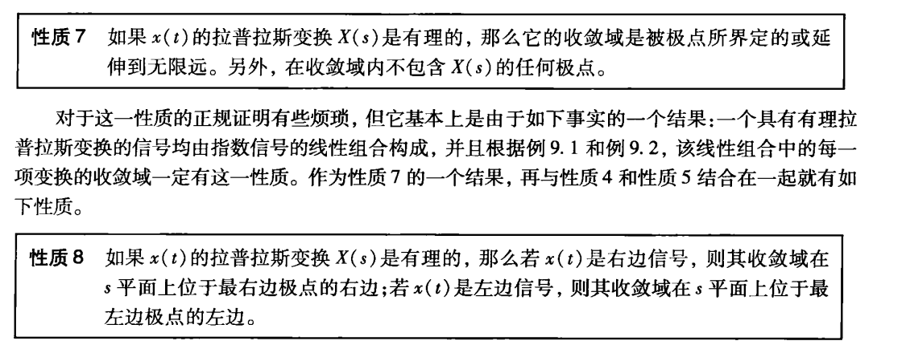

**性质 7**：若 $X(s)$ 是**有理**的，则它的收敛域由极点界定（或延伸到无穷远），并且**收敛域内不含任何极点**。

**性质 8**：若 $X(s)$ 有理，则

- 若 $x(t)$ 是**右边**信号，收敛域在最**右**边极点的**右**边；
- 若 $x(t)$ 是**左边**信号，收敛域在最**左**边极点的**左**边；
- （由两者结合）若 $x(t)$ 是**双边**信号，收敛域是相邻两极点之间的**带状区域**。

这条性质是本章最实用的工具：**同一个代数式 $X(s)$，配上不同的收敛域，对应完全不同的时域信号**。下面三个例题用的都是同一个 $X(s)=\dfrac{1}{(s+1)(s+2)}$，只改收敛域。

3. [返回](#li-ti)例题3（收敛域在最右极点右边 → 右边信号）

设

$$

X(s)=\dfrac{1}{(s+1)(s+2)},\qquad Re\{s\}>-1
$$

求 $x(t)$。

  
点击查看解析与答案

  

**第一步：部分分式展开**

$$

X(s)=\dfrac{1}{(s+1)(s+2)}=\dfrac{A}{s+1}+\dfrac{B}{s+2}
$$

用留数（遮盖法）直接读系数：

$$

A=\left[(s+1)X(s)\right]_{s=-1}=\dfrac{1}{-1+2}=1
\qquad
B=\left[(s+2)X(s)\right]_{s=-2}=\dfrac{1}{-2+1}=-1
$$

所以

$$

X(s)=\dfrac{1}{s+1}-\dfrac{1}{s+2}
$$

**第二步：按收敛域决定每一项的"边性"**

收敛域 $Re\{s\}>-1$ 在两个极点的**右边**，说明整个信号是**右边信号**，每一项都取右边信号的反变换：

$$

\dfrac{1}{s+1}\ \longleftrightarrow\ e^{-t}u(t)
\qquad
\dfrac{1}{s+2}\ \longleftrightarrow\ e^{-2t}u(t)
$$

**第三步：合并**

$$

\boxed{x(t)=\left(e^{-t}-e^{-2t}\right)u(t)}
$$

  

4. [返回](#li-ti)例题4（收敛域在最左极点左边 → 左边信号）

代数式同上，但收敛域改为 $Re\{s\}<-2$，求 $x(t)$。

  
点击查看解析与答案

  

**部分分式与例题 3 完全相同**（只取决于代数式，与收敛域无关）：

$$

X(s)=\dfrac{1}{s+1}-\dfrac{1}{s+2}
$$

收敛域 $Re\{s\}<-2$ 在两个极点的**左边**，所以每一项都取**左边信号**：

$$

\dfrac{1}{s+1}\ \longleftrightarrow\ -e^{-t}u(-t),\qquad Re\{s\}<-1
$$

$$

\dfrac{1}{s+2}\ \longleftrightarrow\ -e^{-2t}u(-t),\qquad Re\{s\}<-2
$$

于是

$$

\boxed{x(t)=\left(-e^{-t}+e^{-2t}\right)u(-t),\qquad Re\{s\}<-2}
$$

  

5. [返回](#li-ti)例题5（收敛域是带状 → 双边信号）

代数式仍为 $X(s)=\dfrac{1}{(s+1)(s+2)}$，但收敛域改为 $-2<Re\{s\}<-1$，求 $x(t)$。

  
点击查看解析与答案

  

部分分式仍是

$$

X(s)=\dfrac{1}{s+1}-\dfrac{1}{s+2}
$$

现在收敛域夹在两个极点**之间**，就要**对每一项分别判断边性**：

- 极点 $s=-1$：收敛域 $Re\{s\}<-1$ 位于它的**左边** ⟹ 这一项取**左边**信号，即 $-e^{-t}u(-t)$；
- 极点 $s=-2$：收敛域 $Re\{s\}>-2$ 位于它的**右边** ⟹ 这一项取**右边**信号，即 $e^{-2t}u(t)$。

所以

$$

\boxed{x(t)=-e^{-t}u(-t)+e^{2\cdot0}\cdot e^{-2t}u(t)=-e^{-t}u(-t)+e^{-2t}u(t),\qquad -2<Re\{s\}<-1}
$$

**三例对比**：同一个代数式，三种收敛域给出三个完全不同的信号（右边、左边、双边）。这就是为什么书中强调——**写拉普拉斯变换必须把收敛域一起写出来**，否则不唯一。

  

<!--知识点3-->
## 三、零极点图与一阶系统

### 图 9-8 + 图 9-9　从极点位置读频率响应

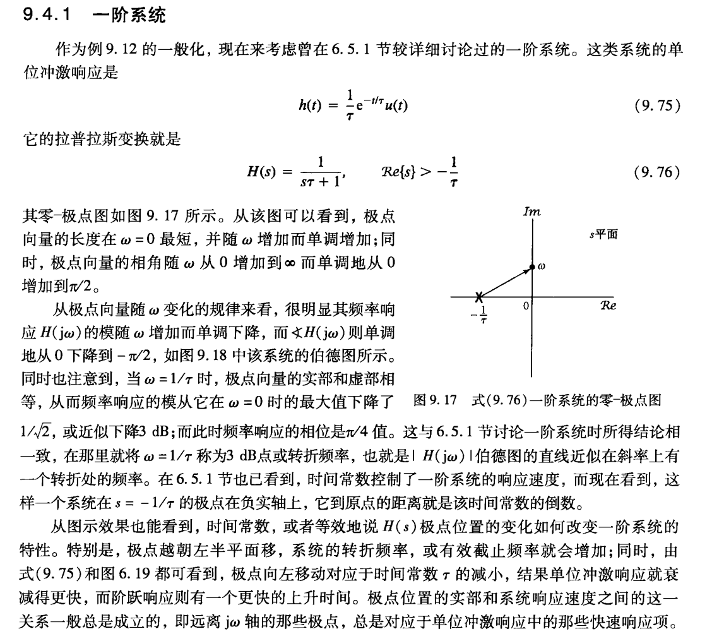

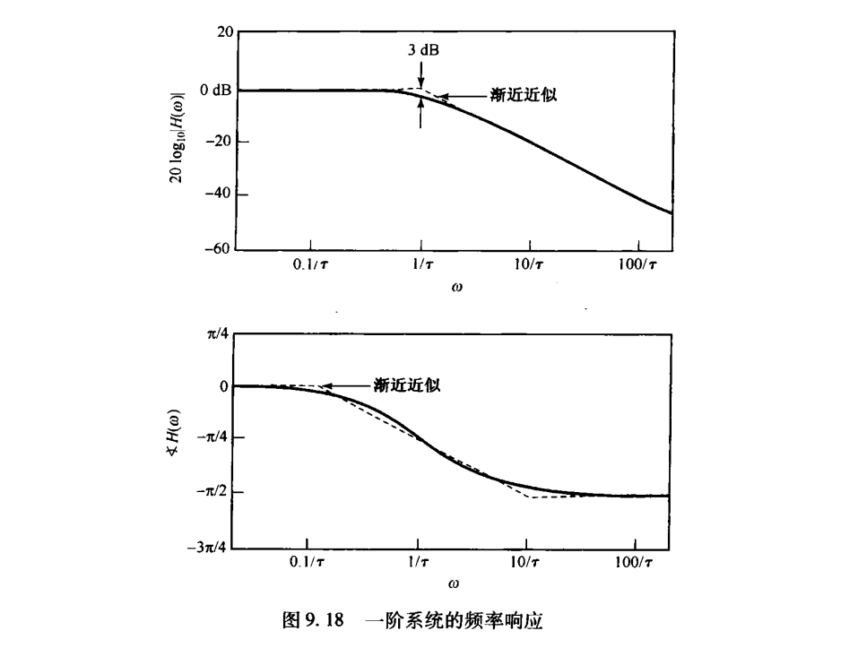

一阶系统的单位冲激响应与系统函数：

$$

h(t)=\dfrac{1}{\tau}e^{-t/\tau}u(t)
\qquad
H(s)=\dfrac{1}{s\tau+1}=\dfrac{1/\tau}{s+1/\tau},\qquad Re\{s\}>-\dfrac{1}{\tau} \tag{9.75, 9.76}
$$

**1. 零极点图**

$$

H(s)=\dfrac{1/\tau}{s+1/\tau}
$$

只有一个极点 $s=-1/\tau$（实轴左半平面），没有有限零点。极点到虚轴上一点 $s=j\omega$ 的**向量**为
$$

(\text{极点向量})=j\omega-\left(-\dfrac{1}{\tau}\right)=j\omega+\dfrac{1}{\tau}
$$

频率响应就是这些向量的模与相角之比：

$$

\left|H(j\omega)\right|=\frac{1/\tau}{\left|j\omega+1/\tau\right|}
\qquad
\angle H(j\omega)=-\angle\left(j\omega+\dfrac{1}{\tau}\right)
$$

**2. 由极点向量读出频率响应**

- 极点向量的长度 $\sqrt{\omega^{2}+1/\tau^{2}}$ 随 $\omega$ 单调增加 ⟹ $\left|H(j\omega)\right|$ 随 $\omega$ 单调**下降**；
- 极点向量的相角从 0 单调增加到 $\pi/2$ ⟹ 相位从 0 单调下降到 $-\pi/2$；
- 当 $\omega=1/\tau$ 时，向量的实部与虚部相等，长度是 $\omega=0$ 时的 $\sqrt{2}$ 倍，故模下降到 $\dfrac{1}{\sqrt{2}}$（即**下降 3 dB**），相位正好是 $-\pi/4$。

这就是把 $\omega=1/\tau$ 称为 **3 dB 点 / 转折频率**的原因（图 9-18 中标出了这一点，以及 -20 dB/dec 的直线渐近近似）。

**3. 极点位置与响应速度**

- 极点越靠**左**（$\tau$ 越小）⟹ 转折频率越高、冲激响应衰减越快、阶跃响应上升越快；
- 一般结论：**离 $j\omega$ 轴越远的极点，对应时域中衰减越快的项**。

<!--知识点4-->
## 四、拉普拉斯变换的性质

### 图 9-10　性质表与常用定理

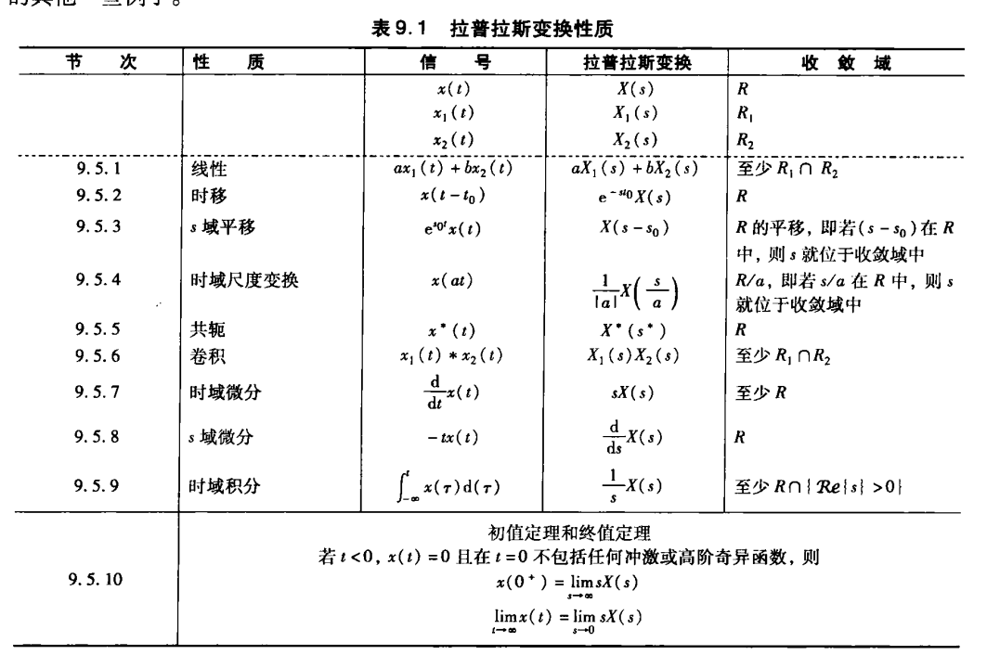

表中记 $x(t)\leftrightarrow X(s)$（收敛域 $R$）、$x_1(t)\leftrightarrow X_1(s)$（$R_1$）、$x_2(t)\leftrightarrow X_2(s)$（$R_2$）。下面把主要性质推一遍。

**1. 线性**

$$

ax_1(t)+bx_2(t)\ \longleftrightarrow\ aX_1(s)+bX_2(s),\qquad Re\{s\}\in R_1\cap R_2
$$

积分是线性运算，直接得到；收敛域至少是两者的交集（有时会扩大）。

**2. 时移**

$$

x(t-t_0)\ \longleftrightarrow\ \int_{-\infty}^{+\infty}x(t-t_0)e^{-st}dt
\overset{\tau=t-t_0}{=}\int x(\tau)e^{-s(\tau+t_0)}d\tau
=e^{-st_0}X(s)
$$

收敛域**不变**（时移不改变信号的增长性）。

**3. $s$ 域平移**

$$

e^{s_0t}x(t)\ \longleftrightarrow\ \int x(t)e^{-(s-s_0)t}dt=X(s-s_0)
$$

收敛域随之平移：$R$ 平移到 $R+s_0$。

**4. 时域尺度变换**

$$

x(at)\ \longleftrightarrow\ \int x(at)e^{-st}dt\overset{\tau=at}{=}\dfrac{1}{\left|a\right|}\int x(\tau)e^{-\frac{s}{a}\tau}d\tau
=\dfrac{1}{\left|a\right|}X\left(\dfrac{s}{a}\right)
$$

（$a>0$ 时上下限不变；$a<0$ 时上下限互换、补一个负号，与 $\dfrac{1}{a}$ 合成 $\dfrac{1}{|a|}$）。收敛域为 $R/a$。

**5. 卷积**

$$

x_1(t)*x_2(t)\ \longleftrightarrow\ X_1(s)X_2(s),\qquad Re\{s\}\in R_1\cap R_2
$$

推导与傅里叶变换的卷积性质完全相同（交换积分次序），把 $j\omega$ 换成 $s$ 即可。

**6. 时域微分**

$$

\boxed{\dfrac{dx(t)}{dt}\ \longleftrightarrow\ sX(s)}
$$

用分部积分：

$$

\int_{-\infty}^{+\infty}\dfrac{dx}{dt}e^{-st}dt
=\left[x(t)e^{-st}\right]_{-\infty}^{+\infty}+s\int_{-\infty}^{+\infty}x(t)e^{-st}dt=sX(s)
$$

（收敛域内 $x(t)e^{-st}\to0$，故边界项为零。）注意这是**双边**情形；单边情形多一项 $x(0^-)$，见第八节。

**7. $s$ 域微分**

$$

-tx(t)\ \longleftrightarrow\ \dfrac{dX(s)}{ds}
$$

由 $\dfrac{dX}{ds}=\int x(t)\left(-t\right)e^{-st}dt$ 直接得到。

**8. 时域积分**

$$

\int_{-\infty}^{t}x(\tau)d\tau\ \longleftrightarrow\ \dfrac{1}{s}X(s),\qquad Re\{s\}\in R\cap\left\{Re\{s\}>0\right\}
$$

多出的条件 $Re\{s\}>0$ 是为了让积分后的信号仍在收敛域内（直流分量可能使 $s=0$ 成为极点）。

**9. 补充：$s$ 域积分性质（重要）**

表中没有列出这一条，但考试常考，且它是 $s$ 域微分的"对偶"：

$$

\boxed{\mathscr{L}\left\{\dfrac{x(t)}{t}\right\}=\int_{s}^{+\infty}X(\sigma)\,d\sigma}
$$

**推导**：从定义出发，把 $X(\sigma)=\int_{0^-}^{+\infty}x(t)e^{-\sigma t}dt$ 两边对 $\sigma$ 从 $s$ 积分到 $+\infty$，并**交换积分次序**：

$$

\int_{s}^{+\infty}X(\sigma)d\sigma
=\int_{s}^{+\infty}\left[\int_{0^-}^{+\infty}x(t)e^{-\sigma t}dt\right]d\sigma
=\int_{0^-}^{+\infty}x(t)\left[\int_{s}^{+\infty}e^{-\sigma t}d\sigma\right]dt
$$

内层积分：$\displaystyle\int_{s}^{+\infty}e^{-\sigma t}d\sigma=\dfrac{e^{-st}}{t}$（$t>0$ 时才收敛）。于是

$$

\int_{s}^{+\infty}X(\sigma)d\sigma=\int_{0^-}^{+\infty}\dfrac{x(t)}{t}e^{-st}dt=\mathscr{L}\left\{\dfrac{x(t)}{t}\right\}
$$

**使用条件**：① $\dfrac{x(t)}{t}$ 在 $t=0$ 处要有定义（实用上要求 $x(0)=0$，否则 $t\to0$ 时发散）；② 积分 $\int_{s}^{+\infty}X(\sigma)d\sigma$ 收敛（$s$ 取得足够大）；③ $s$ 在 $x(t)/t$ 的收敛域内。一般 $x(t)/t$ 的收敛域比 $X(s)$ 的收敛域更宽。

**典型用法**（求 $\dfrac{\sin t}{t}u(t)$ 的变换）：

$$

\mathscr{L}\left\{\sin t\,u(t)\right\}=\dfrac{1}{s^{2}+1}
\quad\Longrightarrow\quad
\mathscr{L}\left\{\dfrac{\sin t}{t}u(t)\right\}=\int_{s}^{+\infty}\dfrac{d\sigma}{\sigma^{2}+1}
$$

$$

=\left.\arctan\sigma\right|_{s}^{+\infty}=\dfrac{\pi}{2}-\arctan s=\arctan\dfrac{1}{s},\qquad s>0
$$

**10. 初值定理与终值定理（含使用条件）**

$$

\boxed{x(0^+)=\lim_{s\to\infty}sX(s)}
\qquad
\boxed{\lim_{t\to\infty}x(t)=\lim_{s\to0}sX(s)}
$$

**初值定理的条件**

1. $t<0$ 时 $x(t)=0$（因果信号；单边变换天然满足）；
2. $x(t)$ 在 $t=0$ 处**不含冲激及其各阶导数**。
   若含冲激，必须先把 $X(s)$ 中对应的多项式部分扣掉，对剩余部分用定理。例如 $x(t)=\delta(t)+e^{-t}u(t)$ 时 $X(s)=1+\dfrac{1}{s+1}$，$\lim_{s\to\infty}sX(s)=\infty$，公式失效；应先扣掉那个 $1$（对应 $\delta(t)$），对 $\dfrac{1}{s+1}$ 用初值定理得 $1$，而 $x(0^+)=1$。

**终值定理的条件**

**$sX(s)$ 的全部极点都必须位于左半 $s$ 平面**（等价于 $x(t)$ 当 $t\to\infty$ 时有确定极限）。三种典型失效情形：

| 情形 | 例子 | $sX(s)$ | 原因 |
| :--- | :--- | :--- | :--- |
| 右半平面极点 | $x=e^{2t}u(t)$ | $\dfrac{s}{s-2}$ | 极限发散。公式给 0，实际为 $\infty$，**错** |
| 虚轴共轭极点 | $x=\cos t\,u(t)$ | $\dfrac{s^{2}}{s^{2}+1}$ | 等幅振荡，无极限。公式给 0，实际不存在 |
| 原点二阶以上极点 | $x=tu(t)$ | $\dfrac{1}{s}$ | 发散。公式给 $\infty$ |

反之，只要 $sX(s)$ 的极点全在左半平面（**允许 $X(s)$ 在原点有一阶极点**，此时 $sX(s)$ 在原点解析），终值定理就成立。例如 $x(t)=u(t)$，$X(s)=\dfrac{1}{s}$，$sX(s)=1$，终值 $=1$，与 $\lim_{t\to\infty}u(t)=1$ 一致。

<!--知识点5-->
## 五、因果性

### 图 9-12　因果性与收敛域

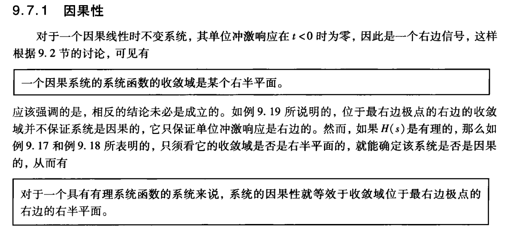

- 因果系统的单位冲激响应满足 $h(t)=0\ (t<0)$，即 $h(t)$ 是**右边信号**，所以它的收敛域是**某个右半平面**。

$$

\boxed{\text{因果}\ \Longrightarrow\ \text{收敛域为某个右半平面}}
$$

- 但要特别注意：**反过来不一定成立**。收敛域在最右边极点的右边，只能保证 $h(t)$ 是**右边信号**，不能保证 $h(t)=0\ (t<0)$——因为 $h(t)$ 在 $t<0$ 的小区间里仍可能非零，而收敛域只反映"整体增长性"。
- 不过若 $H(s)$ 是**有理**的，两者就等价：

$$

\boxed{H(s)\ \text{有理时：系统因果}\iff \text{收敛域位于最右边极点的右边}}
$$

6. [返回](#li-ti)例题6（判断因果性并与收敛域对照）

判断下列系统是否因果，并检查它们与收敛域的关系：  
**(a)** $h(t)=e^{-t}u(t)$；  
**(b)** $h(t)=e^{-|t|}$；  
**(c)** $H(s)=\dfrac{e^{s}}{s+1},\quad Re\{s\}>-1$。

  
点击查看解析与答案

  

**(a)** $t<0$ 时 $h(t)=0$，故**因果**。其系统函数

$$

H(s)=\dfrac{1}{s+1},\qquad Re\{s\}>-1
$$

极点在 $s=-1$，收敛域在最右极点的右边——与因果性一致 ✔

**(b)** $t<0$ 时 $h(t)=e^{-|t|}=e^{t}\ne0$，故**非因果**。由例题 2（取 $b=1$）：

$$

H(s)=\dfrac{-2}{s^{2}-1},\qquad -1<Re\{s\}<1
$$

极点在 $s=\pm1$，收敛域是两极点的**带状**区域，不是右半平面——与非因果性一致 ✔

**(c)** 收敛域 $Re\{s\}>-1$ 位于最右极点（$s=-1$）的右边，按"有理则等价"的说法似乎该判为因果；但这里 $e^{s}$ **不是有理函数**，所以不能套那条结论。用**时移性质**求出 $h(t)$ 再判断：

$$

e^{-t}u(t)\ \longleftrightarrow\ \dfrac{1}{s+1},\qquad Re\{s\}>-1
$$

而 $H(s)=\dfrac{e^{s}}{s+1}=\dfrac{1}{s+1}\cdot e^{s}$，即把时域信号**左移 1**：

$$

h(t)=e^{-(t+1)}u(t+1)
$$

它在 $-1<t<0$ 区间内**不为零**，所以系统**非因果** ✘

> 这正是书上的提示：因果性确实意味着收敛域在最右极点右边，但反向结论一般**不成立**，除非 $H(s)$ 是有理函数。(c) 就是反例——$e^{s}$ 这个"非有理因子"对应时域的超前。

  

<!--知识点6-->
## 六、稳定性

### 图 9-15　稳定性与 jω 轴

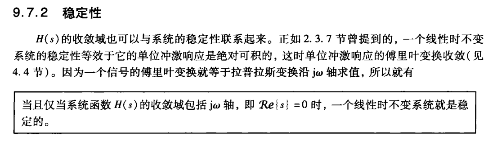

由第二章的结论，系统稳定 ⟺ 单位冲激响应绝对可积 ⟺ $h(t)$ 的**傅里叶变换收敛**。而傅里叶变换就是拉普拉斯变换**沿 $j\omega$ 轴**的取值，所以立刻得到：

$$

\boxed{\text{系统稳定}\iff H(s)\ \text{的收敛域包含}\ j\omega\ \text{轴（即}\ Re\{s\}=0\text{）}}
$$

7. [返回](#li-ti)例题7（同一个 H(s) 的三种收敛域与稳定性）

设系统函数为

$$

H(s)=\dfrac{s-1}{(s+1)(s-2)}
$$

请就三种不同的收敛域分别求出 $h(t)$，并判断系统的因果性与稳定性。

  
点击查看解析与答案

  

**部分分式**

$$

H(s)=\dfrac{s-1}{(s+1)(s-2)}=\dfrac{A}{s+1}+\dfrac{B}{s-2}
$$

$$

A=\left.\dfrac{s-1}{s-2}\right|_{s=-1}=\dfrac{-2}{-3}=\dfrac{2}{3}
\qquad
B=\left.\dfrac{s-1}{s+1}\right|_{s=2}=\dfrac{1}{3}
$$

$$

H(s)=\dfrac{2/3}{s+1}+\dfrac{1/3}{s-2}
$$

**情形 (a)：收敛域 $Re\{s\}>2$（因果）**

两个极点都在收敛域左边 ⟹ 两项都是右边信号：

$$

h(t)=\left(\dfrac{2}{3}e^{-t}+\dfrac{1}{3}e^{2t}\right)u(t)
$$

因果 ✔。但收敛域不含 $j\omega$ 轴（轴在 $Re\{s\}=0$，而收敛域是 $>2$）⟹ **不稳定** ✘（$e^{2t}$ 项发散）。

**情形 (b)：收敛域 $-1<Re\{s\}<2$（稳定）**

- 极点 $s=-1$：收敛域在其右边 ⟹ $e^{-t}u(t)$；
- 极点 $s=2$：收敛域在其左边 ⟹ $-\dfrac{1}{3}e^{2t}u(-t)$。

$$

h(t)=\dfrac{2}{3}e^{-t}u(t)-\dfrac{1}{3}e^{2t}u(-t)
$$

收敛域包含 $j\omega$ 轴 ⟹ **稳定** ✔（两项都绝对可积：$\int_0^\infty\frac23e^{-t}dt+\int_{-\infty}^0\frac13e^{2t}dt=\frac23+\frac16<\infty$）。

**情形 (c)：收敛域 $Re\{s\}<-1$（反因果）**

两个极点都在收敛域右边 ⟹ 两项都是左边信号：

$$

h(t)=-\left(\dfrac{2}{3}e^{-t}+\dfrac{1}{3}e^{2t}\right)u(-t)
$$

反因果 ✘，且收敛域不含 $j\omega$ 轴 ⟹ **不稳定** ✘。

**小结**：同一个代数式，**只有"带状收敛域跨过 $j\omega$ 轴"这一种**才是稳定的；而稳定与因果往往不能兼得（本题无"既因果又稳定"的收敛域可选，因为 $s=2$ 在右半平面）。

  

8. [返回](#li-ti)例题8（由条件信息反求系统函数，详解）

已知某 LTI 系统满足下列条件：  
1. 系统是**因果**的；  
2. 系统函数**有理**，且**只有两个极点**，分别在 $s=-2$ 与 $s=4$；  
3. 若输入 $x(t)=1$，则输出 $y(t)=0$；  
4. 单位冲激响应在 $t=0^{+}$ 处的值为 $4$。  

求该系统的系统函数 $H(s)$。

  
点击查看解析与答案

  

**第 ① 步：由条件 2 写出 $H(s)$ 的形式**

只有两个极点 $s=-2$、$s=4$，所以分母固定：

$$

H(s)=\dfrac{p(s)}{(s+2)(s-4)}=\dfrac{p(s)}{s^{2}-2s-8}
$$

其中 $p(s)$ 是待定的多项式（分子既可能低于、等于也可能高于分母的阶次）。

**第 ② 步：顺带判断稳定性**

条件 1 说系统因果，由第五节，收敛域必须是 $Re\{s\}>4$（最右极点 $s=4$ 的右边）。而 $Re\{s\}=0$ 的 $j\omega$ 轴**不在**这个收敛域内，所以系统**不稳定**（$s=4$ 在右半平面决定的）。本题不必用这一结论，但它可以帮你检查结果是否自洽。

**第 ③ 步：用条件 3 定出 $p(0)=0$**

$x(t)=1=e^{0\cdot t}$ 是系统的**特征函数**（对应 $s=0$），因此输出等于 $H(0)$ 乘以同一个 $e^{0\cdot t}$：

$$

y(t)=H(0)\cdot 1=H(0)
$$

已知 $y(t)=0$，故

$$

H(0)=\dfrac{p(0)}{-8}=0\quad\Longrightarrow\quad p(0)=0
$$

即 $p(s)$ 在 $s=0$ 处有根，可提出因子 $s$：

$$

p(s)=s\,q(s)
$$

**第 ④ 步：用条件 4 与初值定理定出 $q(s)$**

由初值定理，

$$

h(0^{+})=\lim_{s\to\infty}sH(s)=\lim_{s\to\infty}\dfrac{s^{2}q(s)}{s^{2}-2s-8}=4 \tag{9.138}
$$

分析这个极限的阶次：

- 分母是**二阶**多项式；要得到**有限非零**极限，$sH(s)$ 的分子必须是**二阶**，即 $q(s)$ 必须是**常数**（记作 $K$）。若 $q(s)$ 的次数 $\ge1$，分子阶次高于分母，极限发散；若 $q(s)=0$，极限为 0。
- 取 $q(s)=K$，则 $sH(s)=\dfrac{Ks^{2}}{s^{2}-2s-8}$，当 $s\to\infty$ 时分子分母的最高次项起主导作用，极限为 $K$。

由 (9.138) 得

$$

K=4\quad\Longrightarrow\quad p(s)=4s
$$

**第 ⑤ 步：结果**

$$

\boxed{H(s)=\dfrac{4s}{s^{2}-2s-8}=\dfrac{4s}{(s+2)(s-4)},\qquad Re\{s\}>4}
$$

**校验**

- 极点：$s=-2$、$s=4$ ✔（只有两个）；
- $H(0)=\dfrac{0}{-8}=0$ ✔（条件 3）；
- $h(0^{+})=\lim_{s\to\infty}\dfrac{4s^{2}}{s^{2}-2s-8}=4$ ✔（条件 4）；
- 因果 ⟹ 收敛域 $Re\{s\}>4$ ✔（最右极点右边）。

  

<!--知识点7-->
## 七、单边拉普拉斯变换

### 图 9-18　单边拉普拉斯变换的定义

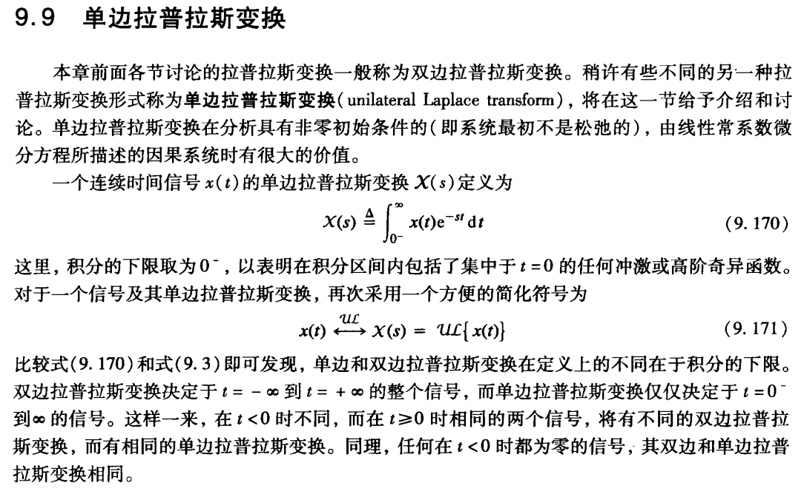

前面各节讨论的都是**双边**拉普拉斯变换。另一种形式是**单边**拉普拉斯变换：

$$

\boxed{X(s)\ \triangleq\ \int_{0^{-}}^{+\infty}x(t)e^{-st}dt} \tag{9.170}
$$

记作 $x(t)\overset{UL}{\longleftrightarrow}X(s)=\mathscr{UL}\{x(t)\}$。

**几个要点**

- 积分下限取 $0^{-}$ 而不是 $0$，是为了把**集中在 $t=0$ 的冲激或高阶奇异函数**也计入积分。
- 单边与双边的唯一区别就是**积分下限**：双边看整个信号（$-\infty\to+\infty$），单边只看 $t=0^{-}\to+\infty$ 的部分。
- 由此立刻得到：
  - 两个**在 $t<0$ 不同、在 $t\ge0$ 相同**的信号，双边变换不同，但**单边变换相同**；
  - 任何**在 $t<0$ 恒为零**的信号，其单边、双边变换**完全相同**。
- 正因为丢掉了 $t<0$ 的部分，**单边变换的收敛域总是某个右半平面**（有理时为最右极点之右），所以讨论单边变换时通常不再专门强调收敛域。
- 单边变换的价值在于分析**带非零初始条件**（即系统初始不松弛）的因果 LTI 系统——微分方程的初始条件会自然出现在变换里（见下一节的时域微分性质）。

<!--知识点8-->
## 八、单边拉普拉斯变换的性质

### 图 9-19　与双边不同的几条性质

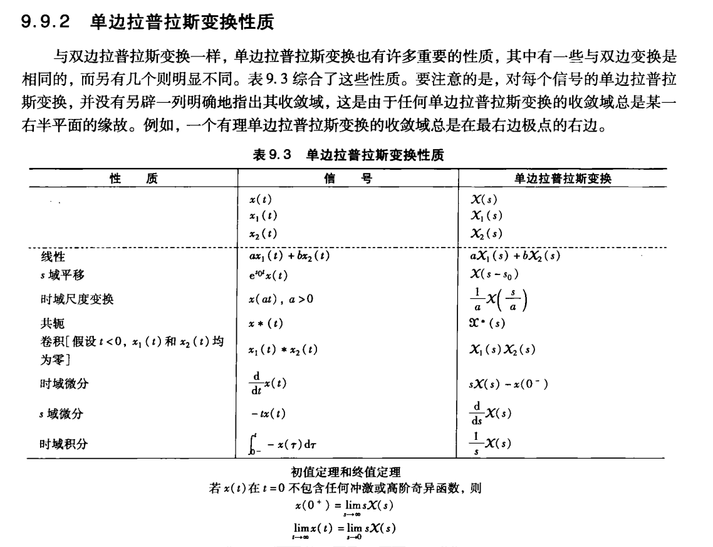

与双边相同的性质（线性、$s$ 域平移、时域尺度、共轭、$s$ 域微分）不再重复，这里只推**与双边不同**的几条。

**1. 时域微分（多出初始值项）**

$$

\boxed{\mathscr{L}\left\{\dfrac{dx(t)}{dt}\right\}=sX(s)-x(0^{-})}
$$

**推导**：分部积分，注意积分下限是 $0^{-}$：

$$

\int_{0^{-}}^{+\infty}\dfrac{dx}{dt}e^{-st}dt
=\left[x(t)e^{-st}\right]_{0^{-}}^{+\infty}+s\int_{0^{-}}^{+\infty}x(t)e^{-st}dt
$$

上界项在收敛域内趋于 0；下界项为 $-x(0^{-})e^{0}=-x(0^{-})$。故得 $sX(s)-x(0^{-})$。

**高阶推广**：

$$

\mathscr{L}\left\{\dfrac{d^{2}x}{dt^{2}}\right\}=s^{2}X(s)-s\,x(0^{-})-x'(0^{-})
$$

$$

\mathscr{L}\left\{\dfrac{d^{n}x}{dt^{n}}\right\}
=s^{n}X(s)-\sum_{k=0}^{n-1}s^{\,n-1-k}\,x^{(k)}(0^{-})
$$

> 对比：**双边**时域微分是 $\dfrac{dx}{dt}\leftrightarrow sX(s)$，**没有** $x(0^{-})$ 这一项。差别就来自双边积分跨越了整个 $t<0$，边界项 $\left[xe^{-st}\right]_{-\infty}^{+\infty}$ 两端都为 0；而单边只从 $0^{-}$ 开始积，下端留下了初始值。

**2. 时域积分（下限为 $0^{-}$）**

$$

\boxed{\mathscr{L}\left\{\int_{0^{-}}^{t}x(\tau)d\tau\right\}=\dfrac{1}{s}X(s)}
$$

注意积分下限是 $0^{-}$ 而不是 $-\infty$。与双边的 $\displaystyle\int_{-\infty}^{t}x(\tau)d\tau\leftrightarrow\dfrac{1}{s}X(s)$ 相比，单边版本"看不到" $t<0$ 的历史，因此形式更简单，也不需要额外加 $Re\{s\}>0$ 的条件（因为单边收敛域本身就是右半平面）。

**3. 卷积（需要"$t<0$ 为零"的前提）**

$$

\boxed{\mathscr{L}\left\{x_1(t)*x_2(t)\right\}=X_1(s)X_2(s)},\qquad \text{要求 }t<0\text{ 时 }x_1(t)=x_2(t)=0
$$

**为什么要加前提**：单边变换把 $t<0$ 的部分丢掉了，而卷积 $\displaystyle\int_{-\infty}^{+\infty}x_1(\tau)x_2(t-\tau)d\tau$ 需要整段积分。只有当两个信号在 $t<0$ 都为零时，卷积在 $t<0$ 也为零，单边与双边一致，性质才成立。

**4. 初值定理与终值定理**

$$

x(0^{+})=\lim_{s\to\infty}sX(s)
\qquad
\lim_{t\to\infty}x(t)=\lim_{s\to0}sX(s)
$$

条件：$x(t)$ 在 $t=0$ 处不含冲激或高阶奇异函数（否则要先扣除对应多项式），终值定理还要求 $sX(s)$ 的极点全在左半平面——详见第四节第 10 条。

<!--知识点9-->
## 九、z 变换的定义

### 图 10-1　z 变换的定义与系统函数

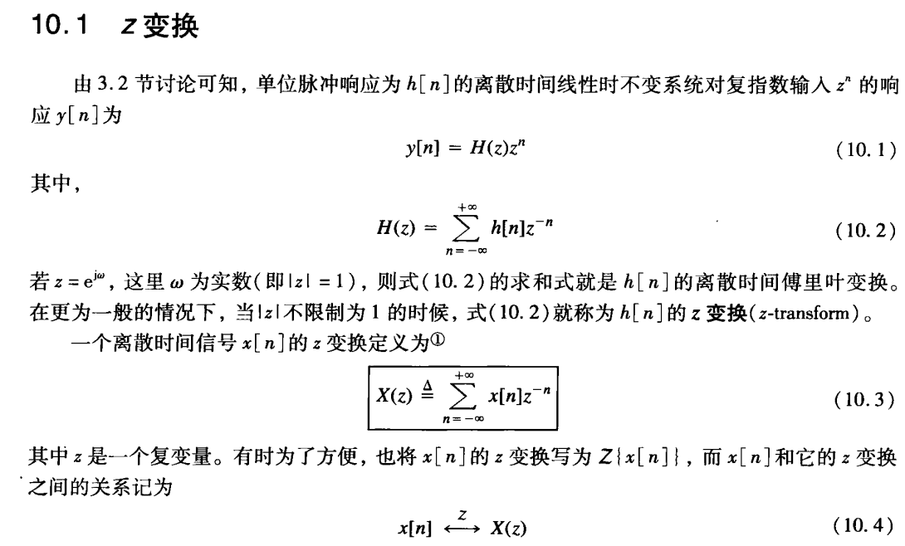

对单位脉冲响应为 $h[n]$ 的离散时间 LTI 系统，输入复指数 $z^{n}$ 时输出仍是同一个复指数乘一个系数：

$$

y[n]=H(z)z^{n}
$$

其中

$$

H(z)=\sum_{n=-\infty}^{+\infty}h[n]z^{-n} \tag{10.2}
$$

若 $z=e^{j\omega}$（即 $|z|=1$），式 (10.2) 的求和式就是 $h[n]$ 的**离散时间傅里叶变换**；当 $|z|$ 不限制为 $1$ 时，式 (10.2) 就称为 $h[n]$ 的 **z 变换**。

一般地，一个序列 $x[n]$ 的 z 变换定义为

$$

\boxed{X(z)\overset{\triangle}{=}\sum_{n=-\infty}^{+\infty}x[n]z^{-n}} \tag{10.3}
$$

其中 $z$ 是一个复变量，记 $x[n]$ 的 z 变换为 $\mathscr{Z}\{x[n]\}$，序列与它的变换之间的关系记为

$$

x[n]\overset{\mathscr{Z}}{\longleftrightarrow}X(z) \tag{10.4}
$$

三点理解：

- z 变换就是"先把序列乘上 $r^{-n}$（$r=|z|$）再做 DTFT"，即 $X(re^{j\omega})=\mathscr{F}\{x[n]r^{-n}\}$。这个 $r^{-n}$ 起的作用与拉普拉斯变换里的 $e^{-\sigma t}$ 完全一样——都是把发散的信号"压"成可积的。
- 正因为多了这个可以自由选择的衰减因子，**$X(z)$ 必须连带收敛域才唯一确定序列**。同一个代数式配上不同收敛域，对应的是完全不同的序列（下文例 10、例 15 会反复印证这一点）。
- 与拉普拉斯变换通过 $z=e^{sT}$ 相联系：$s$ 平面左半平面映射到单位圆内、右半平面映射到单位圆外、$j\omega$ 轴映射到单位圆。后面"因果看最外层极点、稳定看单位圆"的判据都源于此。

9. [返回](#li-ti)例题9（$a^{n}u[n]$ 的 z 变换与收敛域）

求序列 $x[n]=a^{n}u[n]$（$a$ 为实常数）的 z 变换。

**(1)** 按定义求和，写出 $X(z)$ 及其收敛域；  
**(2)** 指出 $X(z)$ 的零点与极点，并说明收敛域与极点位置的关系；  
**(3)** 分别判断 $a=\dfrac{1}{2}$、$a=1$、$a=2$ 三种情形下 $x[n]$ 的傅里叶变换是否存在。

  
点击查看解析与答案

  

**(1)** 由 $u[n]$ 知求和只看 $n\ge0$：

$$

X(z)=\sum_{n=-\infty}^{+\infty}a^{n}u[n]z^{-n}=\sum_{n=0}^{+\infty}\left(az^{-1}\right)^{n}
$$

这是公比为 $az^{-1}$ 的等比级数，收敛的充要条件是 $\left|az^{-1}\right|<1$，即 $|z|>|a|$。于是

$$

\boxed{X(z)=\dfrac{1}{1-az^{-1}}=\dfrac{z}{z-a}},\qquad |z|>|a| \tag{10.9}
$$

序列的形状就是"从 $1$ 开始按 $a$ 逐点衰减"：

![例 9 的序列 $a^{n}u[n]$（取 $a=0.7$）](./images/ch10-ex9-sequence.png)

**(2)** 把 $X(z)=\dfrac{z}{z-a}$ 写成多项式之比：分子 $z$ 的根是**零点** $z=0$，分母 $z-a$ 的根是**极点** $z=a$。收敛域 $|z|>|a|$ 恰好是半径等于极点模的**圆外**，这正是性质 8（右边序列的收敛域在最外层极点的外边）。

**(3)** 收敛域含不含单位圆 $|z|=1$，决定 DTFT 是否存在：

- $a=\dfrac{1}{2}$：收敛域 $|z|>\dfrac12$ 含单位圆，DTFT 存在，即 $\dfrac{1}{1-\frac12 e^{-j\omega}}$；
- $a=1$：$x[n]=u[n]$，收敛域 $|z|>1$ 不含单位圆（$z=1$ 正好是极点），DTFT 在通常意义下不收敛；
- $a=2$：$x[n]=2^{n}u[n]$ 本身发散，收敛域 $|z|>2$ 不含单位圆，DTFT 不存在。

  

10. [返回](#li-ti)例题10（左边序列：同一代数式、不同收敛域）

设 $x[n]=-a^{n}u[-n-1]$。

**(1)** 求它的 z 变换及收敛域；  
**(2)** 与例题 9 比较：$X(z)$ 的代数式、零点极点、收敛域各有什么异同？  
**(3)** 若只告诉你 $X(z)=\dfrac{z}{z-0.5}$，能否唯一确定序列？还需要补充什么信息？

  
点击查看解析与答案

  

**(1)** 按定义：

$$

X(z)=-\sum_{n=-\infty}^{+\infty}a^{n}u[-n-1]z^{-n}=-\sum_{n=-\infty}^{-1}a^{n}z^{-n}
$$

令 $m=-n$（$m$ 从 $1$ 到 $+\infty$）：

$$

X(z)=-\sum_{m=1}^{+\infty}a^{-m}z^{m}=1-\sum_{m=0}^{+\infty}\left(a^{-1}z\right)^{m} \tag{10.10}
$$

等比级数收敛要求 $\left|a^{-1}z\right|<1$，即 $|z|<|a|$。此时

$$

X(z)=1-\dfrac{1}{1-a^{-1}z}=\dfrac{1}{1-az^{-1}}=\dfrac{z}{z-a},\qquad |z|<|a| \tag{10.11}
$$

**(2)** 把两个例子并排看（取 $a=0.5$）：

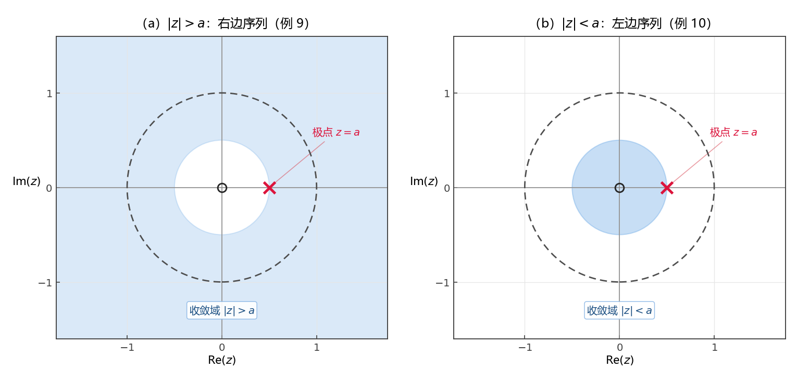

- 代数式：都是 $\dfrac{z}{z-a}$，**完全相同**；
- 零点与极点：都是零点 $z=0$、极点 $z=a$，**完全相同**；
- 收敛域：例 9 是 $|z|>|a|$（极点外），本例是 $|z|<|a|$（极点内），**正好互补**。

所以"z 变换"永远是"代数式 $+$ 收敛域"这一对；只写代数式是没法反推出序列的。

**(3)** 不能唯一确定。$\dfrac{z}{z-0.5}$ 有两种取法：

$$

|z|>0.5\ \Longrightarrow\ x[n]=\left(\dfrac{1}{2}\right)^{n}u[n];\qquad
|z|<0.5\ \Longrightarrow\ x[n]=-\left(\dfrac{1}{2}\right)^{n}u[-n-1]
$$

所以必须补充收敛域。顺带一句：前者收敛域含单位圆 $|z|=1$，有 DTFT；后者不含，DTFT 不收敛。

  

11. [返回](#li-ti)例题11（双边序列 $b^{|n|}$ 的收敛域）

设 $x[n]=b^{|n|}$（$b>0$）。

**(1)** 把它拆成右边序列与左边序列之和；  
**(2)** 求 $X(z)$ 及其收敛域，并说明 $b$ 满足什么条件时这个 z 变换才存在；  
**(3)** 取 $b=\dfrac{1}{2}$，写出 $X(z)$ 的零点与极点，并画出收敛域。

  
点击查看解析与答案

  

**(1)** 这是**双边**序列，按 $n\ge0$ 与 $n\le-1$ 拆成一个右边序列加一个左边序列：

$$

x[n]=b^{n}u[n]+b^{-n}u[-n-1] \tag{10.32}
$$

**(2)** 分别用例 9 与例 10 的结果（第二项取 $a=1/b$）：

$$

b^{n}u[n]\overset{\mathscr{Z}}{\longleftrightarrow}\dfrac{1}{1-bz^{-1}},\qquad |z|>b \tag{10.33}
$$

$$

b^{-n}u[-n-1]\overset{\mathscr{Z}}{\longleftrightarrow}\dfrac{-1}{1-b^{-1}z^{-1}},\qquad |z|<\dfrac{1}{b} \tag{10.34}
$$

两项相加，收敛域取**交集**：

$$

X(z)=\dfrac{1}{1-bz^{-1}}-\dfrac{1}{1-b^{-1}z^{-1}}
=\dfrac{\left(b-\dfrac{1}{b}\right)z}{\left(z-b\right)\left(z-\dfrac{1}{b}\right)},\qquad b<|z|<\dfrac{1}{b}
$$

交集非空要求 $b<\dfrac{1}{b}$，即 $0<b<1$。此时收敛域是一个**环带**，包含单位圆，$b^{|n|}$ 的 DTFT 存在。若 $b\ge1$，交集为空（环带退化成空集），z 变换**不存在**——序列在 $n\to\pm\infty$ 两侧都不衰减，两边都发散。

**(3)** 取 $b=\dfrac{1}{2}$，则 $b-\dfrac{1}{b}=\dfrac12-2=-\dfrac32$，于是

$$

X(z)=-\dfrac{3}{2}\cdot\dfrac{z}{\left(z-\dfrac{1}{2}\right)\left(z-2\right)},\qquad \dfrac{1}{2}<|z|<2
$$

零点 $z=0$，两个极点 $z=\dfrac12$ 与 $z=2$；收敛域夹在这两个极点之间：

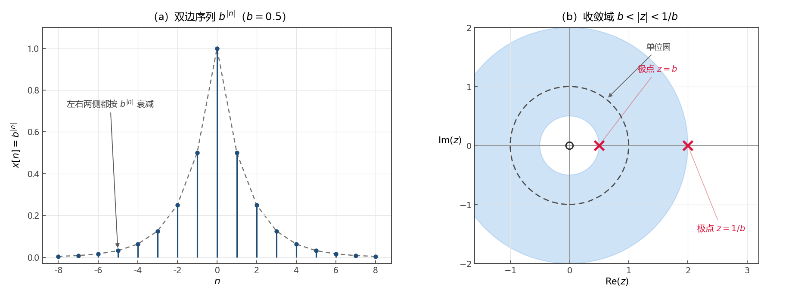

  

<!--知识点10-->
## 十、z 变换的收敛域

### 图 10-5　收敛域与极点的关系

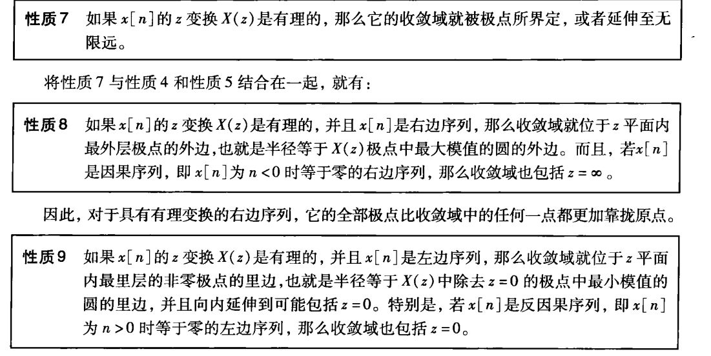

z 变换的收敛域就是使 $\sum\left|x[n]z^{-n}\right|<+\infty$ 的那些 $z$ 组成的集合，它由 $|z|$ 决定，因此在 z 平面上总是**以原点为中心的圆（环）**。对于有理的 $X(z)$，还有更具体的结论：

- **性质 7**：若 $x[n]$ 的 z 变换 $X(z)$ 是有理的，则它的收敛域被**极点**所界定，或者延伸至无穷远。
- **性质 8**：若 $X(z)$ 有理且 $x[n]$ 是**右边序列**，则收敛域位于最外层极点的外边，即半径等于极点最大模值的圆外；若 $x[n]$ 是**因果**序列（$n<0$ 时为零），还包括 $z=\infty$。
- **性质 9**：若 $X(z)$ 有理且 $x[n]$ 是**左边序列**，则收敛域位于最里层非零极点的里边，并向内延伸至可能包括 $z=0$；若 $x[n]$ 是**反因果**序列（$n>0$ 时为零），还包括 $z=0$。

常用结论汇总：

| 序列类型 | 收敛域形状 | 典型例子 |
| :--- | :--- | :--- |
| 有限长 | 整个 z 平面（可能除去 $z=0$ 或 $z=\infty$） | $\delta[n]$、$\delta[n-m]$ |
| 右边 | 某圆外部 $\vert z\vert >r_{\max}$ | $a^{n}u[n]$ |
| 左边 | 某圆内部 $\vert z\vert <r_{\min}$ | $-a^{n}u[-n-1]$ |
| 双边 | 环带 $r_1<\vert z\vert <r_2$ | $b^{\vert n\vert }$（$0<b<1$） |

由此还可以反推序列的"边性"：知道收敛域是圆外、圆内还是环带，就知道序列是右边、左边还是双边——这就是用收敛域判因果性的依据（见第十三节）。

12. [返回](#li-ti)例题12（由极点写出所有可能的收敛域）

已知

$$

X(z)=\dfrac{1}{\left(1-\dfrac{1}{3}z^{-1}\right)\left(1-2z^{-1}\right)} \tag{10.37}
$$

**(1)** 求出 $X(z)$ 的极点，并列出与它相容的**所有**收敛域；  
**(2)** 对每种收敛域，写出对应的序列 $x[n]$；  
**(3)** 三种收敛域中哪一种使系统稳定？它对应因果系统吗？

  
点击查看解析与答案

  

**(1)** 分母的两个根给出两个极点：$z=\dfrac{1}{3}$ 与 $z=2$。按性质 7，收敛域被极点界定，所以两个极点把 z 平面切成三块，每一块都是一个合法收敛域：

$$

\text{(a) }|z|>2,\qquad \text{(b) }\dfrac{1}{3}<|z|<2,\qquad \text{(c) }|z|<\dfrac{1}{3}
$$

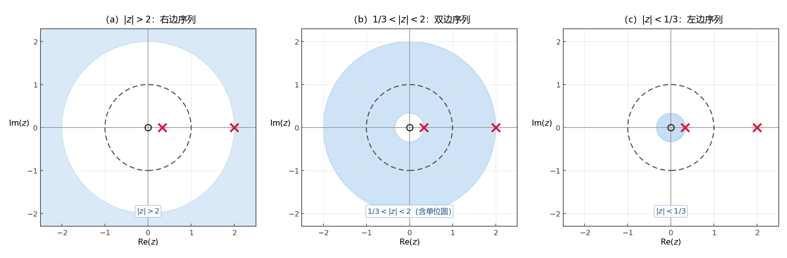

**(2)** 先把 $X(z)$ 按 $z^{-1}$ 展开成部分分式：

$$

X(z)=\dfrac{-1/5}{1-\dfrac{1}{3}z^{-1}}+\dfrac{6/5}{1-2z^{-1}}
$$

**(a)** $|z|>2$：两项的收敛域都在各自极点之外，都取右边：

$$

x[n]=\left[-\dfrac{1}{5}\left(\dfrac{1}{3}\right)^{n}+\dfrac{6}{5}2^{n}\right]u[n]
$$

**(b)** $\dfrac{1}{3}<|z|<2$：第一项在 $z=\dfrac13$ 外（取右边），第二项在 $z=2$ 内（取左边）：

$$

x[n]=-\dfrac{1}{5}\left(\dfrac{1}{3}\right)^{n}u[n]-\dfrac{6}{5}2^{n}u[-n-1]
$$

**(c)** $|z|<\dfrac{1}{3}$：两项都在各自极点之内，都取左边：

$$

x[n]=\dfrac{1}{5}\left(\dfrac{1}{3}\right)^{n}u[-n-1]-\dfrac{6}{5}2^{n}u[-n-1]
$$

**(3)** 三种收敛域里**只有 (b) 包含单位圆**（$\dfrac{1}{3}<1<2$），所以只有它对应的序列有傅里叶变换、系统稳定；但 (b) 是环带，对应双边序列，**不因果**。(a) 因果但不稳定。

本例的极点在单位圆外（$z=2$），所以不存在使系统既因果又稳定的收敛域——因果要求取 $|z|>2$，而这个区域不含单位圆。

  

<!--知识点11-->
## 十一、z 逆变换

### 图 10-7　z 逆变换的围线积分公式

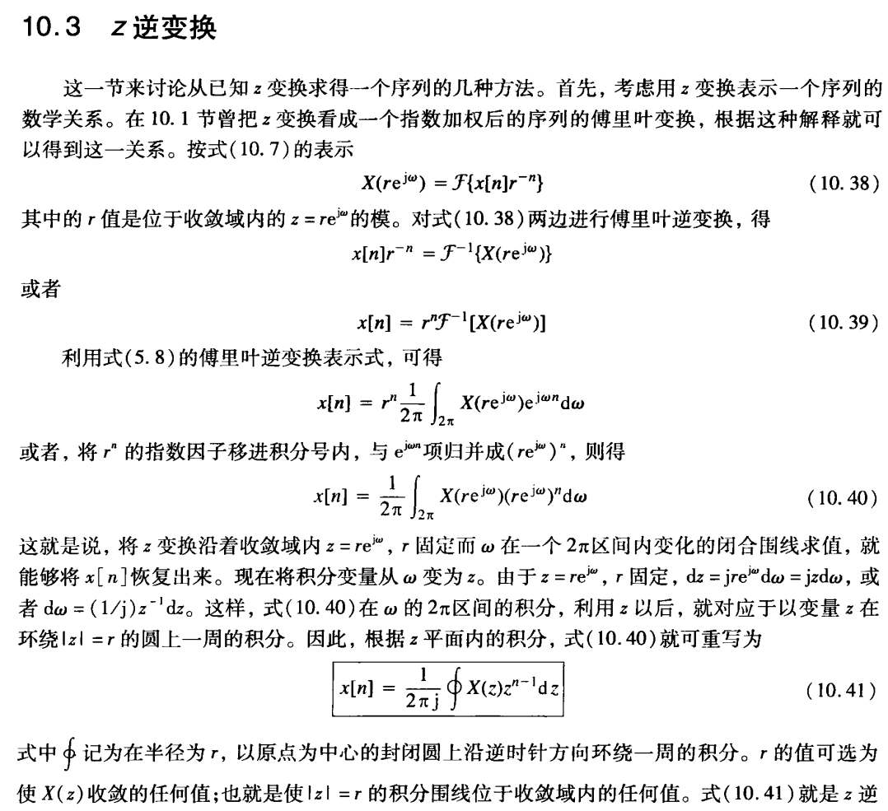

把 z 变换看成"指数加权后的傅里叶变换"：$X(re^{j\omega})=\mathscr{F}\{x[n]r^{-n}\}$，其中 $r$ 取在收敛域内。对 $\omega$ 做逆 DTFT 得 $x[n]r^{-n}$，再乘回 $r^{n}$：

$$

x[n]=\dfrac{1}{2\pi}\int_{2\pi}X(re^{j\omega})\left(re^{j\omega}\right)^{n}d\omega \tag{10.40}
$$

令 $z=re^{j\omega}$，则 $dz=jre^{j\omega}d\omega=jz\,d\omega$，即 $d\omega=\dfrac{1}{j}z^{-1}dz$。$\omega$ 在一个 $2\pi$ 区间变化，正好对应 $z$ 沿半径 $r$ 的圆绕行一周，于是

$$

\boxed{x[n]=\dfrac{1}{2\pi j}\oint X(z)z^{n-1}dz} \tag{10.41}
$$

其中 $\oint$ 表示在半径为 $r$、以原点为圆心的圆上沿逆时针方向绕行一周，$r$ 的取值就是"使 $|z|=r$ 整个落在收敛域内"的任意值。

**这个积分实用中几乎不用**，真正好用的是"部分分式展开 $+$ 查表"：

1. 把 $X(z)$ 按 $z^{-1}$ 展开成部分分式；
2. 逐项查表，**每一项取右边还是取左边由收敛域决定**；
3. 把各项加起来。

| 项的极点 | 该项的收敛域 | 对应的时域项 |
| :--- | :--- | :--- |
| $z=a$ | $\vert z\vert >\vert a\vert $ | $a^{n}u[n]$ |
| $z=a$ | $\vert z\vert <\vert a\vert $ | $-a^{n}u[-n-1]$ |

记忆口诀：**收敛域在极点外 $\to$ 右边、用 $u[n]$；在极点内 $\to$ 左边、用 $-u[-n-1]$**。部分分式展开是"按 $z^{-1}$ 展开"，所以每个系数的求法与拉普拉斯变换的部分分式完全平行。

13. [返回](#li-ti)例题13（收敛域在最外层极点外：右边序列）

已知

$$

X(z)=\dfrac{3-\dfrac{5}{6}z^{-1}}{\left(1-\dfrac{1}{4}z^{-1}\right)\left(1-\dfrac{1}{3}z^{-1}\right)},\qquad |z|>\dfrac{1}{3} \tag{10.42}
$$

**(1)** 把它展开成部分分式；  
**(2)** 求 $x[n]$，并说明每一项取右边还是取左边的依据；  
**(3)** 判断 $x[n]$ 的边性与因果性，并指出它有没有 DTFT。

  
点击查看解析与答案

  

**(1)** 极点为 $z=\dfrac14$ 与 $z=\dfrac13$，部分分式展开：

$$

X(z)=\dfrac{1}{1-\dfrac{1}{4}z^{-1}}+\dfrac{2}{1-\dfrac{1}{3}z^{-1}} \tag{10.43}
$$

**(2)** 最外层极点的模是 $\dfrac13$，收敛域 $|z|>\dfrac13$ 位于它之外，所以 $x[n]$ 是**右边序列**。每一项的收敛域都必须与总收敛域相容，也就是取各自极点的外边（$|z|>\dfrac14$ 与 $|z|>\dfrac13$），两项都取右边，查表得

$$

x[n]=\left(\dfrac{1}{4}\right)^{n}u[n]+2\left(\dfrac{1}{3}\right)^{n}u[n] \tag{10.49}
$$

**(3)** $n<0$ 时两项都是零 $\to$ 右边序列 $\to$ **因果**。收敛域 $|z|>\dfrac13$ 含单位圆，所以它还有 DTFT（对应稳定系统）。

  

14. [返回](#li-ti)例题14（收敛域是环带：一项右边、一项左边）

同一个代数式

$$

X(z)=\dfrac{3-\dfrac{5}{6}z^{-1}}{\left(1-\dfrac{1}{4}z^{-1}\right)\left(1-\dfrac{1}{3}z^{-1}\right)}
$$

但收敛域改为 $\dfrac{1}{4}<|z|<\dfrac{1}{3}$。

**(1)** 部分分式展开式 (10.43) 不变，指出每一项应取右边还是左边；  
**(2)** 求 $x[n]$；  
**(3)** 判断 $x[n]$ 的边性，并说明这个收敛域含不含单位圆。

  
点击查看解析与答案

  

**(1)** 关键看极点在收敛域的里侧还是外侧：

- 极点 $z=\dfrac14$ 的模比环带的内半径小，收敛域在它**外边** $\to$ 这一项取右边；
- 极点 $z=\dfrac13$ 的模比环带的外半径大，收敛域在它**里边** $\to$ 这一项取左边。

**(2)** 于是

$$

x_1[n]=\left(\dfrac{1}{4}\right)^{n}u[n],\qquad |z|>\dfrac{1}{4} \tag{10.50}
$$

$$

x_2[n]=-2\left(\dfrac{1}{3}\right)^{n}u[-n-1],\qquad |z|<\dfrac{1}{3} \tag{10.51}
$$

$$

x[n]=\left(\dfrac{1}{4}\right)^{n}u[n]-2\left(\dfrac{1}{3}\right)^{n}u[-n-1] \tag{10.53}
$$

**(3)** 收敛域是环带，序列两边都有值 $\to$ **双边序列**，既不因果也不反因果。环带 $\dfrac14<|z|<\dfrac13$ **不含**单位圆（因为 $\dfrac13<1$），所以这个序列没有 DTFT。

  

15. [返回](#li-ti)例题15（收敛域在最里层极点内：左边序列）

仍是同一个代数式，收敛域为 $|z|<\dfrac{1}{4}$。

**(1)** 求每一项的收敛域及对应的序列；  
**(2)** 求 $x[n]$；  
**(3)** 把例题 13、14、15 的结果放在一起比较，说明"只给代数式不够"。

  
点击查看解析与答案

  

**(1)** 收敛域 $|z|<\dfrac{1}{4}$ 位于**两个极点的里侧**，所以两项都要取各自极点的里边，都是左边序列。第一项：

$$

x_1[n]=-\left(\dfrac{1}{4}\right)^{n}u[-n-1],\qquad |z|<\dfrac{1}{4} \tag{10.54}
$$

第二项与例题 14 的 $x_2[n]$ 相同（式 10.51）。

**(2)** 相加得

$$

x[n]=-\left(\dfrac{1}{4}\right)^{n}u[-n-1]-2\left(\dfrac{1}{3}\right)^{n}u[-n-1]
$$

**(3)** 三问的代数式完全相同，只是收敛域不同，却得到三个完全不同的序列：

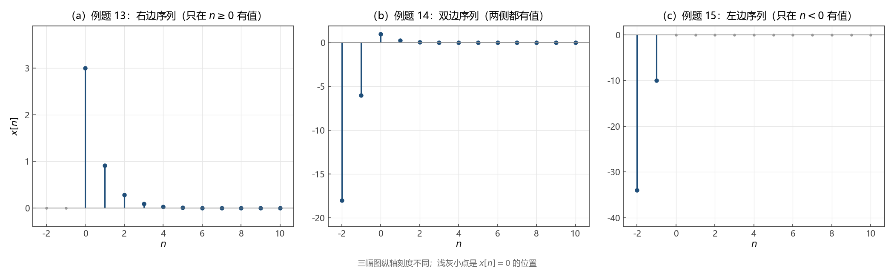

- 例题 13（$|z|>\dfrac13$）：只在 $n\ge0$ 有值，**右边**序列，因果；
- 例题 14（$\dfrac14<|z|<\dfrac13$）：两侧都有值，**双边**序列；
- 例题 15（$|z|<\dfrac14$）：只在 $n<0$ 有值，**左边**序列，反因果。

这正是"求 z 逆变换必须给出收敛域"的最好说明：代数式只决定零极点位置，收敛域才决定序列长在哪一侧。

  

<!--知识点12-->
## 十二、z 变换的性质

### 图 10-11　性质表与初值定理

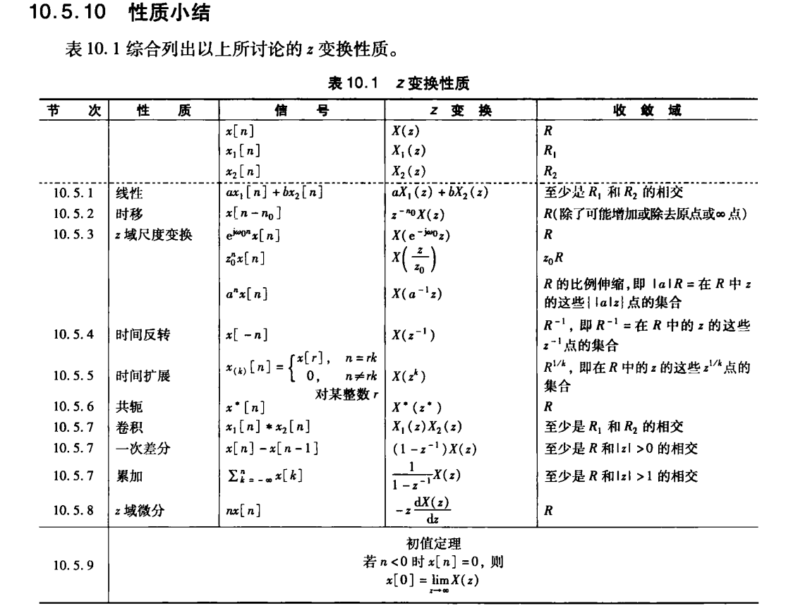

表中记 $x[n]\leftrightarrow X(z)$（收敛域 $R$）、$x_1[n]\leftrightarrow X_1(z)$（$R_1$）、$x_2[n]\leftrightarrow X_2(z)$（$R_2$）。下面把主要性质推一遍。

**1. 线性**

$$

ax_1[n]+bx_2[n]\ \longleftrightarrow\ aX_1(z)+bX_2(z),\qquad \text{至少是 }R_1\cap R_2
$$

求和是线性的，直接得到；收敛域至少是两者的交集（有时会扩大）。

**2. 时移**

$$

x[n-n_0]\ \longleftrightarrow\ \sum_{n}x[n-n_0]z^{-n}\overset{m=n-n_0}{=}\sum_{m}x[m]z^{-(m+n_0)}=z^{-n_0}X(z)
$$

收敛域仍是 $R$（可能增加或除去原点或 $\infty$ 点）。

**3. z 域尺度变换**

$$

z_0^{n}x[n]\ \longleftrightarrow\ \sum_{n}z_0^{n}x[n]z^{-n}=\sum_{n}x[n]\left(\dfrac{z}{z_0}\right)^{-n}=X\left(\dfrac{z}{z_0}\right)
$$

收敛域为 $z_0R$（即 $R$ 里每个 $z$ 乘上 $z_0$）。两个常用的特例：

- $a^{n}x[n]\leftrightarrow X\left(a^{-1}z\right)$；
- $e^{j\omega_0 n}x[n]\leftrightarrow X\left(e^{-j\omega_0}z\right)$。

**这条才是拉普拉斯变换"$s$ 域平移"的对偶**。拉普拉斯变换里有 $e^{s_0t}x(t)\leftrightarrow X(s-s_0)$，令 $z_0=e^{s_0T}$ 就得到 $z_0^{n}x[n]\leftrightarrow X\left(z/z_0\right)$——两者是同一个结论在 $z=e^{sT}$ 下的翻译。而 $e^{j\omega_0 n}$ 只是其中 $s_0=j\omega_0$ 的特例：它不改变 $|z|$，只把单位圆上的频率整体旋转 $\omega_0$，对应连续时间傅里叶变换的频移性质。

**4. 时间反转**

$$

x[-n]\ \longleftrightarrow\ \sum_{n}x[-n]z^{-n}\overset{m=-n}{=}\sum_{m}x[m]\left(z^{-1}\right)^{-m}=X\left(z^{-1}\right)
$$

收敛域为 $R^{-1}$：把 $R$ 中每个 $z$ 换成 $z^{-1}$，圆内变成圆外、圆外变成圆内。

**5. 时间扩展**

$$

x_{(k)}[n]=\begin{cases}x[m], & n=mk\\ 0, & n\ne mk\end{cases}
\qquad\longleftrightarrow\qquad X\left(z^{k}\right)
$$

推导只需把 $n=mk$ 代入：$\sum_{m}x[m]z^{-mk}=\sum_{m}x[m]\left(z^{k}\right)^{-m}=X\left(z^{k}\right)$。收敛域为 $R^{1/k}$。

**6. 共轭**

$$

x^{*}[n]\ \longleftrightarrow\ \sum_{n}x^{*}[n]z^{-n}=\left[\sum_{n}x[n]\left(z^{*}\right)^{-n}\right]^{*}=X^{*}\left(z^{*}\right)
$$

收敛域仍为 $R$。当 $x[n]$ 是实序列时，$X(z)=X^{*}\left(z^{*}\right)$，即零极点共轭成对出现、且关于实轴对称。

**7. 卷积**

$$

x_1[n]*x_2[n]=\sum_{k}x_1[k]x_2[n-k]\ \longleftrightarrow\ \sum_{k}x_1[k]z^{-k}\sum_{n}x_2[n-k]z^{-(n-k)}=X_1(z)X_2(z)
$$

收敛域至少是 $R_1\cap R_2$。交换求和次序即可，与傅里叶变换、拉普拉斯变换的卷积性质完全同构。

**8. 一次差分**

$$

x[n]-x[n-1]\ \longleftrightarrow\ X(z)-z^{-1}X(z)=\left(1-z^{-1}\right)X(z)
$$

收敛域至少是 $R\cap\left\{|z|>0\right\}$。

**9. 累加**

注意 $\sum_{k=-\infty}^{n}x[k]=x[n]*u[n]$，于是

$$

\sum_{k=-\infty}^{n}x[k]\ \longleftrightarrow\ X(z)\cdot\dfrac{1}{1-z^{-1}},\qquad \text{收敛域至少是 }R\cap\left\{|z|>1\right\}
$$

多出来的 $|z|>1$ 正是 $u[n]$ 自己的收敛域——累加会把序列的直流分量留下来，相当于"在 $z=1$ 处增加一个极点"，所以必须把 $z=1$ 排除在收敛域之外。这一条与第 8 条互为逆运算：差分乘 $\left(1-z^{-1}\right)$，累加除 $\left(1-z^{-1}\right)$。

**10. z 域微分**

$$

n\,x[n]\ \longleftrightarrow\ -z\dfrac{dX(z)}{dz}
$$

推导：

$$

-z\dfrac{dX}{dz}=-z\sum_{n}x[n]\left(-n\right)z^{-n-1}=\sum_{n}n\,x[n]z^{-n}
$$

收敛域仍为 $R$。（在拉普拉斯变换里对应的是 $-tx(t)\leftrightarrow\dfrac{dX(s)}{ds}$，见第四节第 7 条。）

**11. 补充：初值定理与终值定理（含使用条件）**

表 10.1 最后只列了**初值定理**，这里把**终值定理**一并补上（两式都是对单边 z 变换而言的，单边与双边的差别见第十六节）：

$$

\boxed{x[0]=\lim_{z\to\infty}X(z)},\qquad \boxed{\lim_{n\to\infty}x[n]=\lim_{z\to1}\left(z-1\right)X(z)}
$$

**初值定理的条件**

1. $n<0$ 时 $x[n]=0$（因果序列，单边变换天然满足）；
2. $X(z)$ 中**不含 $z$ 的正幂项**，即把它写成 $z$ 的多项式之比时，分子的阶次不高于分母的阶次。若含正幂项，必须先把对应 $\delta[n+k]$ 的多项式部分扣掉，对剩余部分用定理。

反例：$x[n]=\delta[n+1]$，则 $X(z)=z$，$\lim_{z\to\infty}X(z)=\infty$，而 $x[0]=0$——公式失效。扣掉 $z$（对应 $\delta[n+1]$）之后剩余为 $0$，才与 $x[0]=0$ 一致。

**终值定理的条件**

**$\left(z-1\right)X(z)$ 的全部极点都必须严格位于单位圆内**。等价的说法是：$X(z)$ 只允许在 $z=1$ 处有**一阶**极点，其余极点全在单位圆内。三种典型失效情形：

| 情形 | 例子 | $X(z)$ | $\left(z-1\right)X(z)$ | 结果 |
| :--- | :--- | :--- | :--- | :--- |
| 单位圆外极点 | $x[n]=2^{n}u[n]$ | $\dfrac{z}{z-2}$ | $\dfrac{z\left(z-1\right)}{z-2}$ | 公式给 $0$，实际 $\to\infty$，**错** |
| 单位圆上一阶共轭极点 | $x[n]=\left(-1\right)^{n}u[n]$ | $\dfrac{z}{z+1}$ | $\dfrac{z\left(z-1\right)}{z+1}$ | 等幅振荡，极限不存在，公式给 $0$ |
| 单位圆上二阶极点 | $x[n]=nu[n]$ | $\dfrac{z}{\left(z-1\right)^{2}}$ | $\dfrac{z}{z-1}$ | 线性增长，公式给 $\infty$，无有限终值 |

反之，只要 $\left(z-1\right)X(z)$ 的极点全在单位圆内，终值定理就成立。两个可以自检的例子：

- $x[n]=u[n]$，$X(z)=\dfrac{z}{z-1}$，$\left(z-1\right)X(z)=z$ 在 $z=1$ 处只有一个非零值、没有极点，终值 $=\left.z\right|_{z=1}=1$，与 $\lim_{n\to\infty}u[n]=1$ 一致；
- $x[n]=\left(\dfrac{1}{2}\right)^{n}u[n]$，$X(z)=\dfrac{z}{z-\frac12}$，$\left(z-1\right)X(z)=\dfrac{z\left(z-1\right)}{z-\frac12}$ 的极点在 $z=\dfrac12$（圆内），终值 $=\left.\dfrac{z\left(z-1\right)}{z-\frac12}\right|_{z=1}=0$，与序列趋于 $0$ 一致。

<!--知识点13-->
## 十三、因果性

### 图 10-13　因果性与收敛域

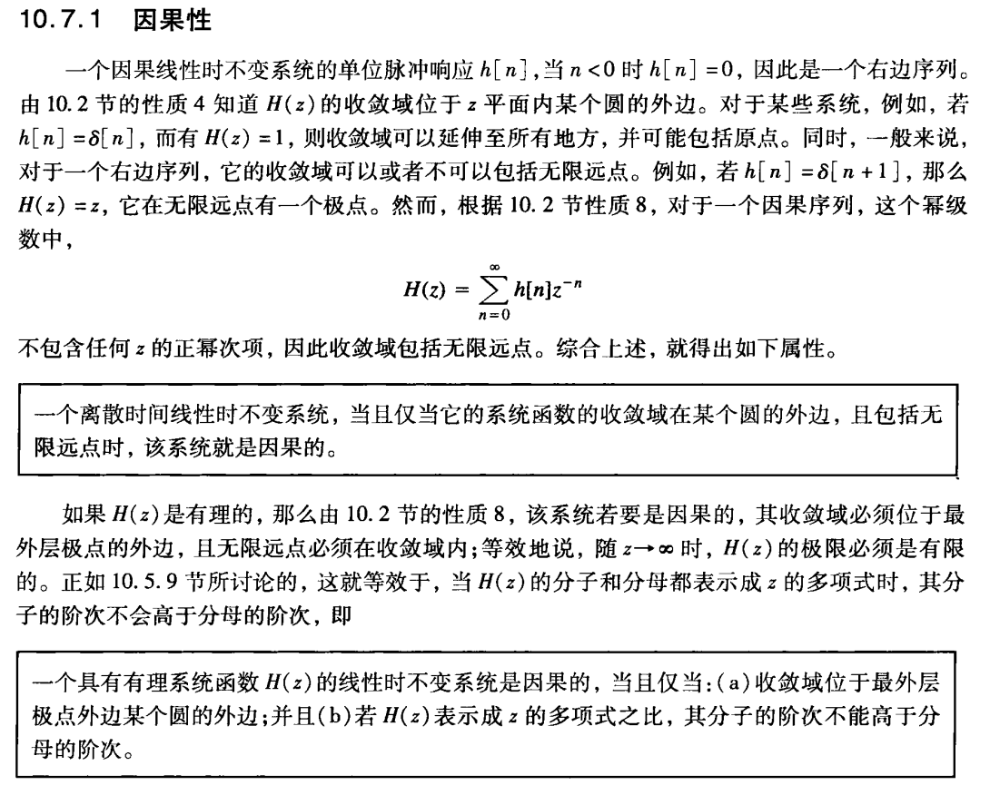

因果离散时间 LTI 系统要求 $n<0$ 时 $h[n]=0$，即 $h[n]$ 是右边序列。由性质 8 与性质 4，立刻得到：

> 一个离散时间 LTI 系统，当且仅当它的系统函数 $H(z)$ 的收敛域在某个圆的外边、且包括无限远点时，该系统就是因果的。

"包括无限远点"的原因很直接：因果序列的 $H(z)=\sum_{n=0}^{\infty}h[n]z^{-n}$ 只含 $z$ 的**负幂**，$z\to\infty$ 时不会发散。

若 $H(z)$ 有理，判据还可以再具体化：

> 具有有理 $H(z)$ 的 LTI 系统是因果的，当且仅当：(a) 收敛域位于最外层极点外边的某个圆之外；(b) 把 $H(z)$ 写成 $z$ 的多项式之比时，分子的阶次不高于分母的阶次。

条件 (b) 等价于"$H(z)$ 展开后不含 $z$ 的正幂项"，也就是 $z\to\infty$ 时 $H(z)$ 有有限极限。**只看 (b) 就能否定因果性，完全不需要知道收敛域**——这是考试里最快的判据。

16. [返回](#li-ti)例题16（不看收敛域也能判因果）

**(1)** 考虑系统函数

$$

H(z)=\dfrac{z^{3}-2z^{2}+z}{z^{2}+\dfrac{1}{4}z+\dfrac{1}{8}}
$$

判断该系统是否因果，并说明判断时**不需要知道收敛域**的理由。

**(2)** 考虑系统函数

$$

H(z)=\dfrac{1}{1-\dfrac{1}{2}z^{-1}}+\dfrac{1}{1-2z^{-1}},\qquad |z|>2 \tag{10.97}
$$

判断该系统是否因果，并求单位脉冲响应 $h[n]$。

  
点击查看解析与答案

  

**(1)** 分子阶次 $3$ 高于分母阶次 $2$，做一次长除即可看出它含有 $z$ 的正幂：

$$

H(z)=z-\dfrac{9}{4}+\cdots
$$

$z$ 的正幂对应 $h[n]$ 在 $n<0$ 的取值（例如 $z$ 对应 $\delta[n+1]$），所以该系统**不因果**。这一步完全用不到收敛域。

**(2)** 先把两项合并成一个分式：

$$

H(z)=\dfrac{\left(1-2z^{-1}\right)+\left(1-\dfrac{1}{2}z^{-1}\right)}{\left(1-\dfrac{1}{2}z^{-1}\right)\left(1-2z^{-1}\right)}
=\dfrac{2-\dfrac{5}{2}z^{-1}}{1-\dfrac{5}{2}z^{-1}+z^{-2}}
=\dfrac{2z^{2}-\dfrac{5}{2}z}{z^{2}-\dfrac{5}{2}z+1}
$$

分子、分母都是 $z$ 的 $2$ 次多项式，阶次相同，不含 $z$ 的正幂 → **因果**。

再看收敛域：$|z|>2$ 位于最外层极点（$z=2$ 与 $z=\dfrac12$ 中模为 $2$ 的那个）的外边，说明 $h[n]$ 是右边序列，与"因果"一致。

最后逐项查表：两项的收敛域都在各自极点外，都是右边序列，所以

$$

h[n]=\left(\dfrac{1}{2}\right)^{n}u[n]+2^{n}u[n]
$$

顺带一句：这个系统**因果但不稳定**——极点 $z=2$ 在单位圆外，收敛域不含单位圆，$2^{n}u[n]$ 还会一直增长。

  

<!--知识点14-->
## 十四、稳定性

### 图 10-15　稳定性与单位圆

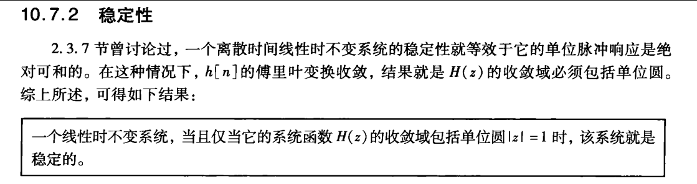

离散时间 LTI 系统的稳定等价于它的单位脉冲响应**绝对可和**，此时 $h[n]$ 的傅里叶变换收敛，而 $H(j\omega)$ 就是 $H(z)$ 在单位圆上的取值，于是

> 一个 LTI 系统，当且仅当它的系统函数 $H(z)$ 的收敛域**包括单位圆 $|z|=1$** 时，该系统就是稳定的。

把因果性与稳定性合起来——因果要求收敛域是最外层极点外的圆外区域，稳定要求这个区域含单位圆：

> **因果且稳定 $\Longleftrightarrow$ $H(z)$ 的全部极点都严格位于单位圆内。**

三种极点位置的含义：

| 极点位置 | 系统性质 | 说明 |
| :--- | :--- | :--- |
| 全部在单位圆内 | 因果且稳定 | 最外层极点模 $<1$，收敛域 $\vert z\vert >r_{\max}$ 必含单位圆 |
| 有极点落在单位圆上（一阶） | 临界稳定 | 等幅振荡，$h[n]$ 不绝对可和 |
| 有极点在单位圆外 | 不稳定 | 收敛域无法包含单位圆 |

17. [返回](#li-ti)例题17（一个系统、三种收敛域：因果性与稳定性怎么判）

已知某离散时间 LTI 系统的系统函数

$$

H(z)=\dfrac{z^{2}}{\left(z-1\right)\left(z-\dfrac{1}{2}\right)}
$$

**(1)** 写出 $H(z)$ 的极点，并列出所有可能的收敛域；  
**(2)** 对每种收敛域，判断该系统的因果性与稳定性；  
**(3)** 是否存在某种收敛域，使该系统**既因果又稳定**？

  
点击查看解析与答案

  

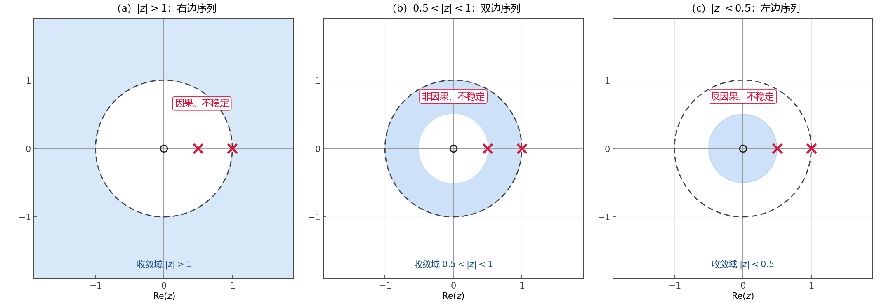

**(1)** 极点为 $z=1$（落在单位圆上）与 $z=\dfrac{1}{2}$（在单位圆内）；零点为 $z=0$（二阶）。由性质 7，收敛域被极点界定，两个极点把 z 平面分成三块：

**(a)** $|z|>1$；**(b)** $\dfrac{1}{2}<|z|<1$；**(c)** $|z|<\dfrac{1}{2}$。

**(2)** 逐个判断：

- **(a)** $|z|>1$：收敛域在最外层极点的外边 $\to$ 右边序列 $\to$ **因果**。但 $|z|>1$ 是开区域，不含 $|z|=1$（单位圆正好被极点 $z=1$ 占着）$\to$ **不稳定**。
- **(b)** $\dfrac{1}{2}<|z|<1$：收敛域是环带 $\to$ 双边序列 $\to$ **非因果**；环带在 $|z|=1$ 的里侧，也不含单位圆 $\to$ **不稳定**。
- **(c)** $|z|<\dfrac{1}{2}$：收敛域在最里层极点的里边 $\to$ 左边序列 $\to$ **反因果**；不含单位圆 $\to$ **不稳定**。

**(3)** **不存在**。因果要求收敛域是最外层极点之外的圆外区域，稳定要求该区域包含单位圆，两者同时成立等价于"最外层极点的模小于 $1$"。而本例有极点 $z=1$ **恰好落在**单位圆上，无论选哪种收敛域，单位圆都在收敛域之外，所以这个系统要么不因果、要么不稳定，不可能既因果又稳定。

（把 $H(z)$ 改成 $\dfrac{z^{2}}{\left(z-0.5\right)\left(z-0.8\right)}$，两个极点 $0.5$、$0.8$ 都在单位圆内，此时取收敛域 $|z|>0.8$：既在最外层极点外（因果），又包含单位圆（稳定），系统就因果且稳定了。）

  

<!--知识点15-->
## 十五、单边 z 变换

### 图 10-16　单边 z 变换的定义

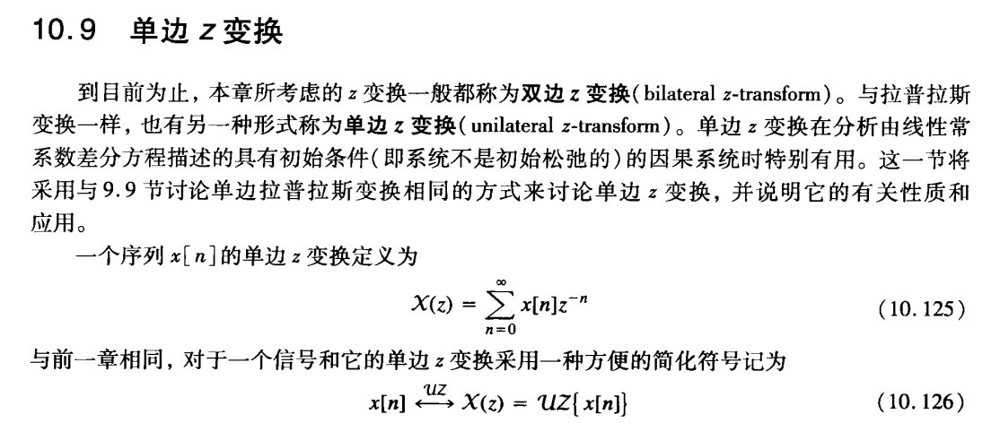

前面讨论的 z 变换一般称为**双边** z 变换。与拉普拉斯变换一样，还有一种形式称为**单边** z 变换：

$$

X(z)=\sum_{n=0}^{\infty}x[n]z^{-n} \tag{10.125}
$$

与前面一样，对信号和它的单边 z 变换采用简化记号

$$

x[n]\overset{uZ}{\longleftrightarrow}X(z)=\mathscr{UZ}\{x[n]\} \tag{10.126}
$$

单边 z 变换在分析由**线性常系数差分方程**描述的、具有初始条件（即系统不是初始松弛的）的因果系统时特别有用——它扮演的角色与单边拉普拉斯变换解微分方程时完全一样。

因为求和从 $n=0$ 开始，$X(z)$ 只含 $z$ 的负幂，所以**任何单边 z 变换的收敛域总是某个圆的外部**；若 $X(z)$ 有理，收敛域就是最外层极点的外边。这也是下一节里单边性质表干脆不列"收敛域"这一列的原因。

<!--知识点16-->
## 十六、单边 z 变换的性质

### 图 10-17　与双边不同的几条性质

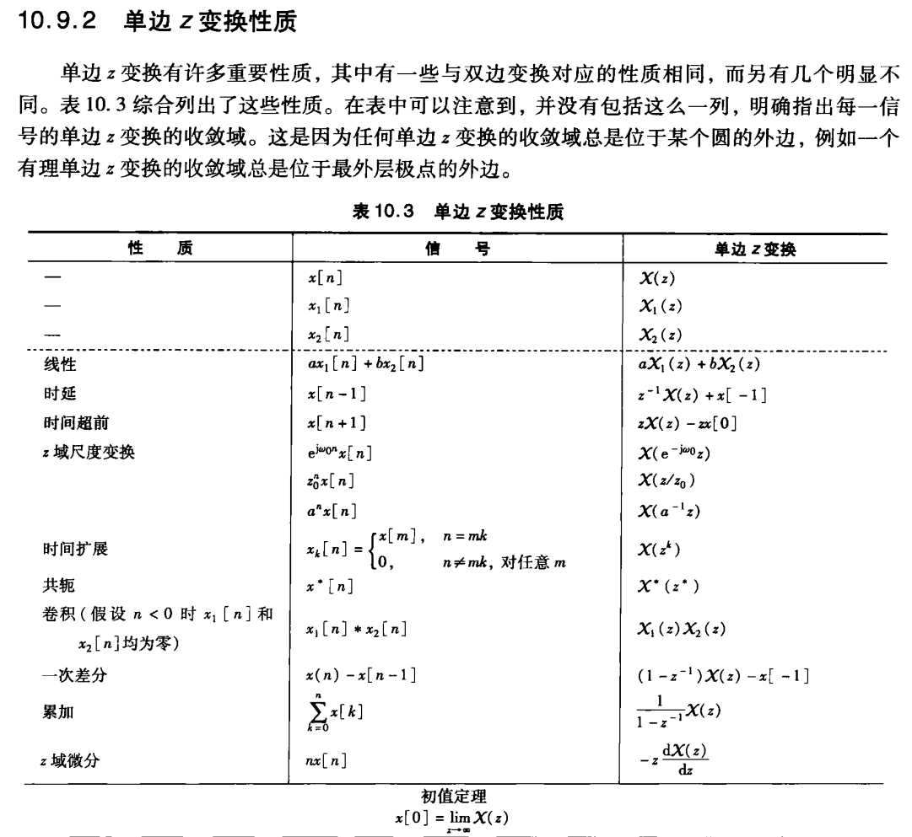

单边 z 变换的许多性质与双边相同，另有一些明显不同。这里仅作了解，重点记住"哪些地方与双边不一样、以及为什么不一样"。

**与双边相同的性质**：线性、$z$ 域尺度变换（$a^{n}x[n]\leftrightarrow X\left(a^{-1}z\right)$）、时间扩展、共轭、$z$ 域微分（$nx[n]\leftrightarrow-z\dfrac{dX}{dz}$），以及卷积

$$

x_1[n]*x_2[n]\ \longleftrightarrow\ X_1(z)X_2(z),\qquad \text{要求 }n<0\text{ 时 }x_1[n]=x_2[n]=0
$$

卷积这条必须加前提：单边变换丢掉了 $n<0$ 的数据，而卷积要整段求和，只有当两个序列在 $n<0$ 都为零时，单边与双边才一致。

**与双边不同的性质**（差别全部来自 $n<0$ 那部分数据被丢掉了）：

**1. 时延**

$$

x[n-1]\overset{uZ}{\longleftrightarrow}z^{-1}X(z)+x[-1]
$$

推导：

$$

\sum_{n=0}^{\infty}x[n-1]z^{-n}\overset{m=n-1}{=}\sum_{m=-1}^{\infty}x[m]z^{-(m+1)}=z^{-1}\left[x[-1]+X(z)\right]=z^{-1}X(z)+x[-1]
$$

双边时这一项没有 $x[-1]$，因为双边求和从 $n=-\infty$ 开始、不会"漏掉" $n=-1$ 那一点。

**2. 时间超前**

$$

x[n+1]\overset{uZ}{\longleftrightarrow}zX(z)-zx[0]
$$

推导：

$$

\sum_{n=0}^{\infty}x[n+1]z^{-n}\overset{m=n+1}{=}\sum_{m=1}^{\infty}x[m]z^{-(m-1)}=z\left[X(z)-x[0]\right]=zX(z)-zx[0]
$$

**3. 一次差分**

$$

x[n]-x[n-1]\overset{uZ}{\longleftrightarrow}\left(1-z^{-1}\right)X(z)-x[-1]
$$

就是 $X(z)$ 减去第 1 条的结果，附加项 $-x[-1]$ 来自时延。

**4. 累加（下限是 $0$ 而不是 $-\infty$）**

$$

\sum_{k=0}^{n}x[k]\overset{uZ}{\longleftrightarrow}\dfrac{1}{1-z^{-1}}X(z)
$$

双边的累加是 $\sum_{k=-\infty}^{n}$，还要额外限制 $|z|>1$；单边从 $0$ 开始，不会把 $n<0$ 的部分带进来，形式更干净。

**5. 初值定理**

$$

x[0]=\lim_{z\to\infty}X(z)
$$

单边变换天然满足 $n<0$ 时 $x[n]=0$，所以初值定理在这里不需要附加因果条件（但仍要求不含 $z$ 的正幂项）。终值定理见第十二节第 11 条。

**为什么会"多出 $x[-1]$、$x[0]$"**：单边求和只覆盖 $n\ge0$，任何把序列左右平移的运算都会让原来在 $n<0$ 的部分"暴露"或"丢失"，于是以一个常数的形式留在结果里。这个常数正是**初始条件**——用它解差分方程时，两边取单边 z 变换，$x[-1]$ 这类项会原样保留，从而一次求出包含零输入响应与零状态响应的全响应。

## 附一：常用拉普拉斯变换对

| 序号 | 时域 $x(t)$ | 变换 $X(s)$ | 收敛域 |
| :---: | :--- | :--- | :--- |
| $1$ | $\delta(t)$ | $1$ | 全部 $s$ |
| $2$ | $u(t)$ | $\dfrac{1}{s}$ | $Re\{s\}>0$ |
| $3$ | $-u(-t)$ | $\dfrac{1}{s}$ | $Re\{s\}<0$ |
| $4$ | $\dfrac{t^{n-1}}{(n-1)!}u(t)$ | $\dfrac{1}{s^{n}}$ | $Re\{s\}>0$ |
| $5$ | $-\dfrac{t^{n-1}}{(n-1)!}u(-t)$ | $\dfrac{1}{s^{n}}$ | $Re\{s\}<0$ |
| $6$ | $e^{-at}u(t)$ | $\dfrac{1}{s+a}$ | $Re\{s\}>-a$ |
| $7$ | $-e^{-at}u(-t)$ | $\dfrac{1}{s+a}$ | $Re\{s\}<-a$ |
| $8$ | $\dfrac{t^{n-1}}{(n-1)!}e^{-at}u(t)$ | $\dfrac{1}{(s+a)^{n}}$ | $Re\{s\}>-a$ |
| $9$ | $-\dfrac{t^{n-1}}{(n-1)!}e^{-at}u(-t)$ | $\dfrac{1}{(s+a)^{n}}$ | $Re\{s\}<-a$ |
| $10$ | $\delta(t-T)$ | $e^{-sT}$ | 全部 $s$ |
| $11$ | $\left(\cos\omega_0 t\right)u(t)$ | $\dfrac{s}{s^{2}+\omega_0^{2}}$ | $Re\{s\}>0$ |
| $12$ | $\left(\sin\omega_0 t\right)u(t)$ | $\dfrac{\omega_0}{s^{2}+\omega_0^{2}}$ | $Re\{s\}>0$ |
| $13$ | $\left(e^{-at}\cos\omega_0 t\right)u(t)$ | $\dfrac{s+a}{(s+a)^{2}+\omega_0^{2}}$ | $Re\{s\}>-a$ |
| $14$ | $\left(e^{-at}\sin\omega_0 t\right)u(t)$ | $\dfrac{\omega_0}{(s+a)^{2}+\omega_0^{2}}$ | $Re\{s\}>-a$ |
| $15$ | $u_n(t)=\dfrac{d^{n}\delta(t)}{dt^{n}}$ | $s^{n}$ | 全部 $s$ |
| $16$ | $u_{-n}(t)=\underbrace{u(t)*\cdots*u(t)}_{n\ \text{次}}$ | $\dfrac{1}{s^{n}}$ | $Re\{s\}>0$ |

**记忆要点**

- 右半平面收敛域对应**右边**信号（$u(t)$ 型），左半平面收敛域对应**左边**信号（$u(-t)$ 型）——第 2、3 行与第 6、7 行是成对出现的。
- 第 4、5 行说明：**$t^{n-1}/(n-1)!$ 的作用是"把 $1/s$ 变成 $1/s^{n}$"**，这正好是"时域除以 $n-1$ 阶乘、频域多除一个 $s$"的对应。
- 第 11～14 行是振荡型，分母是 $(s+a)^{2}+\omega_0^{2}$：实部决定衰减（$-a$），虚部决定振荡频率（$\omega_0$），极点在 $s=-a\pm j\omega_0$。

## 附二：常用 z 变换对

| 序号 | 序列 $x[n]$ | 变换 $X(z)$ | 收敛域 |
| :---: | :--- | :--- | :--- |
| $1$ | $\delta[n]$ | $1$ | 全部 $z$ |
| $2$ | $u[n]$ | $\dfrac{1}{1-z^{-1}}$ | $\vert z\vert >1$ |
| $3$ | $-u[-n-1]$ | $\dfrac{1}{1-z^{-1}}$ | $\vert z\vert <1$ |
| $4$ | $\delta[n-m]$ | $z^{-m}$ | 全部 $z$，除去 $0$（若 $m>0$）或 $\infty$（若 $m<0$） |
| $5$ | $a^{n}u[n]$ | $\dfrac{1}{1-az^{-1}}$ | $\vert z\vert >\vert a\vert $ |
| $6$ | $-a^{n}u[-n-1]$ | $\dfrac{1}{1-az^{-1}}$ | $\vert z\vert <\vert a\vert $ |
| $7$ | $n\,a^{n}u[n]$ | $\dfrac{az^{-1}}{\left(1-az^{-1}\right)^{2}}$ | $\vert z\vert >\vert a\vert $ |
| $8$ | $-n\,a^{n}u[-n-1]$ | $\dfrac{az^{-1}}{\left(1-az^{-1}\right)^{2}}$ | $\vert z\vert <\vert a\vert $ |
| $9$ | $\left(\cos\omega_0 n\right)u[n]$ | $\dfrac{1-\left(\cos\omega_0\right)z^{-1}}{1-\left(2\cos\omega_0\right)z^{-1}+z^{-2}}$ | $\vert z\vert >1$ |
| $10$ | $\left(\sin\omega_0 n\right)u[n]$ | $\dfrac{\left(\sin\omega_0\right)z^{-1}}{1-\left(2\cos\omega_0\right)z^{-1}+z^{-2}}$ | $\vert z\vert >1$ |
| $11$ | $\left(r^{n}\cos\omega_0 n\right)u[n]$ | $\dfrac{1-\left(r\cos\omega_0\right)z^{-1}}{1-\left(2r\cos\omega_0\right)z^{-1}+r^{2}z^{-2}}$ | $\vert z\vert >r$ |
| $12$ | $\left(r^{n}\sin\omega_0 n\right)u[n]$ | $\dfrac{\left(r\sin\omega_0\right)z^{-1}}{1-\left(2r\cos\omega_0\right)z^{-1}+r^{2}z^{-2}}$ | $\vert z\vert >r$ |

**记忆要点**

- 第 2、3 行与第 5、6 行都是"同一个代数式、两种收敛域"的成对出现：代数式一样，收敛域在极点外还是在极点内，决定了序列是右边还是左边。这正是 z 变换必须连带收敛域的原因（对照例 9、例 10）。
- 第 5、6 行的极点在 $z=a$，收敛域 $|z|>|a|$ 对应 $a^{n}u[n]$、$|z|<|a|$ 对应 $-a^{n}u[-n-1]$。
- 第 7、8 行是第 5、6 行乘以 $n$ 的结果，对应 $z$ 域微分 $n\,x[n]\leftrightarrow-z\dfrac{dX(z)}{dz}$：**时域乘 $n$ 相当于在 $z=a$ 处把一阶极点变成二阶极点**。
- 第 9～12 行的分母是 $1-\left(2r\cos\omega_0\right)z^{-1}+r^{2}z^{-2}$，对应一对共轭极点 $z=re^{\pm j\omega_0}$：$r$ 决定包络按 $r^{n}$ 衰减的快慢，$\omega_0$ 决定数字角频率；$r=1$ 时就是第 9、10 行。
- 与附一对照着记：s 平面上的极点 $-a$ 经 $z=e^{sT}$ 映射到 z 平面上的 $e^{-aT}$，所以拉普拉斯变换对里的 $s+a$ 与 z 变换对里的 $1-az^{-1}$ 是同一个极点的两种写法；$s^{2}+\omega_0^{2}$ 与 $1-\left(2\cos\omega_0\right)z^{-1}+z^{-2}$ 同理。

例题(点击下面跳转)  

[例1](#li-1)　[例2](#li-2)　[例3](#li-3)　[例4](#li-4)  
[例5](#li-5)　[例6](#li-6)　[例7](#li-7)　[例8](#li-8)  
[例9](#li-9)　[例10](#li-10)　[例11](#li-11)　[例12](#li-12)  
[例13](#li-13)　[例14](#li-14)　[例15](#li-15)　[例16](#li-16)  
[例17](#li-17)
