<!--前提-->
## 前提:文末有可直接查看的[例题](#li-ti)
- 本文把教材（奥本海姆《信号与系统》第二版）的**第一章**与**第二章前半部分**合为一个大章来记。
- **第一章（§1.2）** 整理成 6 个知识点、4 道例题。其中知识点 4（图 1-6、图 1-7）与知识点 5（图 1-8、图 1-9）只作概念讲解，不配例题。
- **第二章前半部分** 整理成 2 个知识点、4 道例题（卷积和与卷积积分），对应知识点 7、8。
- 第一章的图片是同一段内容的连续截图，因此**按组插入**：图 1-2 与图 1-3 一组、图 1-4 与图 1-5 一组，依此类推。
- 记号：连续信号 $x(t)$、离散信号 $x[n]$；单位阶跃 $u(t)$、单位冲激 $\delta(t)$；单位脉冲响应 $h[n]$、$h(t)$。

<!--知识点1-->
## 一、能量与功率信号

### 图 1-1　能量与平均功率的定义

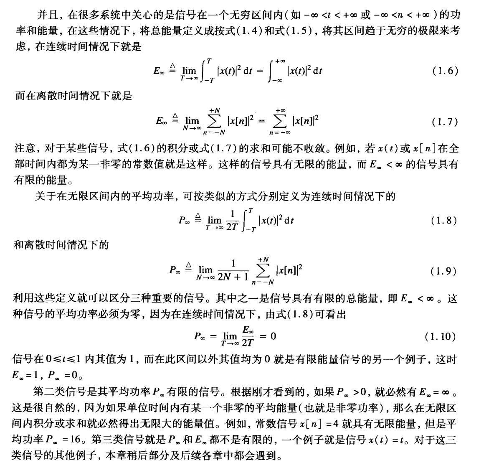

- 总能量 $E_\infty$、平均功率 $P_\infty$ 的定义，以及三类信号：能量信号、功率信号、都不是。

1. [返回](#li-ti)例题1（三类信号的判断）

判断下列信号的类型，并求出对应的 $E_\infty$、$P_\infty$：  
(1) $x_1(t)$ 在 $0\le t\le 1$ 内为 $1$，其余为 $0$　
(2) $x_2[n]=4$　
(3) $x_3(t)=t$

  
点击查看解析与答案

  

**(1)** 按式 (1.6)：
$$

E_\infty=\int_{0}^{1}1^2dt=1<\infty
\qquad
P_\infty=\lim_{T\to\infty}\dfrac{E_\infty}{2T}=0
$$

→ **能量信号**（能量有限、平均功率为零，见式 1.10）。

**(2)** 按式 (1.7)、(1.9)：
$$

E_\infty=\sum_{n=-\infty}^{+\infty}4^2\to\infty
\qquad
P_\infty=\lim_{N\to\infty}\dfrac{1}{2N+1}\sum_{n=-N}^{N}16=16
$$

→ **功率信号**（$E_\infty$ 无限、$P_\infty$ 有限非零）。

**(3)** 按式 (1.6)、(1.8)：
$$

E_\infty=\int_{0}^{+\infty}t^2dt\to\infty
\qquad
P_\infty=\lim_{T\to\infty}\dfrac{1}{2T}\int_{0}^{T}t^2dt
=\lim_{T\to\infty}\dfrac{T^2}{6}\to\infty
$$

→ $E_\infty$、$P_\infty$ **都不是有限值**，既非能量信号也非功率信号。

  

<!--知识点2-->
## 二、偶信号与奇信号

### 图 1-2 + 图 1-3　偶/奇信号的定义与奇偶分解

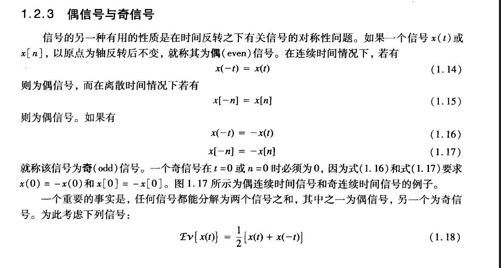

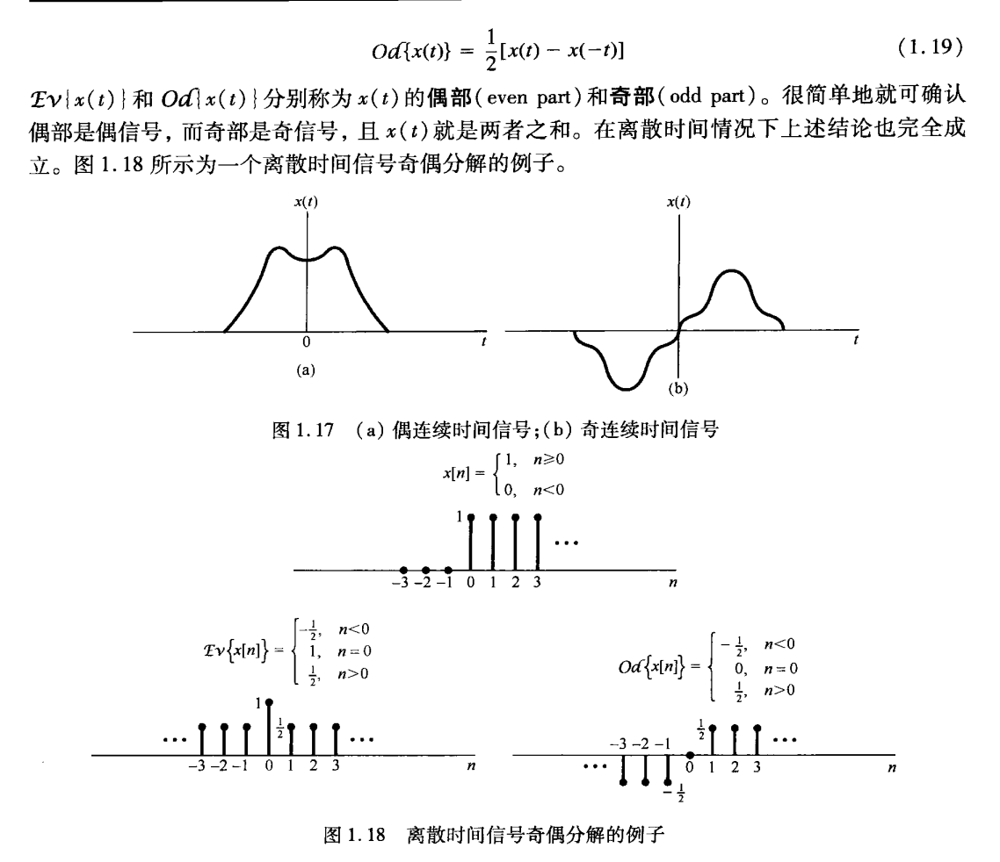

- 两张图是**同一段落**的上下两段：图 1-2 到式 (1.18) 为止，图 1-3 从式 (1.19) 接着往下。
- 偶：$x(-t)=x(t)$、$x[-n]=x[n]$；奇：$x(-t)=-x(t)$、$x[-n]=-x[n]$，奇信号在 $t=0$（$n=0$）处必为 $0$。
- 任何信号都能拆成偶部与奇部之和：
$$

Ev\left\{x(t)\right\}=\dfrac{1}{2}\left[x(t)+x(-t)\right]
\qquad
Od\left\{x(t)\right\}=\dfrac{1}{2}\left[x(t)-x(-t)\right]
$$

2. [返回](#li-ti)例题2（阶跃/冲激表示 + 求导 + 奇偶分量）

已知信号 $f(t)$ 的波形如下图所示：$t<0$ 的一段位于**第二象限**，$t>0$ 的一段位于**第四象限**，两段在 $y$ 轴处断开。  
**(1)** 用**阶跃函数** $u(t)$ 表示 $f(t)$；  
**(2)** 求 $f(t)$ 的导数 $f'(t)$，并用**冲激函数** $\delta(t)$ 与**阶跃函数** $u(t)$ 表示；  
**(3)** 求偶部 $Ev\{f(t)\}$ 与奇部 $Od\{f(t)\}$，并画出它们的波形。

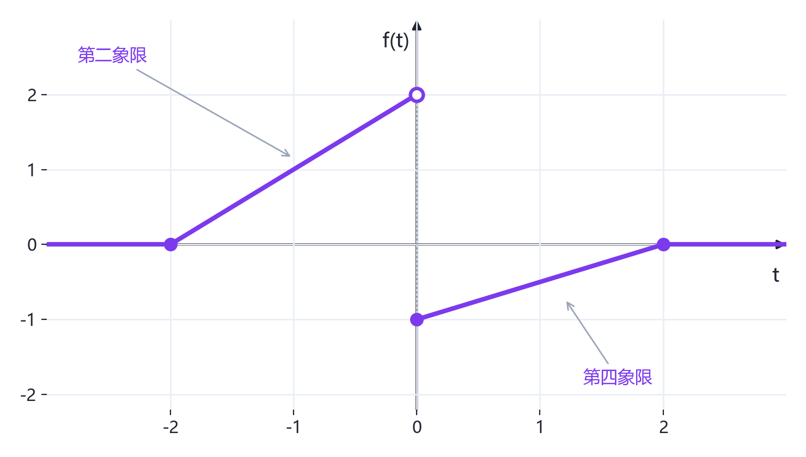

  
点击查看解析与答案

  

**第(1)问：用 $u(t)$ 表示 $f(t)$**

先把波形看成"两段门"的叠加：$-2\le t<0$ 段是斜率为 $1$ 的直线，$0\le t<2$ 段是斜率为 $\dfrac{1}{2}$ 的直线：

$$

f(t)=(t+2)\left[u(t+2)-u(t)\right]+\left(\dfrac{1}{2}t-1\right)\left[u(t)-u(t-2)\right]
$$

展开并合并同类项：

$$

f(t)=(t+2)u(t+2)-(t+2)u(t)+\left(\dfrac{1}{2}t-1\right)u(t)-\left(\dfrac{1}{2}t-1\right)u(t-2)
$$

$$

\boxed{f(t)=(t+2)u(t+2)-\left(\dfrac{1}{2}t+3\right)u(t)-\left(\dfrac{1}{2}t-1\right)u(t-2)}
$$

逐段校验：$t<-2$ 时为 $0$；$-2\le t<0$ 时为 $t+2$；$0\le t<2$ 时为 $(t+2)-\left(\dfrac{1}{2}t+3\right)=\dfrac{1}{2}t-1$；$t\ge 2$ 时三项相消为 $0$，与波形一致。

**第(2)问：求 $f'(t)$**

逐项求导，并用**筛选性质** $(t-a)\delta(t-a)=0$：

$$

\left[(t+2)u(t+2)\right]'=u(t+2)+(t+2)\delta(t+2)=u(t+2)
$$

$$

\left[-\left(\dfrac{1}{2}t+3\right)u(t)\right]'=-\dfrac{1}{2}u(t)-\left(\dfrac{1}{2}t+3\right)\delta(t)=-\dfrac{1}{2}u(t)-3\delta(t)
$$

$$

\left[-\left(\dfrac{1}{2}t-1\right)u(t-2)\right]'=-\dfrac{1}{2}u(t-2)-\left(\dfrac{1}{2}t-1\right)\delta(t-2)=-\dfrac{1}{2}u(t-2)
$$

故

$$

\boxed{f'(t)=u(t+2)-\dfrac{1}{2}u(t)-\dfrac{1}{2}u(t-2)-3\delta(t)}
$$

**从波形看更直观**：

- $(-2,0)$ 内斜率为 $1$ → 对应高度为 $1$ 的平台；
- $(0,2)$ 内斜率为 $\dfrac{1}{2}$ → 对应高度为 $\dfrac{1}{2}$ 的平台；
- $t=-2$ 与 $t=2$ 处函数**连续**（斜率变化由阶跃项承担），所以**没有冲激**；
- $t=0$ 处由 $2$ 跳到 $-1$，跳变幅度为 $-3$ → 产生冲激 $-3\delta(t)$。

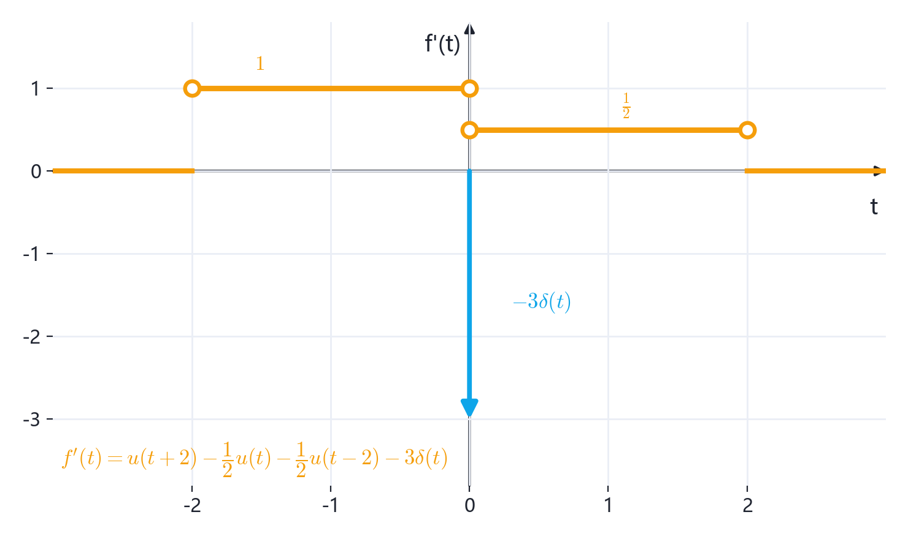

**第(3)问：求偶部与奇部并画图**

先求 $f(-t)$：把 $f(t)$ 关于 $t=0$ 反褶（**区间端点也要跟着翻**），得

$$

f(-t)=
\begin{cases}
-\dfrac{1}{2}t-1, & -2\le t<0\\[8pt]
-t+2, & 0<t\le 2\\[8pt]
0, & \text{其他}
\end{cases}
$$

再按 $f(t)$、$f(-t)$ 的分段点把实轴分段，逐段代入 $Ev=\frac{1}{2}[f(t)+f(-t)]$、$Od=\frac{1}{2}[f(t)-f(-t)]$：

| 区间 | $f(t)$ | $f(-t)$ | 偶部 $Ev$ | 奇部 $Od$ |
| :--- | :--- | :--- | :--- | :--- |
| $t<-2$ 或 $t>2$ | $0$ | $0$ | $0$ | $0$ |
| $-2\le t<0$ | $t+2$ | $-\dfrac{1}{2}t-1$ | $\dfrac{1}{4}t+\dfrac{1}{2}$ | $\dfrac{3}{4}t+\dfrac{3}{2}$ |
| $0<t\le 2$ | $\dfrac{1}{2}t-1$ | $-t+2$ | $-\dfrac{1}{4}t+\dfrac{1}{2}$ | $\dfrac{3}{4}t-\dfrac{3}{2}$ |
| $t=0$ | $-1$ | $-1$ | $-1$ | $0$ |

所以

$$

\boxed{Ev\left\{f(t)\right\}=
\begin{cases}
\dfrac{1}{4}t+\dfrac{1}{2}, & -2\le t<0\\[8pt]
-\dfrac{1}{4}t+\dfrac{1}{2}, & 0<t\le 2\\[8pt]
-1, & t=0\\[8pt]
0, & \text{其他}
\end{cases}}
$$

$$

\boxed{Od\left\{f(t)\right\}=
\begin{cases}
\dfrac{3}{4}t+\dfrac{3}{2}, & -2\le t<0\\[8pt]
\dfrac{3}{4}t-\dfrac{3}{2}, & 0<t\le 2\\[8pt]
0, & \text{其他}
\end{cases}}
$$

画出波形：

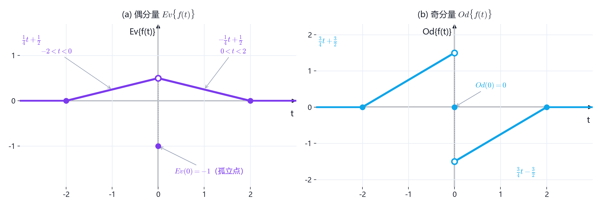

几点说明：

- 偶部由 $(-2,0)$ 与 $(0,2)$ 上斜率相反的两段直线构成，合起来关于纵轴对称；
- 奇部关于原点中心对称，且在 $t=0$ 处 $Od(0)=0$，符合奇信号要求；
- 校验：$-2\le t<0$ 时 $\left(\frac{1}{4}t+\frac{1}{2}\right)+\left(\frac{3}{4}t+\frac{3}{2}\right)=t+2=f(t)$；$0<t\le 2$ 时 $\left(-\frac{1}{4}t+\frac{1}{2}\right)+\left(\frac{3}{4}t-\frac{3}{2}\right)=\frac{1}{2}t-1=f(t)$ ✔
- 由于 $f(t)$ 在 $t=0$ 处跳变，偶部与奇部在 $t=0$ 处也**不连续**：偶部两侧极限为 $\frac{1}{2}$ 而 $Ev(0)=-1$（孤立点）；奇部两侧极限为 $\pm\frac{3}{2}$ 而 $Od(0)=0$。

  

<!--知识点3-->
## 三、连续时间周期复指数信号

### 图 1-4 + 图 1-5　周期性与基波频率

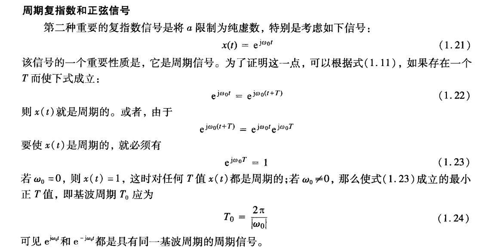

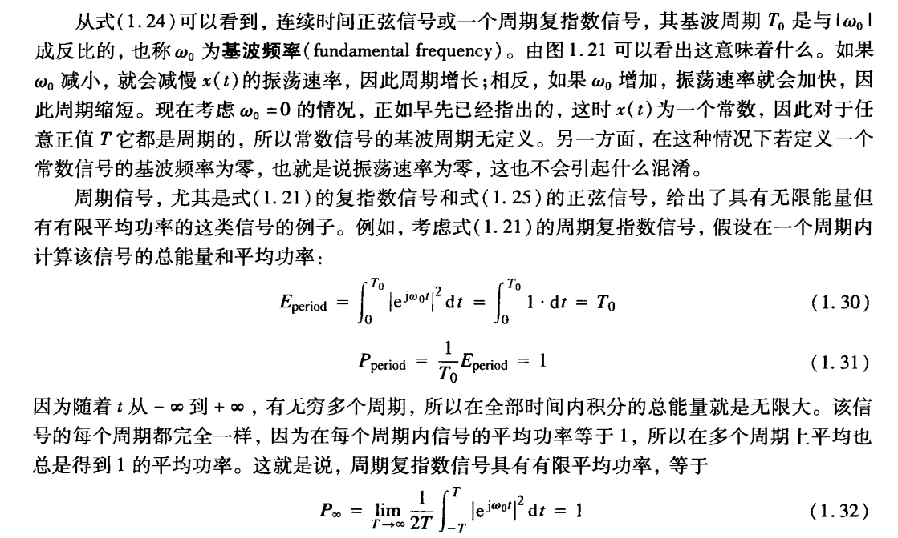

- 由 $e^{j\omega_0 T}=1$ 得**基波周期** $T_0=\dfrac{2\pi}{|\omega_0|}$（图 1-4）；图 1-5 接着说明 $\omega_0$ 为**基波频率**。
- $T_0$ 与 $|\omega_0|$ 成**反比**：$\omega_0$ 越大 → 振荡越快 → 周期越短。
- 周期复指数：一个周期内能量 $E_{\text{period}}=T_0$，平均功率恒为 $P_\infty=1$。

3. [返回](#li-ti)例题3（基波周期、基波频率与功率）

设 $x(t)=e^{j5\pi t}$。  
(1) 求基波周期 $T_0$ 与基波频率 $f_0$；  
(2) 求一个周期内的能量 $E_{\text{period}}$ 与平均功率 $P_\infty$；  
(3) 若把 $\omega_0$ 增大为原来的 $2$ 倍，$T_0$ 与 $f_0$ 各如何变化？

  
点击查看解析与答案

  

**(1)** $\omega_0=5\pi$，由式 (1.24)：
$$

T_0=\dfrac{2\pi}{5\pi}=\dfrac{2}{5}\ \text{s}
\qquad
f_0=\dfrac{1}{T_0}=2.5\ \text{Hz}
$$

**(2)** 由式 (1.30)、(1.31)：
$$

E_{\text{period}}=\int_{0}^{T_0}\left|e^{j5\pi t}\right|^2dt
=\int_{0}^{T_0}1\,dt=T_0=\dfrac{2}{5}
\qquad
P_\infty=\dfrac{E_{\text{period}}}{T_0}=1
$$

**(3)** $\omega_0$ 加倍后 $\omega_0'=10\pi$：
$$

T_0'=\dfrac{2\pi}{10\pi}=\dfrac{1}{5}\ \text{s}=\dfrac{T_0}{2},
\qquad
f_0'=5\ \text{Hz}=2f_0
$$

即**周期减半、频率加倍**，正是 $T_0$ 与 $|\omega_0|$ 成反比。

  

<!--知识点4-->
## 四、成谐波关系的复指数信号（仅概念）

### 图 1-6 + 图 1-7　谐波关系与第 $k$ 次谐波

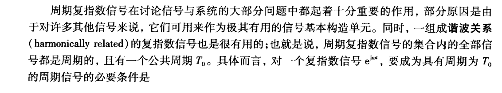

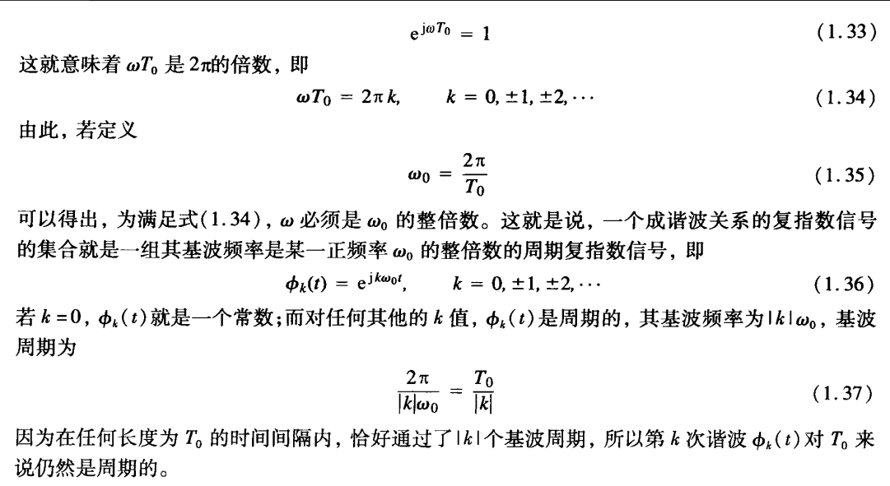

- **成谐波关系**：一组复指数信号全部是周期的，且存在**公共周期** $T_0$。
- 判据：对 $e^{j\omega t}$，要成为周期为 $T_0$ 的周期信号，必须
$$

e^{j\omega T_0}=1
\quad\Longrightarrow\quad
\omega T_0=2\pi k,\qquad k=0,\pm1,\pm2,\cdots
$$

- 令 $\omega_0=\dfrac{2\pi}{T_0}$，则 $\omega$ 必须为 $\omega_0$ 的**整数倍**，即
$$

\phi_k(t)=e^{jk\omega_0 t},\qquad k=0,\pm1,\pm2,\cdots
$$

- 第 $k$ 次谐波：基波频率 $=|k|\omega_0$，基波周期 $=\dfrac{T_0}{|k|}$（在长度 $T_0$ 内恰好通过 $|k|$ 个基波周期）。
- $k=0$ 时 $\phi_0(t)=1$ 是常数，无基波周期。

<!--知识点5-->
## 五、离散复指数的频率模糊性（仅概念）

### 图 1-8 + 图 1-9　$2\pi$ 模糊性与高频位置

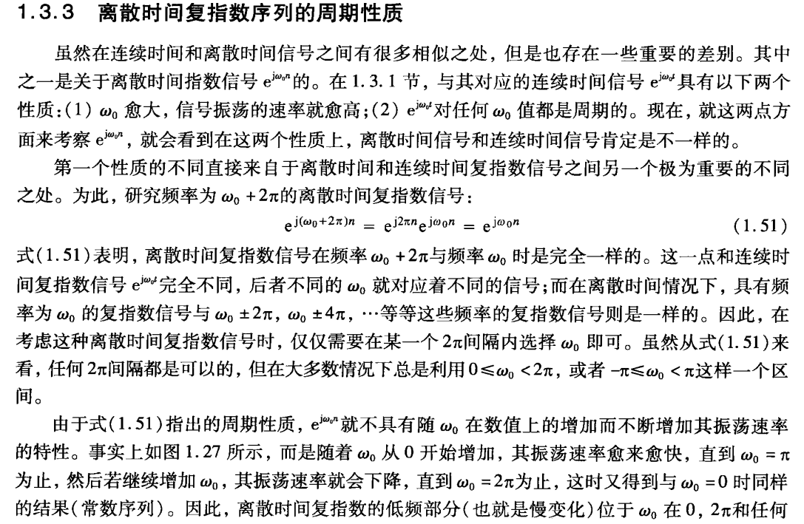

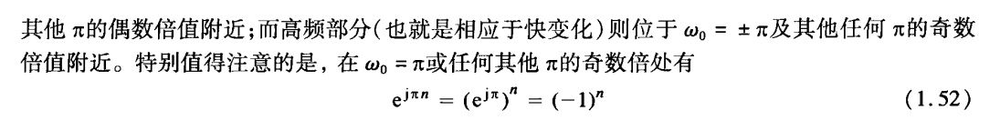

- **$2\pi$ 模糊性**（图 1-8）：离散复指数在 $\omega_0$ 与 $\omega_0+2\pi$ 处是**同一个序列**
$$

e^{j(\omega_0+2\pi)n}=e^{j2\pi n}e^{j\omega_0 n}=e^{j\omega_0 n}
$$

因此只需在 $0\le\omega_0<2\pi$ 或 $-\pi\le\omega_0<\pi$ 内选取 $\omega_0$。

- **振荡速率**（图 1-9）：$\omega_0$ 从 $0$ 增大时振荡变快，到 $\omega_0=\pi$ 最快；再增大反而变慢，到 $\omega_0=2\pi$ 又回到常数序列。
- 因此**低频**（慢变化）在 $\omega_0$ 靠近 $0$、$2\pi$ 及 $\pi$ 的偶数倍处；**高频**（快变化）在 $\omega_0=\pm\pi$ 及 $\pi$ 的奇数倍处。
- 在 $\omega_0=\pi$ 及 $\pi$ 的奇数倍处：
$$

e^{j\pi n}=\left(e^{j\pi}\right)^n=(-1)^n
$$

<!--知识点6-->
## 六、离散复指数序列的周期性

### 图 1-10 + 图 1-11　周期性条件与有理数判据

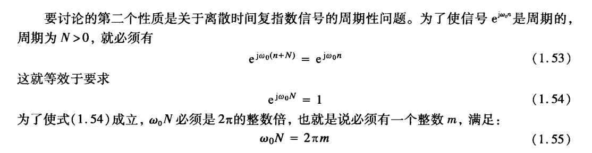

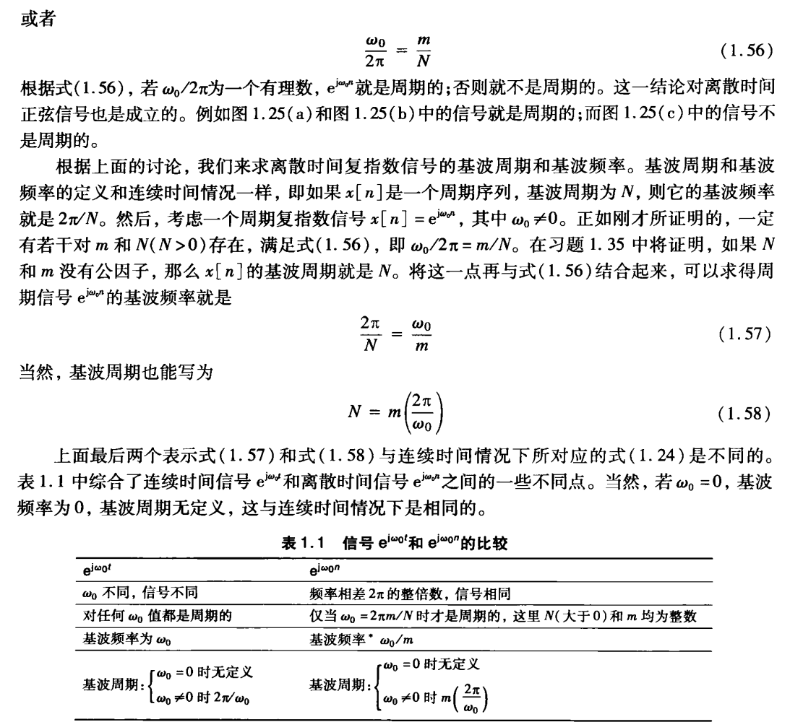

- 图 1-10 推出条件：$e^{j\omega_0 n}$ 以 $N$ 为周期，等价于 $e^{j\omega_0 N}=1$，也即存在整数 $m$ 使
$$

\omega_0 N=2\pi m
$$

- 图 1-11 整理成**有理数判据**：$\dfrac{\omega_0}{2\pi}=\dfrac{m}{N}$ 为**有理数**才周期；约分后分母即为基波周期 $N$。
- 与连续最大差别：$e^{j\omega_0 t}$ 对任何 $\omega_0$ 都周期，而 $e^{j\omega_0 n}$ 不一定（见图中表 1.1）。

4. [返回](#li-ti)例题4（离散周期性判定）

(1) 求 $x_1[n]=e^{j\frac{2\pi}{5}n}$ 的周期 $N$；  
(2) 判断 $x_2[n]=e^{j0.6n}$ 是否为周期序列；  
(3) 求 $x_3[n]=e^{j\frac{12\pi}{5}n}$ 的基波周期 $N$；  
(4) 取相同的 $\omega_0=2$，比较 $e^{j2t}$ 与 $e^{j2n}$ 的周期性。

  
点击查看解析与答案

  

**(1)** 用式 (1.55)：$\omega_0 N=2\pi m$，其中 $\omega_0=\dfrac{2\pi}{5}$：
$$

\dfrac{2\pi}{5}N=2\pi m\ \Rightarrow\ N=5m
$$

取 $m=1$ 得 $N=5$。

**(2)** 由式 (1.56)：
$$

\dfrac{\omega_0}{2\pi}=\dfrac{0.6}{2\pi}=\dfrac{0.3}{\pi}\ \text{为无理数}
$$

→ **不是**周期序列。

**(3)** $\dfrac{\omega_0}{2\pi}=\dfrac{12\pi/5}{2\pi}=\dfrac{6}{5}$，有理数，$m=6$ 与 $N=5$ 互素：
$$

N=5
$$

（校验：$\omega_0 N=\dfrac{12\pi}{5}\times5=12\pi=2\pi\cdot6$。）

**(4)** 同为 $\omega_0=2$：
$$

e^{j2t}:\quad T_0=\dfrac{2\pi}{2}=\pi\ \text{（连续，任何 }\omega_0\text{ 都周期）}
$$

$$

e^{j2n}:\quad \dfrac{\omega_0}{2\pi}=\dfrac{2}{2\pi}=\dfrac{1}{\pi}\ \text{为无理数，故非周期}
$$

这正是表 1.1 中连续与离散最关键的不同点。

  

<!--知识点7-->
## 七、离散时间 LTI 系统的卷积和

### 图 2-1　单位脉冲响应与卷积和

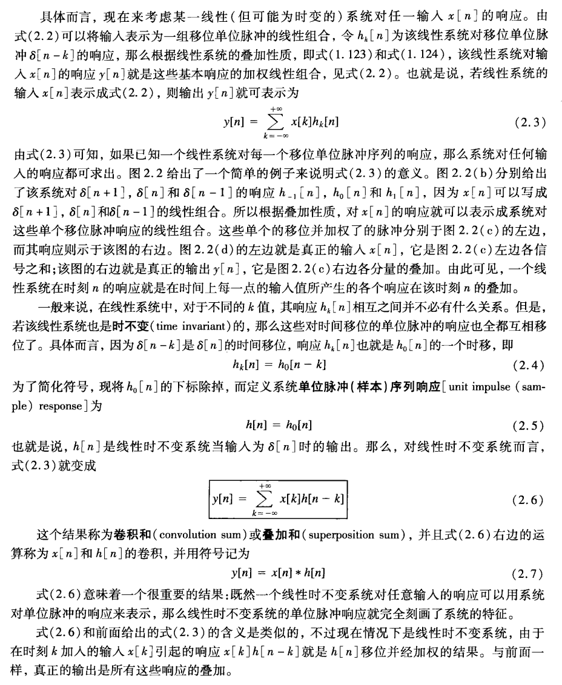

- 把输入写成**移位单位脉冲的线性组合** $x[n]=\sum_{k}x[k]\delta[n-k]$；设系统对 $\delta[n-k]$ 的响应为 $h_k[n]$，由叠加性
$$

y[n]=\sum_{k=-\infty}^{+\infty}x[k]h_k[n]
$$

- 若系统还是**时不变**的，则 $h_k[n]=h_0[n-k]$；把 $h_0[n]$ 简记为**单位脉冲（样本）响应** $h[n]$，于是
$$

\boxed{y[n]=\sum_{k=-\infty}^{+\infty}x[k]h[n-k]}
$$

- 这个结果称为**卷积和**，记作 $y[n]=x[n]*h[n]$。
- 含义：LTI 系统对任意输入的响应完全由单位脉冲响应 $h[n]$ 决定，$h[n]$ 就刻画了系统的特征。

5. [返回](#li-ti)例题5（指数序列与阶跃序列的卷积）

设 $x[n]=\alpha^{n}u[n]$（$0<\alpha<1$）、$h[n]=u[n]$，求 $y[n]=x[n]*h[n]$。

  
点击查看解析与答案

  

**① 先确定乘积的非零范围**

$$

x[k]h[n-k]=\alpha^{k}u[k]\cdot u[n-k]
$$

- $x[k]$ 在 $k\ge 0$ 时非零，$h[n-k]$ 在 $k\le n$ 时非零；
- 当 $n<0$ 时，$k\ge 0$ 与 $k\le n<0$ **没有重合**，故 $y[n]=0$；
- 当 $n\ge 0$ 时，重合部分为 $0\le k\le n$，此时

$$

x[k]h[n-k]=
\begin{cases}
\alpha^{k}, & 0\le k\le n\\[6pt]
0, & \text{其他}
\end{cases}
$$

**② 求和**

$$

y[n]=\sum_{k=0}^{n}\alpha^{k}=\dfrac{1-\alpha^{n+1}}{1-\alpha},\qquad n\ge 0
$$

**③ 合并**

$$

\boxed{y[n]=\dfrac{1-\alpha^{n+1}}{1-\alpha}\,u[n]}
$$

  

6. [返回](#li-ti)例题6（反因果指数序列与阶跃序列的卷积）

设 $x[n]=2^{n}u[-n]$、$h[n]=u[n]$，求 $y[n]=x[n]*h[n]$。

  
点击查看解析与答案

  

**① 确定乘积的非零范围**

- $x[k]=2^{k}u[-k]$ 在 $k\le 0$ 时非零；
- $h[n-k]=u[n-k]$ 在 $k\le n$ 时非零。

所以乘积非零要求 $k\le\min(0,n)$。与例题 5 不同，**无论 $n$ 取何值都存在非零的乘积**，因此要对 $n$ 的符号分情况讨论。

**② 当 $n\ge 0$ 时**（此时 $k\le 0$）

$$

y[n]=\sum_{k=-\infty}^{0}2^{k}
$$

令 $r=-k$，则 $k=0$ 对应 $r=0$、$k\to-\infty$ 对应 $r\to+\infty$：

$$

y[n]=\sum_{r=0}^{\infty}\left(\dfrac{1}{2}\right)^{r}=\dfrac{1}{1-\frac{1}{2}}=2
$$

这里用到**无限项求和公式**：

$$

\sum_{k=0}^{\infty}\alpha^{k}=\dfrac{1}{1-\alpha},\qquad \left|\alpha\right|<1
$$

**③ 当 $n<0$ 时**（此时 $k\le n$）

$$

y[n]=\sum_{k=-\infty}^{n}2^{k}
$$

令 $r=n-k\ge 0$，则 $k=n-r$：

$$

y[n]=\sum_{r=0}^{\infty}2^{\,n-r}=2^{n}\sum_{r=0}^{\infty}\left(\dfrac{1}{2}\right)^{r}=2^{n}\cdot 2=2^{n+1}
$$

**④ 合并**

$$

\boxed{y[n]=2^{n+1}u[-n-1]+2u[n]}
$$

校验：$n=0$ 时 $y[0]=2$；$n=-1$ 时 $y[-1]=1$，与直接求和 $\sum_{k=-\infty}^{-1}2^{k}=1$ 一致。

  

<!--知识点8-->
## 八、连续时间信号的冲激表示与卷积积分

### 图 2-2　用冲激表示连续信号

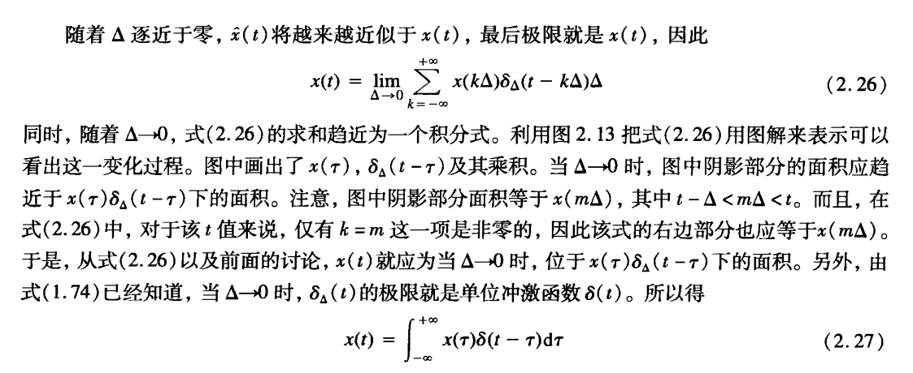

- 用宽度为 $\Delta$、间隔为 $\Delta$ 的窄脉冲去逼近 $x(t)$，$\Delta$ 越小越接近，取极限得
$$

x(t)=\lim_{\Delta\to 0}\sum_{k=-\infty}^{+\infty}x(k\Delta)\delta_{\Delta}(t-k\Delta)\Delta
$$

- 当 $\Delta\to 0$ 时 $\delta_{\Delta}(t)\to\delta(t)$，求和变成积分，得到连续信号的**冲激表示**
$$

\boxed{x(t)=\int_{-\infty}^{+\infty}x(\tau)\delta(t-\tau)\,d\tau}
$$

- 与离散的卷积和完全类比：对单位冲激响应为 $h(t)$ 的 LTI 系统，输出就是**卷积积分**
$$

\boxed{y(t)=x(t)*h(t)=\int_{-\infty}^{+\infty}x(\tau)h(t-\tau)\,d\tau}
$$

7. [返回](#li-ti)例题7（矩形脉冲与斜坡信号的卷积）

求以下两个信号的卷积 $y(t)=x(t)*h(t)$：
$$

x(t)=
\begin{cases}
1, & 0<t<T\\[6pt]
0, & \text{其他}
\end{cases}
\qquad
h(t)=
\begin{cases}
t, & 0<t<2T\\[6pt]
0, & \text{其他}
\end{cases}
$$

  
点击查看解析与答案

  

**① 写出积分并确定非零条件**

$$

y(t)=\int_{-\infty}^{+\infty}x(\tau)h(t-\tau)\,d\tau
$$

- $x(\tau)\ne 0$ 要求 $0<\tau<T$；
- $h(t-\tau)\ne 0$ 要求 $0<t-\tau<2T$，即 $t-2T<\tau<t$。

两个区间 $(0,T)$ 与 $(t-2T,\,t)$ 要有交，就必须满足 $t>0$ 且 $t<3T$；其余情况 $y(t)=0$。

**② 分段积分**

- $t\le 0$：无重合，$y(t)=0$。

- $0<t\le T$：重合部分为 $0<\tau<t$

$$

y(t)=\int_{0}^{t}(t-\tau)\,d\tau=\left[t\tau-\dfrac{\tau^{2}}{2}\right]_{0}^{t}=\dfrac{t^{2}}{2}
$$

- $T<t\le 2T$：重合部分为 $0<\tau<T$

$$

y(t)=\int_{0}^{T}(t-\tau)\,d\tau=\left[t\tau-\dfrac{\tau^{2}}{2}\right]_{0}^{T}=tT-\dfrac{T^{2}}{2}
$$

- $2T<t\le 3T$：重合部分为 $t-2T<\tau<T$，令 $u=t-\tau$（$u$ 从 $t-T$ 到 $2T$）

$$

y(t)=\int_{t-T}^{2T}u\,du=\dfrac{4T^{2}-(t-T)^{2}}{2}
$$

- $t>3T$：无重合，$y(t)=0$。

**③ 结果**

$$

\boxed{y(t)=
\begin{cases}
0, & t\le 0\\[8pt]
\dfrac{t^{2}}{2}, & 0<t\le T\\[10pt]
tT-\dfrac{T^{2}}{2}, & T<t\le 2T\\[10pt]
\dfrac{4T^{2}-(t-T)^{2}}{2}, & 2T<t\le 3T\\[10pt]
0, & t>3T
\end{cases}}
$$

校验连续性：$t=T$ 处两段都为 $\dfrac{T^2}{2}$；$t=2T$ 处两段都为 $\dfrac{3T^2}{2}$；$t=3T$ 处为 $0$。

  

8. [返回](#li-ti)例题8（因果指数与延迟阶跃的卷积）

令 $y(t)$ 为下列两信号的卷积：
$$

x(t)=e^{2t}u(-t)
\qquad
h(t)=u(t-3)
$$

求 $y(t)$。

  
点击查看解析与答案

  

**① 确定被积函数的非零范围**

$$

y(t)=\int_{-\infty}^{+\infty}x(\tau)h(t-\tau)\,d\tau
$$

- $x(\tau)=e^{2\tau}u(-\tau)$ 在 $\tau<0$ 时非零；
- $h(t-\tau)=u(t-\tau-3)$ 在 $\tau<t-3$ 时非零。

所以被积函数非零的区间是 $\tau<\min(0,\,t-3)$。注意对**任意** $t$ 这两个信号都有重合区，只是重合区间的右端点随 $t$ 变化。

**② 分情况积分**

- 当 $t-3\le 0$（即 $t\le 3$）时，$\min(0,t-3)=t-3$：

$$

y(t)=\int_{-\infty}^{t-3}e^{2\tau}\,d\tau=\dfrac{1}{2}e^{2(t-3)}
$$

- 当 $t-3\ge 0$（即 $t\ge 3$）时，$\min(0,t-3)=0$：

$$

y(t)=\int_{-\infty}^{0}e^{2\tau}\,d\tau=\dfrac{1}{2}
$$

**③ 结果**

$$

\boxed{y(t)=
\begin{cases}
\dfrac{1}{2}e^{2(t-3)}, & t<3\\[10pt]
\dfrac{1}{2}, & t\ge 3
\end{cases}}
$$

校验：$t=3$ 处两段都等于 $\dfrac{1}{2}$，所以 $y(t)$ 在整个实轴上连续。

  

例题(点击下面跳转)  

[例1](#li-1)　[例2](#li-2)　[例3](#li-3)　[例4](#li-4)  
[例5](#li-5)　[例6](#li-6)　[例7](#li-7)　[例8](#li-8)
